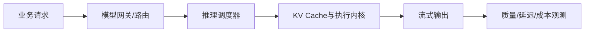

# 方向报告 01｜LLM 与大模型

**周期：** 2026-10-05—2026-10-11  
**核心判断：** LLM 工程竞争不只在模型参数规模，而在如何把模型以可接受的成本、延迟和可靠性提供给真实应用。

## 本期判断

LLM 系统可以拆成模型层、推理运行时、模型网关、应用接口与评测观测五层。量化减少内存，KV Cache 管理减少重复计算，动态批处理提高设备利用率，网关统一模型接入；这些优化针对不同瓶颈，不能把单项 benchmark 当成整体性能。术语见[LLM 词典](../../glossary/llm.md)。

## 10 个项目精读

### 1. [vLLM](https://github.com/vllm-project/vllm) — 把显存管理变成推理系统核心能力
**背景：** 多用户生成请求长度不一，传统批处理会造成显存碎片和设备空转。**方法：** 以 PagedAttention 管理 KV Cache，并配合 continuous batching 动态调度。**解决了什么：** 提高并发下缓存和 GPU 利用效率。**影响：** 推理运行时已成为服务成本和容量的关键决策。**阅读路线：** benchmark 条件 → KV Cache 实现 → scheduler 请求生命周期 → 性能测试和失败案例。

### 2. [SGLang](https://github.com/sgl-project/sglang) — 面向结构化与复杂生成的运行时
**背景：** 多轮工具流程、共享前缀和结构化输出会反复消耗生成计算。**方法：** 将结构化生成、前缀复用与请求调度纳入运行时设计。**解决了什么：** 为复杂生成模式提供专门执行路径。**影响：** 推理系统可能从通用 token 服务走向按应用负载优化。**阅读路线：** 最小结构化生成例子 → 请求表示 → 前缀缓存 → 用相同请求集比较吞吐与 P95 延迟。

### 3. [llama.cpp](https://github.com/ggml-org/llama.cpp) — 本地推理与多硬件适配
**背景：** 云 API 有隐私、费用和网络依赖，本地设备又受内存和算力限制。**方法：** 通过 GGUF、量化选项和多种后端适配 CPU/GPU。**解决了什么：** 降低本地部署门槛。**影响：** 本地推理适合离线和隐私场景，但能启动不代表满足交互延迟。**阅读路线：** 模型加载入口 → 量化格式 → 后端算子 → 固定 prompt 测内存、速度与质量。

### 4. [Microsoft BitNet](https://github.com/microsoft/BitNet) — 极低比特推理
**背景：** 大模型权重存储和搬运成本限制本地推理。**方法：** 探索低比特权重表示和对应推理内核。**解决了什么：** 在特定模型与硬件条件下减少内存和计算需求。**影响：** 若质量损失和内核开销可控，低比特路线可能改变推理硬件门槛。**阅读路线：** 支持模型 → 量化表示/内核 → benchmark 硬件与基线 → 质量退化分析。

### 5. [Transformers](https://github.com/huggingface/transformers) — 统一模型加载和实验接口
**背景：** 不同模型的 tokenizer、配置和权重结构各异，研究代码容易被模型细节绑死。**方法：** 以配置、模型类、tokenizer 和生成 API 提供统一抽象。**解决了什么：** 降低跨模型实验的接入成本。**影响：** 应用更容易切换模型，但统一 API 不代表模型行为等价。**阅读路线：** AutoTokenizer/AutoModel → 配置如何选择架构 → generate 输入输出 → 对应模型测试。

### 6. [LiteLLM](https://github.com/BerriAI/litellm) — 多模型接入与治理
**背景：** 多家模型的路由、限流、重试、成本统计和日志常散落在业务代码。**方法：** 用统一接口封装 provider adapter，并在网关层实现路由与治理。**解决了什么：** 集中管理跨模型的运维逻辑。**影响：** 模型可替换性越来越依赖网关和评测，而不只是接口兼容。**阅读路线：** 请求入口 → provider adapter → 异常映射/retry → 计费与脱敏日志 → 检查重复费用。

### 7. [Ollama](https://github.com/ollama/ollama) — 本地模型分发与运行体验
**背景：** 下载模型、配置后端和管理本地服务对非专家用户较繁琐。**方法：** 封装模型打包、运行命令和本地 API。**解决了什么：** 加快本地原型与离线工作流搭建。**影响：** 本地模型体验会进入桌面开发工具，但生产服务仍需访问控制与资源隔离。**阅读路线：** 模型清单/模板 → 下载与启动 → API 和并发行为 → 服务监听地址与模型来源。

### 8. [AirLLM](https://github.com/lyogavin/airllm) — 以数据搬运换取更低显存需求
**背景：** 权重超过可用显存时，常规加载路径会失败。**方法：** 分层加载或卸载权重，在 GPU、主存和存储间搬运数据。**解决了什么：** 在部分资源受限环境打开大模型运行的可能性。**影响：** 低显存运行可能以更高延迟和更低吞吐为代价。**阅读路线：** 权重分片 → 层切换/缓存 → 显存与磁盘 I/O → 首 token 和每 token 延迟。

### 9. [Text Generation Inference](https://github.com/huggingface/text-generation-inference) — 生产推理服务组件
**背景：** 生产服务还要处理健康检查、并发、流式响应、监控和加载失败。**方法：** 提供服务化运行路径和部署/观测组件。**解决了什么：** 帮助把模型推理放入可运维服务。**影响：** 生产部署需要关注生命周期和可观测性，而不只是离线速度。**阅读路线：** 支持矩阵 → 服务入口/健康检查/指标 → 压测配置 → 与另一运行时用同负载对照。

### 10. [OpenAI Python SDK](https://github.com/openai/openai-python) — 将网络失败纳入应用设计
**背景：** API 调用会遇到限流、超时、断流和异步取消。**方法：** 提供类型化接口、异常体系、流式/异步调用与客户端配置。**解决了什么：** 统一常见 API 交互细节。**影响：** SDK 的重试语义会影响应用可靠性，但有副作用的请求不能盲目重试。**阅读路线：** 请求构造 → 异常与 retry 条件 → 流式事件解析 → 用限流/断流模拟测试。

## 结构图：推理请求链

## 方法论沉淀

推理性能对照必须固定模型、量化、硬件、输入/输出长度、并发和质量评测。至少分别记录 TTFT、每 token 延迟、总吞吐、峰值内存与输出质量。项目清单结合趋势线索与长期基础设施，不是严格官方周增 Star 排名。
