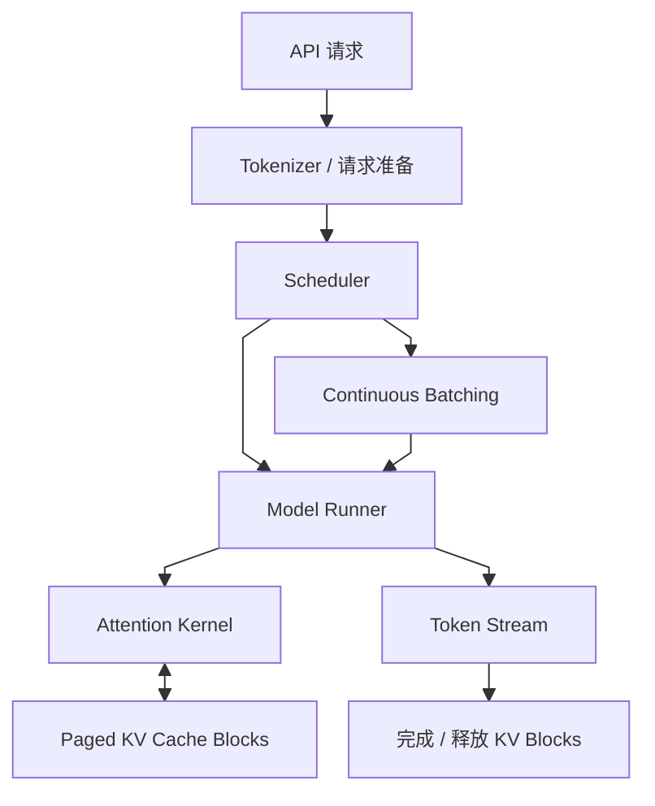
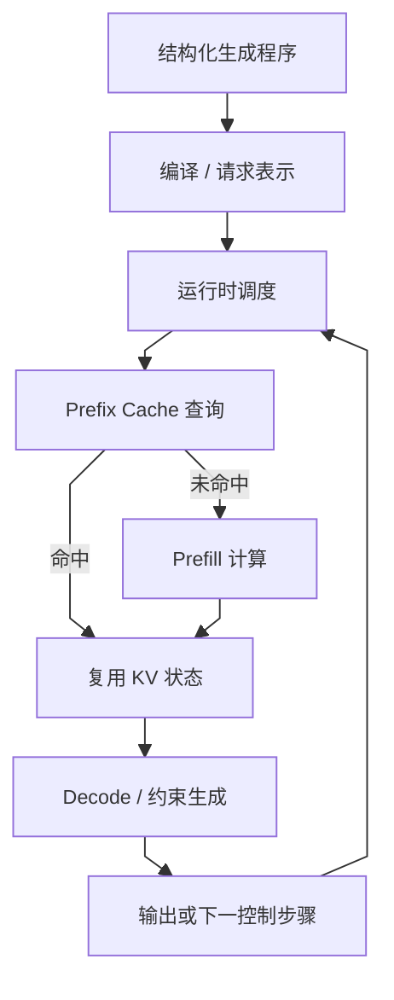
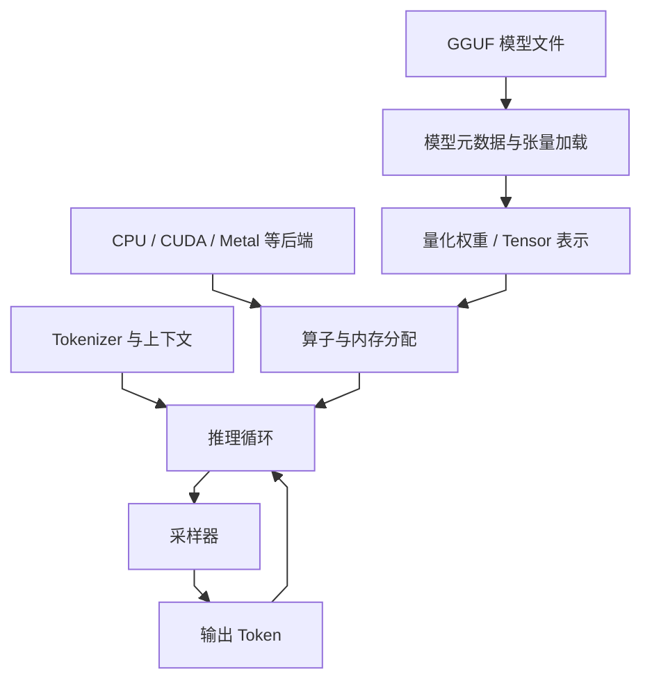
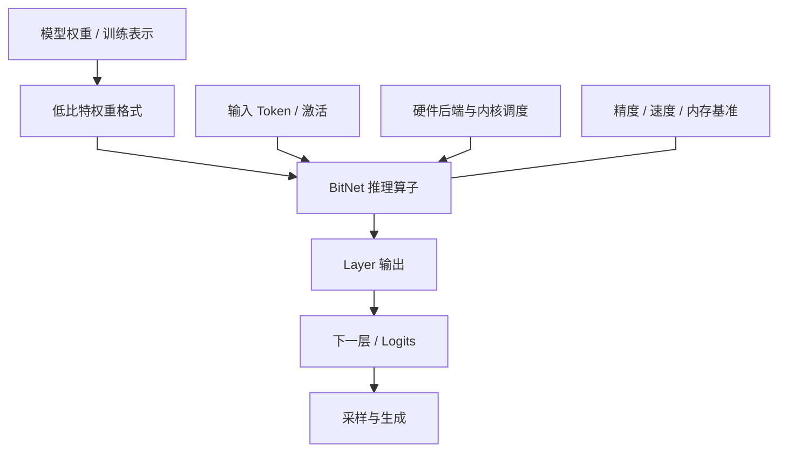
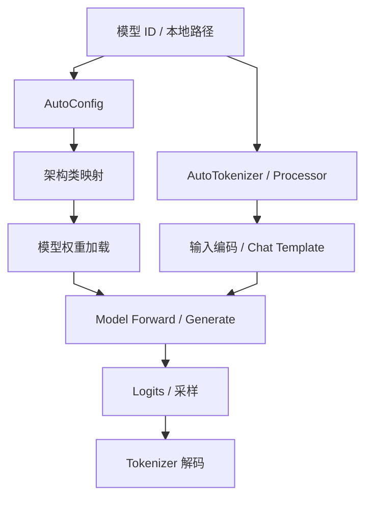
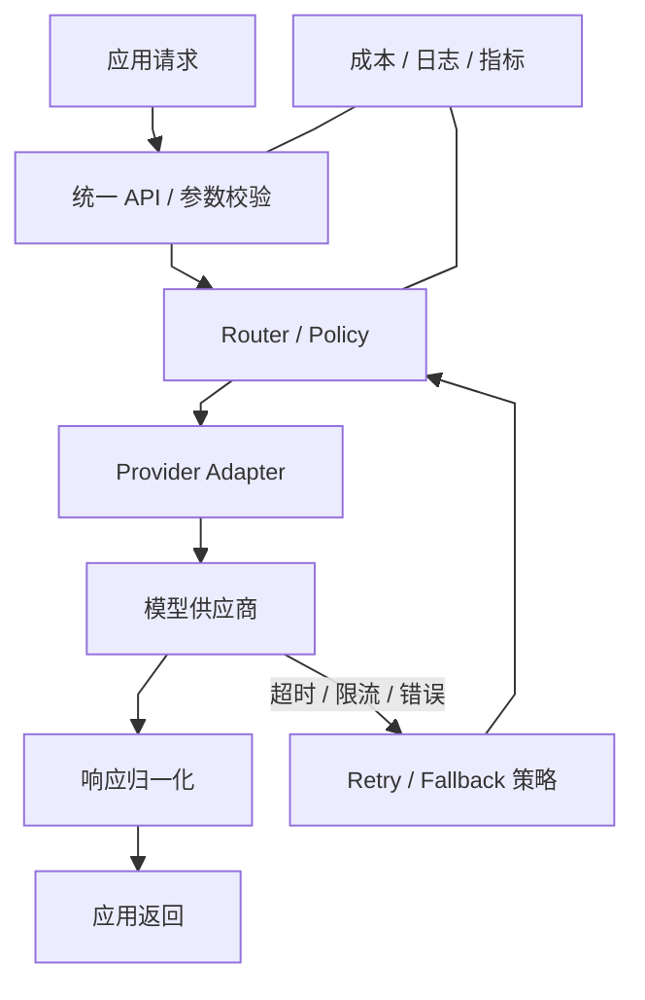
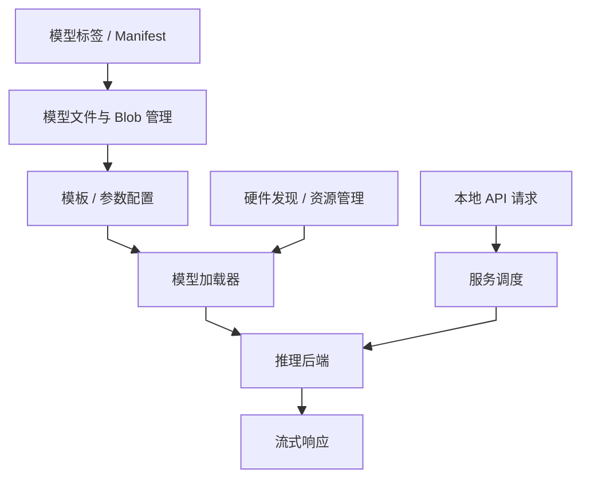
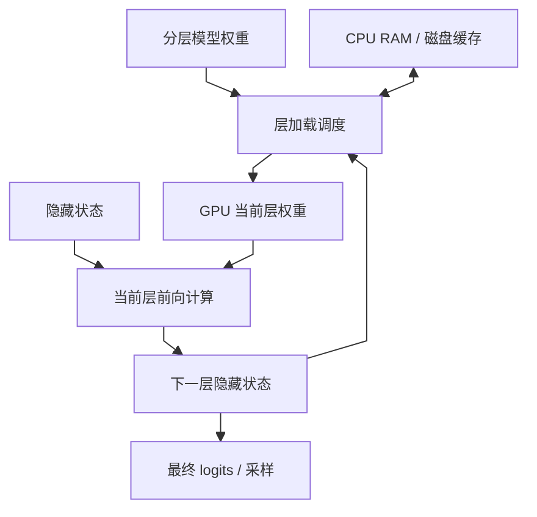
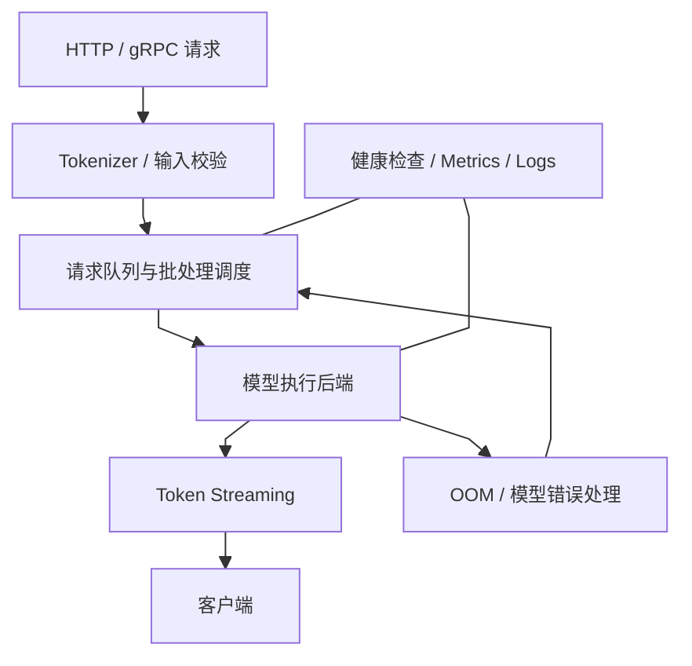
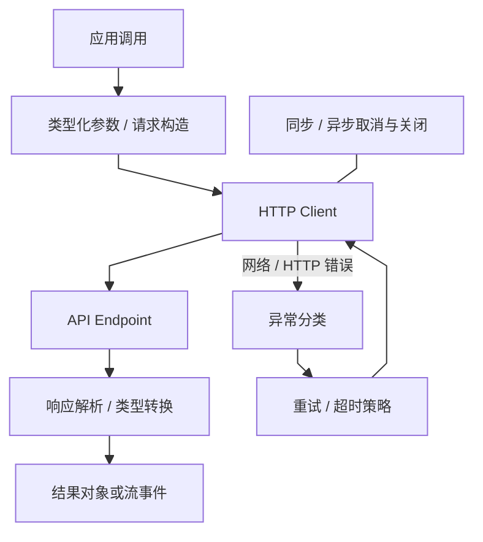

# 方向报告 01｜LLM 与大模型：推理系统的瓶颈、架构与成本

**周期：** 2026-10-05—2026-10-11

## 技术判断

大模型产品的工程竞争已经不止是模型能力，还包括权重如何装入设备、KV Cache 如何分配、请求如何批处理、不同模型如何路由，以及错误如何被观测和恢复。以下项目覆盖推理运行时、模型接口、量化、本地执行和生产治理。项目是技术研究入口，不等于全部属于本周官方 Trending 榜单；性能结论必须绑定硬件、模型、输入输出长度、并发、质量指标和软件版本。

## 10 个项目精读

### 1. [vLLM](https://github.com/vllm-project/vllm) — 以 KV Cache 管理改善并发推理

**技术分析**

自回归模型每生成一个 token，都需要保留先前 token 的 Key/Value 张量。**请求长度不同、到达时间不同，会使静态批处理出现填充浪费，也让连续显存分配产生碎片。**vLLM 的关键设计是 [PagedAttention](https://www.google.com/search?q=PagedAttention%20%E6%8A%80%E6%9C%AF%E5%8E%9F%E7%90%86%20%E8%A7%A3%E9%87%8A "PagedAttention：用固定大小块管理 KV Cache，降低连续显存分配约束")：把逻辑上的 KV 序列映射到非连续的固定大小块，避免要求每条序列占据一段连续显存；调度器则在请求生成和结束时动态调整批次。收益来自两个相互关联的机制：KV 块管理提高显存利用率，continuous batching 减少设备等待。**但它并不消除注意力计算和 KV 容量随上下文增长的成本；长上下文、并行策略、模型结构、量化与硬件都会改变结果。**阅读时要分清理论内存利用率、吞吐和单请求延迟，不能仅引用项目 benchmark 的最大吞吐数字。应固定请求长度分布和并发，对照相同模型、硬件与输出质量，观察 TTFT、每 token 延迟、吞吐和峰值显存。

**项目结构图**

**技术判断与边界：** 其优势主要来自 KV 块利用率和请求动态调度，适合关注并发容量的服务负载；长上下文与尾延迟仍可能受访存、模型结构和调度策略限制，不能把单次峰值吞吐直接视为线上收益。

### 2. [SGLang](https://github.com/sgl-project/sglang) — 面向结构化生成与前缀复用的运行时

**技术分析**

**简单的文本补全只需一次连续生成，但真实应用经常包含共享系统提示、结构化输出、多轮工具调用、分支采样和约束解码。** **若运行时把这些工作流拆成互不相关的请求，公共前缀会重复进行 prefill，应用层也需要自行处理控制逻辑。**SGLang 的路线是让[结构化生成](https://www.google.com/search?q=%E7%BB%93%E6%9E%84%E5%8C%96%E7%94%9F%E6%88%90%20%E6%8A%80%E6%9C%AF%E5%8E%9F%E7%90%86%20%E8%A7%A3%E9%87%8A "结构化生成：用语法或 schema 约束输出格式，不保证语义正确")原语与服务运行时协同，并利用前缀缓存等机制复用重复计算。**它解决的不是“模型会不会推理”，而是把复杂生成程序映射为更高效的执行计划。**关键取舍在于：缓存命中依赖前缀一致性和内存管理，复杂请求的调度收益依赖实际负载；增加缓存或更积极的批处理也可能提高内存压力或尾延迟。对比 SGLang 与通用服务框架时，应使用真实的共享前缀比例、请求长度分布和并发，而不是只测单一短 prompt。还需分别观察 prefill 与 decode，因为优化前者不一定改善逐 token 生成速度。

**项目结构图**

**技术判断与边界：** 结构化生成与前缀复用能减少无效格式输出和重复 prefill，但收益依赖共享前缀比例、语法约束复杂度与请求分布；单一短 prompt benchmark 不足以判断复杂应用中的性能。

### 3. [llama.cpp](https://github.com/ggml-org/llama.cpp) — 面向 CPU 与多后端的本地推理

**技术分析**

本地运行大模型受到内存带宽、可用 RAM/VRAM、设备算子支持和功耗限制。**llama.cpp 的工程路线不是依赖单一 GPU 服务，而是用 [GGUF](https://www.google.com/search?q=GGUF%20%E6%8A%80%E6%9C%AF%E5%8E%9F%E7%90%86%20%E8%A7%A3%E9%87%8A "GGUF：llama.cpp 生态的模型文件格式，兼容性仍取决于模型和后端") 模型文件、量化权重和多种硬件后端提供可移植推理。**量化可以减少权重存储和内存搬运，但位宽降低会改变数值误差；实际收益取决于量化方案、模型层结构、算子内核和硬件是否能高效执行对应格式。若某个后端不支持高效低比特算子，节省的内存未必转化为更快生成。GGUF 也不等于模型质量保证，它主要承担模型张量与元数据的封装。评估时应同时记录模型来源、量化版本、上下文长度、线程数、后端、首 token 延迟、每 token 速度和任务质量。**对隐私或离线场景，本地执行能减少网络依赖，但仍要考虑本地服务监听地址、模型文件可信度和资源争用。**

**项目结构图**

**技术判断与边界：** llama.cpp 的核心价值是以通用后端和量化格式扩大可运行设备范围；模型能加载不代表 token 延迟可接受，实际体验仍由 CPU/GPU 内核、内存带宽、上下文长度和线程配置共同决定。

### 4. [Microsoft BitNet](https://github.com/microsoft/BitNet) — 低比特权重与专用推理内核

**技术分析**

大模型推理成本不只来自乘加次数，也来自权重从内存搬到计算单元的带宽消耗。BitNet 探索极低比特权重路线，试图减少权重存储与访存成本，并用适配的内核发挥低比特表示的硬件收益。**关键点是算法表示和内核必须匹配：如果只是把权重压缩后再在运行时解码成高精度，或硬件缺少合适的低比特运算路径，理论上的位宽优势可能被转换开销抵消。**低比特也可能带来精度退化，因此应同时检查支持的模型格式、权重训练方式、算子覆盖和任务质量。**不能把一个模型或一台设备上的速度数字外推到所有 Transformer。**评估需要明确基线是 FP16、BF16 还是其他[量化](https://www.google.com/search?q=%E9%87%8F%E5%8C%96%20%E6%8A%80%E6%9C%AF%E5%8E%9F%E7%90%86%20%E8%A7%A3%E9%87%8A "量化：用低精度表示权重或激活，以内存/速度收益换取潜在质量损失")方案，比较模型规模、硬件、内存峰值、tokens/s 和下游任务质量，并区分预填充与生成阶段。该方向的潜在影响在于扩大本地运行可行范围，但前提是质量与硬件效率共同成立。

**项目结构图**

**技术判断与边界：** BitNet 路线的意义在于探索低比特权重表示与专用执行内核协同，而不是简单把浮点权重压缩；是否加速取决于硬件指令和算子是否匹配，必须同时审查任务质量和端到端速度。

### 5. [Transformers](https://github.com/huggingface/transformers) — 跨模型的统一接口与架构抽象

**技术分析**

**模型生态的主要工程摩擦之一，是不同模型有不同配置、[Tokenizer](https://www.google.com/search?q=Tokenizer%20%E6%8A%80%E6%9C%AF%E5%8E%9F%E7%90%86%20%E8%A7%A3%E9%87%8A "Tokenizer：将文本映射为 token 序列，决定输入表示与长度")、权重命名、输入约定和生成参数。**Transformers 用统一的配置、模型类、Tokenizer 与生成接口降低接入成本，使研究者能复用数据管线和训练/推理工具。**但抽象层只统一了调用形式，并不保证模型在输入格式、对话模板、位置编码、图像分辨率、特殊 token 或生成语义上等价。** **若使用错误的 chat template 或默认 generation config，程序仍能运行，却可能得到显著不同的输出。**架构支持通常通过配置映射和具体模型实现落地，因此调试时必须追到模型特定代码，而不能停留在 AutoModel API。它的影响是提高模型实验可组合性，也让依赖版本成为可复现性关键。报告模型结果时应记录模型 revision、Tokenizer revision、模板、dtype、attention backend 和生成参数。

**项目结构图**

**技术判断与边界：** Transformers 的统一 API 降低了跨模型实验的工程摩擦，但配置、tokenizer、聊天模板和权重加载仍决定真实输入输出语义；同一个 generate 调用并不意味着模型间可直接公平比较。

### 6. [LiteLLM](https://github.com/BerriAI/litellm) — 多模型网关、路由与故障治理

**技术分析**

**应用接入多家模型后，错误处理、限流、[重试](https://www.google.com/search?q=%E9%87%8D%E8%AF%95%20%E6%8A%80%E6%9C%AF%E5%8E%9F%E7%90%86%20%E8%A7%A3%E9%87%8A "重试：失败后的重复请求需考虑副作用、重复计费与幂等性")、成本统计、凭据管理和模型降级很容易散落在业务代码里。** **LiteLLM 通过统一请求接口和 provider adapter 将差异集中到网关层，再围绕路由和治理组织模型调用。**它降低的是多供应商接入与运维复杂度，而不是消除供应商之间的语义差异：相同参数名可能有不同默认值，工具调用格式、上下文上限和错误码也未必一致。重试尤其需要审慎：对纯生成请求，重试可能只增加成本；对触发外部动作的应用，重复执行甚至可能产生副作用。路由策略还需权衡价格、延迟、能力与可靠性，单纯按最低价格切换可能损害任务质量。评估应记录路由决策、fallback 次数、重复请求、费用估算偏差、限流行为和敏感日志处理。模型可替换性最终依赖统一接口、任务级评测与真实故障语义，而非 API 形状相似。

**项目结构图**

**技术判断与边界：** LiteLLM 把多 provider 的路由与错误处理集中起来，降低业务重复造轮子的成本；但统一的调用接口无法抹平模型质量和工具协议差异，重试与回退策略还可能带来重复计费或语义变化。

### 7. [Ollama](https://github.com/ollama/ollama) — 本地模型打包、分发与服务接口

**技术分析**

本地模型运行常见的障碍不是模型本身，而是权重下载、格式管理、硬件后端、上下文参数和服务生命周期需要用户手工拼接。**Ollama 将[模型打包](https://www.google.com/search?q=%E6%A8%A1%E5%9E%8B%E6%89%93%E5%8C%85%20%E6%8A%80%E6%9C%AF%E5%8E%9F%E7%90%86%20%E8%A7%A3%E9%87%8A "模型打包：将权重、运行参数与依赖组织成可加载工件")、运行命令与本地 API 封装成统一体验，便于快速试验和离线应用集成。**对工程人员而言，重点不只是“能否启动模型”，还包括模型模板如何控制提示词、权重如何被选择和缓存、服务如何处理并发，以及失败时如何报告资源不足。**便捷的默认设置也可能隐藏模型量化、上下文长度或硬件加速路径，因此不同机器上同一个标签并不必然代表相同性能。**安全方面，本地 API 的监听地址和访问控制也需要核验，不能假定“本地软件”就天然隔离。评估时应记录模型 digest、模板、上下文设置、后端、并发和 API 行为；若用于生产，还需测量冷启动、内存压力和长时间运行稳定性。

**项目结构图**

**技术判断与边界：** Ollama 更适合降低本地原型和个人推理的启用成本，真正部署仍需处理服务监听、并发、模型来源和资源限制；命令启动成功只能证明运行链路基本打通，不等于具有生产安全性。

### 8. [AirLLM](https://github.com/lyogavin/airllm) — 以分层权重搬运换取较低显存占用

**技术分析**

**当模型权重无法一次性放入 GPU [显存](https://www.google.com/search?q=%E6%98%BE%E5%AD%98%20%E6%8A%80%E6%9C%AF%E5%8E%9F%E7%90%86%20%E8%A7%A3%E9%87%8A "显存：承载权重、激活和 KV Cache，峰值占用受并发与上下文影响")时，常规推理加载路径会失败。** **AirLLM 的思路是通过分层加载或卸载权重，在 CPU 内存、存储与 GPU 之间搬运当前执行所需的层，以空间换取可运行性。**其本质不是让模型计算量消失，而是改变权重驻留策略：峰值显存可能下降，但数据搬运、磁盘 I/O、初始化和层切换会引入延迟。效果取决于模型层大小、存储速度、内存容量、缓存策略和请求并发；在多用户服务中，低显存单请求可运行不代表吞吐可接受。阅读时要区分权重切片、加载调度与模型计算本身，检查是否存在重复读盘、内存缓存以及对多卡的支持。基准应报告首 token 延迟、每 token 延迟、磁盘读量、峰值 RAM/VRAM 和输出质量。它适合探索资源受限设备的可运行性，不应未经测量就被视为高性能生产推理方案。

**项目结构图**

**技术判断与边界：** AirLLM 以主存/存储与 GPU 之间的权重搬运换取更低显存占用；当数据搬运成为瓶颈时，能跑更大的模型可能伴随更差的首 token 和逐 token 延迟，需按实际负载衡量权衡。

### 9. [Text Generation Inference](https://github.com/huggingface/text-generation-inference) — 生产级模型服务的生命周期管理

**技术分析**

生产推理服务不仅要运行 forward，还要处理模型下载和加载、健康检查、请求排队、流式响应、异常恢复、指标暴露和部署配置。**TGI 的意义是把这些服务生命周期能力组织成可部署组件，使模型推理能接入容器和运维系统。**服务性能受调度、批处理、模型支持、GPU 内存和网络流式传输共同影响；单次生成速度无法代表系统在并发和故障下的表现。**尤其要看队列等待与模型执行时间如何区分，健康检查是否能识别模型已加载但无法正确服务的状态，以及客户端断开后资源是否及时释放。**不同版本和模型架构的支持情况可能变化，不能仅凭项目历史 benchmark 推断当前部署结果。对照测试应固定模型、硬件、请求分布、输出长度和客户端连接数，记录 [TTFT](https://www.google.com/search?q=TTFT%20%E6%8A%80%E6%9C%AF%E5%8E%9F%E7%90%86%20%E8%A7%A3%E9%87%8A "TTFT：从请求发出到首个输出 token 到达的时间")、吞吐、尾延迟、错误率、冷启动与恢复时间。生产可用性还需要安全更新、访问控制和资源隔离，不由 benchmark 自动保证。

**项目结构图**

**技术判断与边界：** TGI 的价值不只是模型推理，还包括服务生命周期、监控与并发处理；生产适用性要看当前版本的维护状态、硬件支持、部署需求和负载测试，不能仅凭服务可以启动推断运维成熟度。

### 10. [OpenAI Python SDK](https://github.com/openai/openai-python) — 把网络与协议失败纳入应用设计

**技术分析**

**模型 API 客户端看似只是 HTTP 封装，但重试、超时、流式解析、异步取消和异常类型会直接决定应用的可靠性与成本。** **OpenAI Python SDK 提供类型化请求接口、同步/异步客户端、流式响应和常见 API 错误处理，减少业务代码直接操作网络协议的负担。**工程上最需要读懂的是请求失败的语义：连接失败与服务端已处理但响应丢失并不相同；若客户端无条件重试，可能产生重复费用，或在外部工具调用链中重复触发副作用。流式响应还要求正确处理事件结束、连接中断和部分输出，不能把“收到了一段文本”当成请求成功。SDK 的重试和超时默认值可能随版本变化，调用方应显式配置并监控。测试应覆盖 429、5xx、超时、断流、取消与无效参数，确认异常是否可分类、重试次数是否符合预期、日志是否泄露敏感内容。

**项目结构图**

**技术判断与边界：** SDK 对异常、流式事件和重试的封装会直接影响业务可靠性；自动重试适合可安全重复的请求，但有外部副作用的操作需要幂等标识或由调用方控制，避免超时后重复执行。

## 跨项目结论

- **内存管理、调度与内核是三个不同层次。** vLLM 的 KV 管理、SGLang 的结构化执行、BitNet 的低比特内核针对不同瓶颈，不能用单一 tokens/s 数字解释。
- **统一接口不等于行为一致。** Transformers 和 LiteLLM 降低接入摩擦，但模板、参数默认值、错误语义与供应商能力仍需要显式治理。
- **本地可运行不等于生产可用。** llama.cpp、Ollama 与 AirLLM 的目标和代价不同，需同时评估内存、延迟、质量、安全边界和并发。
- **可复现基准必须公开条件。** 模型 revision、量化、硬件、输入/输出长度、并发和质量评测缺一不可。

## 术语入口

- [KV Cache](https://www.google.com/search?q=KV%20Cache%20%E6%8A%80%E6%9C%AF%E5%8E%9F%E7%90%86%20%E8%A7%A3%E9%87%8A "KV Cache：缓存历史 token 的 Key/Value 张量，避免每一步重算整个前缀")
- [量化](https://www.google.com/search?q=%E9%87%8F%E5%8C%96%20%E6%8A%80%E6%9C%AF%E5%8E%9F%E7%90%86%20%E8%A7%A3%E9%87%8A "量化：用较低精度表示权重或激活以降低内存与计算成本，代价可能是数值误差")
- [TTFT](https://www.google.com/search?q=TTFT%20%E6%8A%80%E6%9C%AF%E5%8E%9F%E7%90%86%20%E8%A7%A3%E9%87%8A "TTFT：从请求发出到首个输出 token 到达的时间，包含排队和预填充等开销")
- [Continuous batching](https://www.google.com/search?q=Continuous%20batching%20%E6%8A%80%E6%9C%AF%E5%8E%9F%E7%90%86%20%E8%A7%A3%E9%87%8A "Continuous batching：在请求生成与结束时动态调整批次，提高设备利用率但需关注尾延迟")

## 证据边界

本报告未宣称完成全部项目的源码运行或独立复现。项目方 benchmark 只能支持其所列硬件、模型和负载条件下的结论；具体模块路径随版本变化，应固定 commit 和配置再复核。
