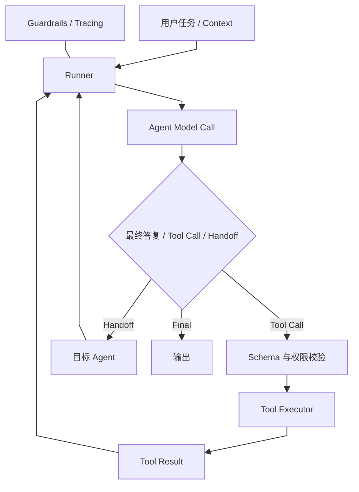
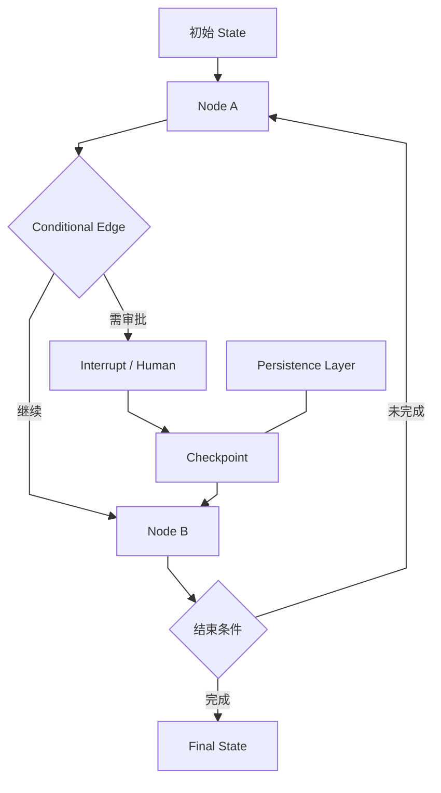
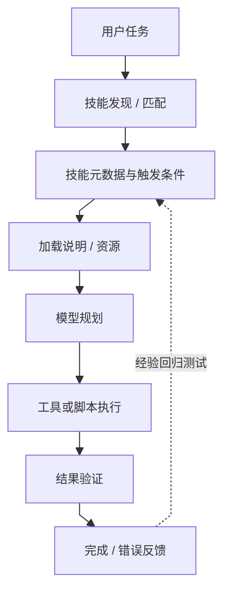
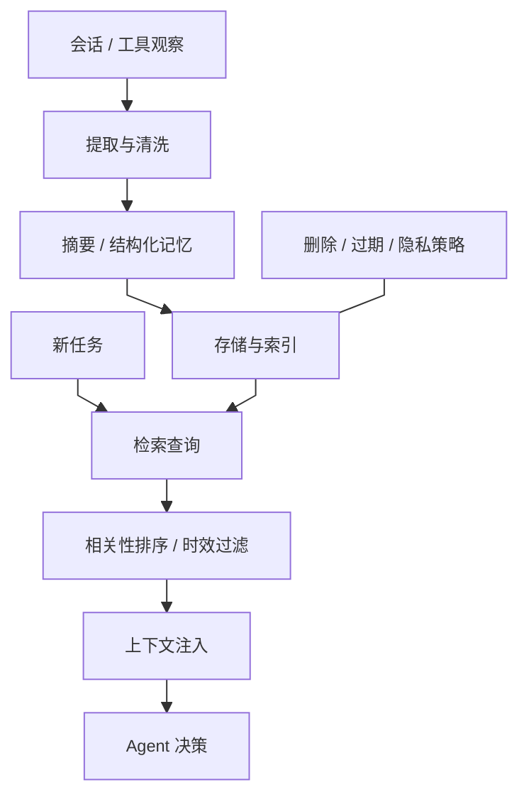
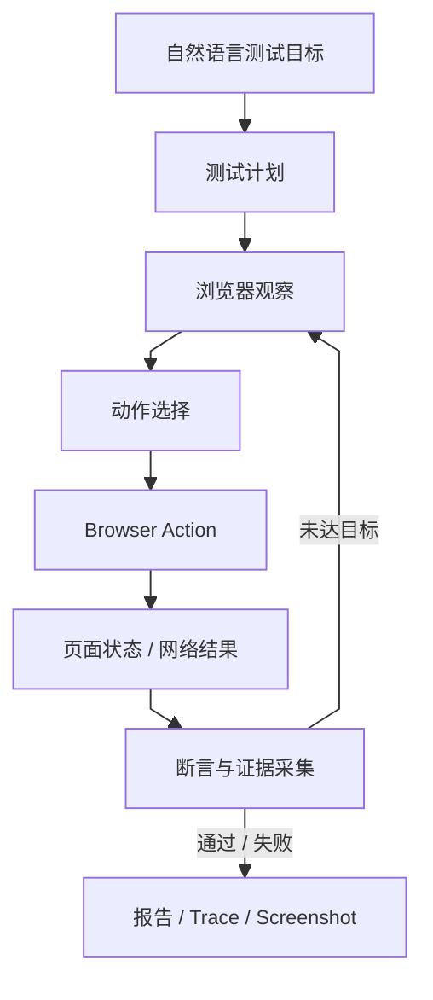
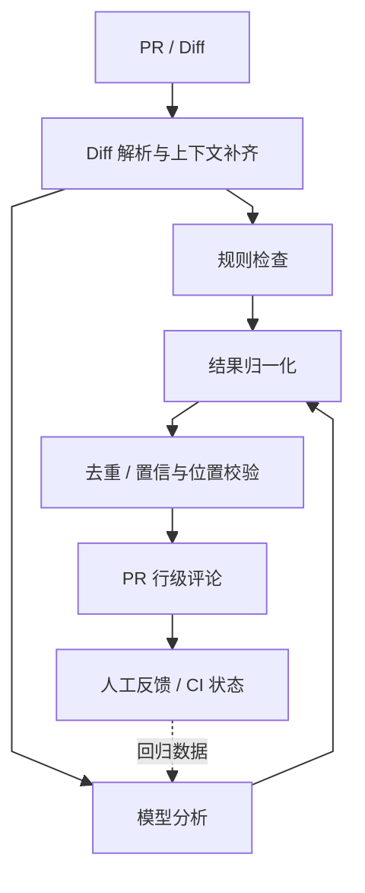
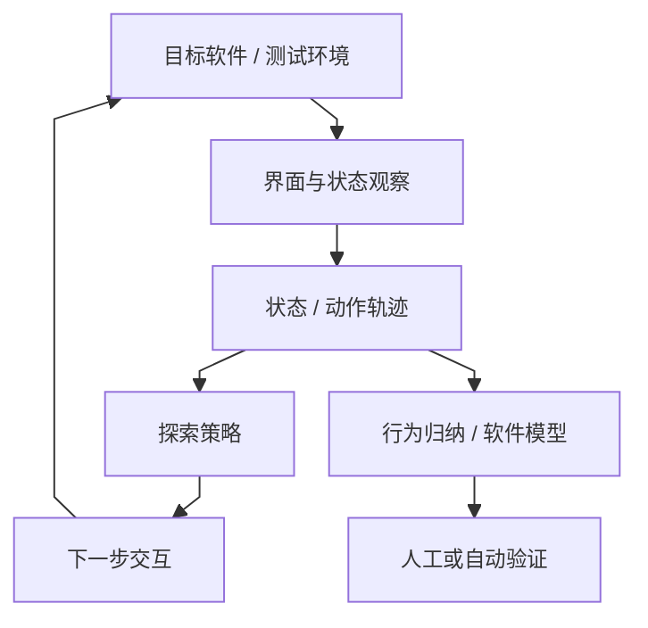
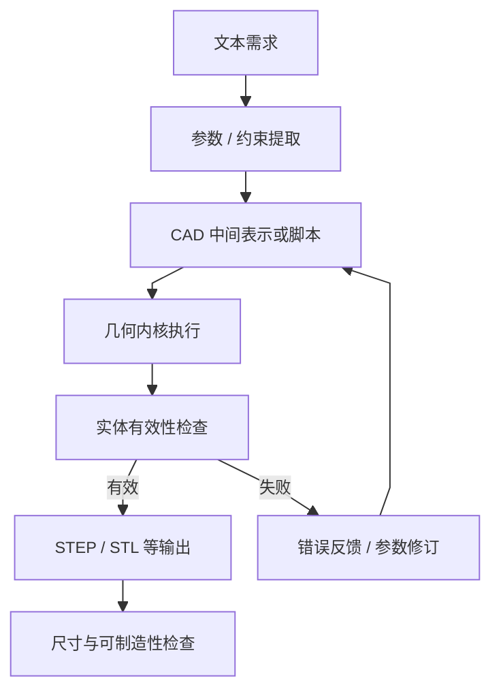
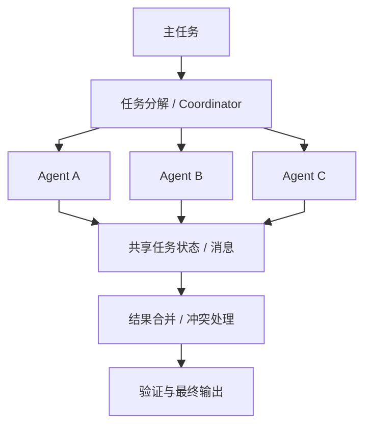
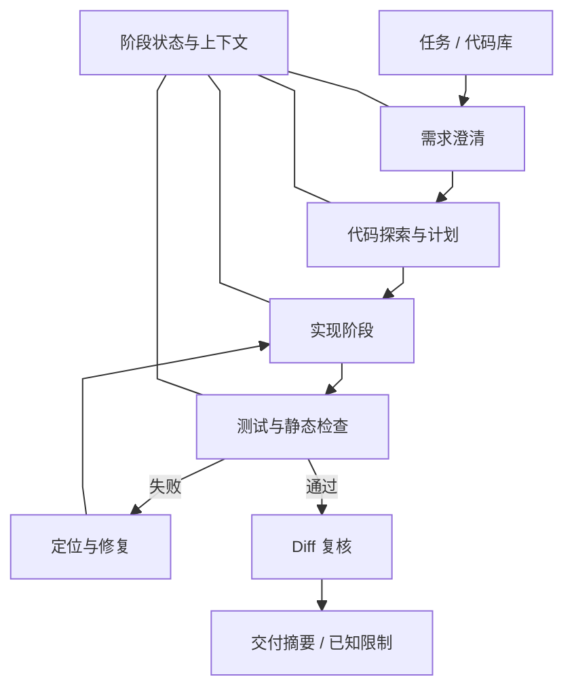

# 方向报告 02｜AI Agent：执行状态、工具边界与可验证工作流

**周期：** 2026-10-05—2026-10-11

## 技术判断

Agent 不是“模型加一段 prompt”，而是由模型决策、状态管理、工具执行、权限控制、结果验证和故障恢复组成的系统。项目之间的技术差异，在于它们如何表达流程、持久化状态、降低重复动作风险，并衡量模型是否真的完成任务。以下项目是工程研究入口，不等于全部属于本周官方 Trending 榜单。

## 10 个项目精读

### 1. [OpenAI Agents SDK](https://github.com/openai/openai-agents-python) — 工具调用、交接与追踪

**技术分析**

当 Agent 需要调用多个工具或将任务交给专门角色时，业务代码容易演变成难以调试的 prompt 分支。**Agents SDK 将 Agent、Runner、工具 schema、handoff、guardrail 和 tracing 组织成相对统一的执行抽象。**典型运行过程不是一次模型调用，而是模型生成动作、执行器验证并调用工具、工具结果回到上下文，再决定继续、交接或结束。**这个循环让调用路径可观测，但并不意味着模型输出天然可信：参数仍需验证，工具权限需要最小化，循环也必须有预算与终止条件。** **[Tracing](https://www.google.com/search?q=Tracing%20%E6%8A%80%E6%9C%AF%E5%8E%9F%E7%90%86%20%E8%A7%A3%E9%87%8A "Tracing：将模型调用、工具执行、延迟和异常串成调用链") 的价值在于把模型调用、工具执行和交接连接起来，帮助定位失败发生在哪一阶段；它不能代替业务级正确性测试。**阅读时要特别区分模型“建议调用工具”与宿主代码“实际执行工具”的边界，并检查异常和 guardrail 是否在每条路径都生效。评估应同时看任务成功率、工具参数正确率、无效循环、人工介入和总成本。

**项目结构图**

**技术判断与边界：** 该 SDK 的关键价值是把模型循环、工具执行、交接和追踪放在可观测的执行框架中；但实际正确性仍依赖宿主程序的 schema、权限、终止条件和业务验证，不应把 tracing 当作结果正确的证明。

### 2. [LangGraph](https://github.com/langchain-ai/langgraph) — 显式状态图与可恢复执行

**技术分析**

长任务会出现分支、循环、暂停等待用户、人工审批和进程崩溃恢复等需求。**把这些状态隐含在长 prompt 或普通函数调用中，往往难以重放和审计。**LangGraph 用状态、节点和条件边表达执行图，并通过 checkpoint/interrupt 等机制保存状态和建立暂停点。其工程价值是让工作流结构显式化：可以观察当前节点、状态如何变化、在哪个条件下进入下一步。**持久化并不自动保证“恰好执行一次”；恢复后若某个节点已调用外部 API、但结果未写入 checkpoint，重放可能再次执行副作用。**因此幂等键、事务边界、状态版本和外部操作记录仍需应用设计。图也可能因状态不断增长或分支组合而变复杂。评估时要测试中断后恢复、重复提交、节点失败和状态 schema 变更，而不只是演示一次成功路径。关键证据是工作流能否在失败点重建一致状态。

**项目结构图**

**技术判断与边界：** 显式状态图和 checkpoint 使暂停、人工审批与失败恢复更可建模；代价是状态 schema 和版本迁移需要维护，且 checkpoint 不能自动回滚已经发生的外部副作用。

### 3. [mattpocock/skills](https://github.com/mattpocock/skills) — 将操作知识封装成可发现的技能

**技术分析**

Agent 的执行质量经常受制于团队经验是否以稳定形式传递：复杂指令可能散落在 prompt、文档和个人习惯里，随着模型或工具变化很难回归。**[Skill](https://www.google.com/search?q=Skill%20%E6%8A%80%E6%9C%AF%E5%8E%9F%E7%90%86%20%E8%A7%A3%E9%87%8A "Skill：可复用任务指引/资源包，本身不是安全沙箱")s 这类目录化机制将任务指引、资源引用和执行约定封装为可发现的能力单元，让 Agent 在相关任务出现时加载适用说明。**它的技术价值在于把程序性知识从一次性上下文转成可版本管理的资产，但“技能”本身不是可执行沙箱，也不保证模型每次遵守。**技能内容可能过期、相互冲突或诱导模型越权，因此需要清晰的触发条件、输入前提、依赖资源和失败处理。**若技能只包含自然语言说明，执行结果仍依赖模型解释；若包含脚本或工具，权限边界和供应链风险就更加重要。应以固定任务集回归测试技能的触发率、完成率和错误动作，并检查版本变化是否改变行为。技能复用的真正收益要用任务质量和维护成本衡量，而不是目录数量。

**项目结构图**

**技术判断与边界：** Skills 把重复工程经验变成可发现模块，能减少提示词复制；它不等于可靠的插件沙箱，技能内容可能过期或冲突，任何脚本与外部工具都仍应由执行层限制权限。

### 4. [claude-mem](https://github.com/thedotmack/claude-mem) — 跨会话记忆与上下文压缩

**技术分析**

**长期任务不能无限携带完整对话：上下文窗口有限，历史内容也混有重复信息、过期事实和偶发错误。**claude-mem 代表一种[记忆](https://www.google.com/search?q=%E8%AE%B0%E5%BF%86%20%E6%8A%80%E6%9C%AF%E5%8E%9F%E7%90%86%20%E8%A7%A3%E9%87%8A "Agent 记忆：选择性保留历史信息供后续检索，可能过期或错误")管线：从交互中提取观察，整理或压缩后存储，再根据后续任务检索相关信息并注入上下文。这个过程的难点不是简单“记得更多”，而是决定什么值得保存、如何标注时间和来源、何时失效，以及检索结果如何影响模型。**压缩会丢失细节，检索会遗漏关键事实，错误记忆则可能在多个会话中反复影响决策。**对涉及隐私或机密的环境，还必须明确保存范围、删除策略和本地/远端存储边界。评估应使用长期任务测试，测量召回关键事实的比例、过期记忆误用率、上下文 token 节省量和最终任务质量；仅展示能回忆某条事实不足以证明记忆机制可靠。

**项目结构图**

**技术判断与边界：** 跨会话记忆能减少重复解释并保存长期任务线索，但摘要与检索可能引入错误、过期或敏感内容；质量关键在写入标准、来源/时间戳、冲突消解和遗忘机制，而不只是检索命中率。

### 5. [tester-army/e2e](https://github.com/tester-army/e2e) — Agent 驱动的端到端测试

**技术分析**

**传统 UI 自动化依赖脆弱的选择器与固定等待；页面稍有改版就可能失败。** **Agent 驱动测试试图把“用户目标”转成浏览器动作，并利用页面观测、断言、截图或轨迹来判断是否完成。**其难点在于将自然语言目标变成可验证条件：如果只让模型判断页面“看起来对”，测试可能把错误状态误判为通过；如果等待和重试策略不明确，偶发网络延迟会造成 flaky tests。浏览器操作还涉及登录态、测试数据和外部副作用，必须在隔离环境运行。工程上要把模型的探索能力与确定性断言分开，关键业务结果应由 DOM 状态、API 响应或数据库状态验证，而不是只靠模型自评。评估应在同一组测试任务上重复运行多次，报告成功率、误报/漏报、平均执行时间、成本和 flaky rate。Agent 可以降低编写脚本的门槛，但不会自动消除测试设计问题。

**项目结构图**

**技术判断与边界：** Agent 驱动的端到端测试有机会降低编写脆弱 UI 脚本的成本，但自然语言动作并不天然确定；实际价值需要重复运行稳定性、明确断言和失败 trace 支持，不能以成功截图替代 flaky rate。

### 6. [Alibaba Open Code Review](https://github.com/alibaba/open-code-review) — 模型审查与 CI 的结合

**技术分析**

代码审查要理解变更语义、调用上下文和潜在回归，纯静态规则容易漏掉语义问题，纯模型评论则可能产生误报、泛泛建议或定位错误。**Open Code Review 代表将 [diff](https://www.google.com/search?q=diff%20%E6%8A%80%E6%9C%AF%E5%8E%9F%E7%90%86%20%E8%A7%A3%E9%87%8A "Diff：代码变更集合，审查系统据此识别潜在问题") 处理、规则/模型分析、评论定位与持续集成流程结合的路线。**关键工程问题是如何把模型输出约束成可操作的评论：需要把问题映射到具体文件和行，过滤重复意见，处理模型无法确定的情况，并避免将敏感代码无控制地发送到外部服务。**模型提出的风险不是已证实 bug，因此审查系统需要可追踪的证据和人工反馈。**评价不应只数评论条数，而要用人工标注的历史 PR 测 precision、recall、误报严重程度、开发者采纳率和额外审查时间。若只优化评论数量，系统可能以噪声换取表面覆盖。阅读时重点看 diff 如何分块、上下文如何补齐、评论如何回写以及 CI 失败条件是什么。

**项目结构图**

**技术判断与边界：** 模型辅助代码审查可以发现规则式 lint 难以覆盖的上下文问题，但误报、重复评论和漏检会消耗审查者注意力；项目质量需在历史 PR 盲测上以真实缺陷标注验证，而不是按生成评论数量判断。

### 7. [morluto/rea](https://github.com/morluto/rea) — 通过交互轨迹理解既有软件

**技术分析**

既有软件常缺少文档，或者源码复杂到无法快速判断真实行为。**让 Agent 通过操作界面探索软件，可以获得动作、[状态](https://www.google.com/search?q=%E7%8A%B6%E6%80%81%20%E6%8A%80%E6%9C%AF%E5%8E%9F%E7%90%86%20%E8%A7%A3%E9%87%8A "状态：描述当前任务/环境的信息，是恢复和决策的依据")变化和界面反馈组成的行为证据，再据此归纳流程。**这条路线将 Agent 从“执行已知步骤”扩展到“探索并建立软件行为模型”，潜在用途包括迁移、测试生成和理解遗留系统。**但探索轨迹不等于完整规格：界面状态可能隐藏后台行为，随机探索也可能遗漏罕见分支，模型还可能将相关性误判为因果。**若软件具有删除、付款或发送等副作用，探索必须在获授权的测试环境中进行。技术评估应明确状态覆盖、动作覆盖、重复运行一致性和模型生成的行为描述是否经独立验证。阅读项目时应查清它记录哪些观测、如何表示状态、何时选择下一动作，以及最终产物是操作脚本、结构模型还是自然语言总结。演示一个应用不能证明可泛化理解任意软件。

**项目结构图**

**技术判断与边界：** 通过交互轨迹理解软件，可把“试着操作”变成可回放证据；但探索轨迹覆盖不到的状态和权限路径仍会遗漏，自动形成的描述应能被实际动作记录支持，不能当作完整逆向结果。

### 8. [text-to-cad](https://github.com/earthtojake/text-to-cad) — 从自然语言到可编辑几何模型

**技术分析**

**自然语言生成图像可以接受视觉近似，但 [CAD](https://www.google.com/search?q=CAD%20%E6%8A%80%E6%9C%AF%E5%8E%9F%E7%90%86%20%E8%A7%A3%E9%87%8A "CAD：计算机辅助设计，几何输出需满足尺寸与拓扑约束") 输出需要尺寸、拓扑和几何约束可编辑，不能只看渲染图是否像目标。** **text-to-cad 的路线是把文字需求转成 CAD 生成过程，并由几何后端创建模型。**关键技术边界在于语言描述往往缺少精确尺寸、约束或制造条件，系统必须推断缺失参数或请求用户补充；即使生成成功，也需要几何内核验证实体是否有效、尺寸是否一致、面是否自交。文本模型擅长补全意图，却不天然保证几何约束满足，因此应将生成与验证分离。该类工具可能降低概念建模的起步成本，但距离工程设计还差公差、材料、装配、可制造性和版本管理。评估应使用明确的尺寸约束和参考模型，比较几何有效率、尺寸误差、可编辑性和后续人工修改时间。仅展示几个视觉上相似的模型，不足以证明其适用于生产 CAD。

**项目结构图**

**技术判断与边界：** 文本转 CAD 的技术门槛在于把语言约束转成几何内核能够接受的实体和参数；渲染图相似不表示尺寸、拓扑、装配和制造约束有效，必须由几何检查与领域规则验证。

### 9. [openrig](https://github.com/mvschwarz/openrig) — 多 Agent 分工与协调

**技术分析**

[多 Agent](https://www.google.com/search?q=%E5%A4%9A%20Agent%20%E6%8A%80%E6%9C%AF%E5%8E%9F%E7%90%86%20%E8%A7%A3%E9%87%8A "多 Agent：多个模型执行单元协作，收益需与协调和通信成本对照") 系统假设复杂任务可以拆分为若干子任务，由不同角色并行或串行完成。**但分工本身会带来协调成本：共享状态可能过期，多个角色可能重复工作，输出之间可能冲突，最后还需要合并与验证。**openrig 可作为研究多角色协作工作流的入口；阅读时应以当前仓库实际实现为准，确认角色定义、任务分配、消息传递和结果合并机制，不要仅根据项目名称推断其内部架构。多 Agent 是否优于单 Agent，取决于任务是否可分解、角色间依赖是否低、通信成本和模型调用成本是否可控。若子任务高度耦合，增加 Agent 可能只增加 token 消耗和错误面。**评估必须使用相同任务集与预算，对照单 Agent、顺序协作和并行协作，记录成功率、总延迟、token 成本、冲突率和人工修复量。**没有这样的对照，就只能说系统支持协作流程，不能声称协作提高了质量。

**项目结构图**

**技术判断与边界：** 多 Agent 分工可能提升并行性和角色专长，但共享状态、消息交换、冲突合并与重复工作会增加成本；是否优于单 Agent 必须用相同任务、模型预算、工具权限和成功标准进行对照。

### 10. [pstack-claude](https://github.com/michael-denyer/pstack-claude) — 将编码任务拆成阶段化流程

**技术分析**

单轮“帮我实现功能”指令容易跳过需求澄清、代码定位、测试、复核和交付说明，尤其在代码库较大时，模型可能过早开始修改。**阶段化编码[工作流](https://www.google.com/search?q=%E5%B7%A5%E4%BD%9C%E6%B5%81%20%E6%8A%80%E6%9C%AF%E5%8E%9F%E7%90%86%20%E8%A7%A3%E9%87%8A "工作流：把模型调用、工具、验证和恢复组成明确执行链")把任务拆成多个状态，每阶段明确输入、输出和完成条件，并在阶段之间传递必要上下文。**这种设计能让过程更可观察，也方便在某一阶段失败后重新执行；但如果阶段交接只传自然语言摘要，关键约束可能在压缩中丢失，阶段过多也会增加 token 成本和等待时间。**真正有效的流程应把可验证工件作为阶段边界，例如修改计划、测试结果、diff、静态检查和最终摘要，而不是依赖模型自述“已完成”。** **应比较阶段化流程与单轮提示在同一 bugfix 或功能任务集上的通过率、回归缺陷、人工干预和成本，并记录测试是否真实执行。**阶段化只是组织机制，不是正确性证明。

**项目结构图**

**技术判断与边界：** 阶段化编码流程能显式安排需求澄清、实现、测试和审查，但流程步骤本身不保证产出正确；若阶段完成条件只检查文本而没有可执行测试和工件，流程容易沦为形式化的 prompt 模板。

## 跨项目结论

- **把模型建议和实际执行分离。** 工具调用、浏览器操作和代码修改必须经过参数校验、权限限制与结果验证。
- **状态恢复需要副作用设计。** checkpoint 或记忆不自动提供 exactly-once；幂等、事件记录和恢复测试仍是应用责任。
- **Agent 评估要看重复性与代价。** 单次成功演示不能代表稳定性；任务成功率应与延迟、成本、人工介入、错误动作共同报告。
- **语言流畅不是正确性证据。** 代码审查、软件理解、CAD 生成和驾驶问答都需要领域层的确定性检查。

## 术语入口

- [工具调用](https://www.google.com/search?q=%E5%B7%A5%E5%85%B7%E8%B0%83%E7%94%A8%20%E6%8A%80%E6%9C%AF%E5%8E%9F%E7%90%86%20%E8%A7%A3%E9%87%8A "工具调用：模型提出结构化动作，由宿主执行器验证权限后调用外部工具")
- [Checkpoint](https://www.google.com/search?q=Checkpoint%20%E6%8A%80%E6%9C%AF%E5%8E%9F%E7%90%86%20%E8%A7%A3%E9%87%8A "Checkpoint：保存工作流状态以支持暂停、恢复与故障重放")
- [幂等性](https://www.google.com/search?q=%E5%B9%82%E7%AD%89%E6%80%A7%20%E6%8A%80%E6%9C%AF%E5%8E%9F%E7%90%86%20%E8%A7%A3%E9%87%8A "幂等性：同一操作重复执行不会重复产生额外效果，是可靠重试与恢复的关键")
- [Human-in-the-loop](https://www.google.com/search?q=Human-in-the-loop%20%E6%8A%80%E6%9C%AF%E5%8E%9F%E7%90%86%20%E8%A7%A3%E9%87%8A "Human-in-the-loop：将人工确认或判断作为执行流程中的显式节点")

## 证据边界

本报告未声称已运行所有项目或完成独立复现。每个项目的结构图是基于公开项目定位所做的技术阅读图，实际模块名和执行细节应以固定版本的源码与官方文档核验；若图与当前版本不一致，应按源码修订。
