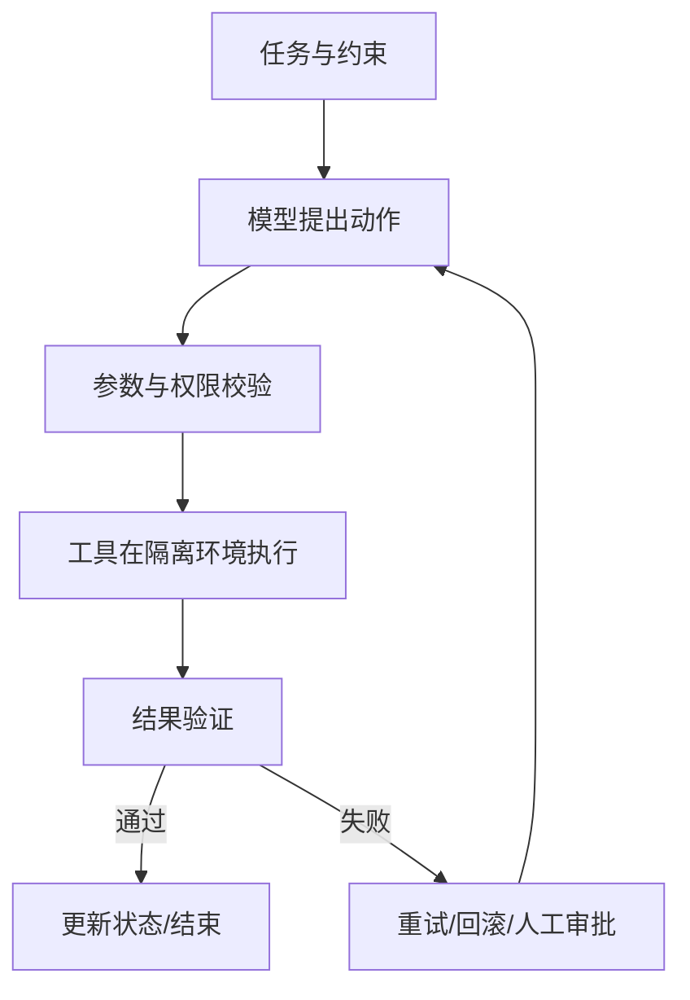

# 方向报告 02｜AI Agent

**周期：** 2026-10-05—2026-10-11  
**核心判断：** Agent 工程重点正从“让模型调用工具”转向“让多步任务可恢复、可验证、可审计”。

## 本期判断

skills、跨会话记忆、编码工作流、E2E 测试、代码审查和软件理解共同指向一件事：模型需要被放进有状态、有权限边界、有结果检查的执行链。Agent 不是一个提示词，而是一套软件系统。术语见[Agent 词典](../../glossary/agent.md)。

## 10 个项目精读

### 1. [OpenAI Agents SDK](https://github.com/openai/openai-agents-python) — 工具、交接和追踪的统一抽象
**背景：** 多工具、多角色执行让散落的业务逻辑难调试。**方法：** 用 Agent/Runner、工具 schema、handoff、guardrail 和 tracing 表达执行流程。**解决了什么：** 统一执行与观测接口。**影响：** Agent 应用会更像有状态软件，而非 prompt 链。**阅读路线：** 最小示例 → Runner 循环 → 参数验证与 handoff → tracing/guardrail 实现和测试。

### 2. [LangGraph](https://github.com/langchain-ai/langgraph) — 显式表达有状态任务
**背景：** 长任务需要分支、循环、暂停、恢复和人工审批。**方法：** 用状态、节点和条件边描述流程，并支持 checkpoint/interrupt。**解决了什么：** 让恢复点和人工介入点显式化。**影响：** 复杂 Agent 更容易测试，但恢复设计不当会重复执行副作用。**阅读路线：** 状态 schema → 节点调度 → checkpoint/interrupt → 崩溃恢复测试。

### 3. [mattpocock/skills](https://github.com/mattpocock/skills) — 把经验封装成可复用技能
**背景：** 工程经验常藏在长提示或个人习惯里，难以版本化和回归测试。**方法：** 将任务指引和资源封装成可发现的技能目录。**解决了什么：** 让团队复用操作流程。**影响：** 技能可能成为 Agent 的可组合操作层，但技能不是沙箱。**阅读路线：** 技能发现/触发 → 输入前提与资源引用 → 实际执行路径 → 版本回归用例。

### 4. [claude-mem](https://github.com/thedotmack/claude-mem) — 跨会话记忆
**背景：** 完整历史过长且充满噪声，长任务重建上下文成本高。**方法：** 将会话观察转成可检索记忆，并选择性注入后续上下文。**解决了什么：** 降低重复解释成本。**影响：** 长期 Agent 的差异可能在记忆治理；错误记忆会持续污染决策。**阅读路线：** 信息采集 → 摘要/索引 → 检索排序 → 上下文注入 → 删除、过期与隐私机制。

### 5. [tester-army/e2e](https://github.com/tester-army/e2e) — Agent 驱动端到端测试
**背景：** UI 变化频繁，传统脚本定位脆弱。**方法：** 将目标转为浏览器动作，并结合断言、截图或运行轨迹。**解决了什么：** 降低测试创建门槛并改善故障诊断。**影响：** 测试是 Agent 价值较容易量化的场景之一，关键在重复运行稳定性。**阅读路线：** 页面定位 → 等待/重试 → 断言 → trace/截图 → 固定任务重复测试并统计 flaky rate。

### 6. [Alibaba Open Code Review](https://github.com/alibaba/open-code-review) — 将模型审查接入工程流水线
**背景：** 纯规则难理解上下文，纯 LLM 评论可能误报、重复或错误。**方法：** 将 diff 预处理、规则/模型分析、评论定位和 CI 结合。**解决了什么：** 把模型建议放入可管理的审查流程。**影响：** 混合式审查可能比自由评论更可控。**阅读路线：** PR/diff 入口 → 规则与模型调用 → 评论去重定位 → 用人工标注历史 PR 测 precision/recall。

### 7. [morluto/rea](https://github.com/morluto/rea) — Agent 探索和理解软件行为
**背景：** 既有软件缺文档或源码难读时，理解界面、状态和流程成本很高。**方法：** 通过交互探索收集行为证据，再整理软件操作和结构的理解。**解决了什么：** 将 Agent 用于软件理解，而不只是执行预设脚本。**影响：** 软件维护、迁移和互操作可能成为新用途，但演示不证明能完整逆向任意软件。**阅读路线：** 探索输入与观测 → 状态/动作轨迹 → 生成结果 → 在获授权测试应用上比较行为差异。

### 8. [text-to-cad](https://github.com/earthtojake/text-to-cad) — 从语言需求到几何对象
**背景：** 生成示意图容易，但工程 CAD 需要尺寸、约束和可编辑几何。**方法：** 将语言需求映射到 CAD 生成流程，再由几何后端产出模型。**解决了什么：** 降低创建初始几何的门槛。**影响：** Agent 可进入设计软件，但工程输出必须经过几何内核和制造约束检查。**阅读路线：** 输入提示/中间表示 → CAD 后端 → 导出格式 → 对尺寸和几何有效性写检查。

### 9. [openrig](https://github.com/mvschwarz/openrig) — 多 Agent 协作
**背景：** 复杂任务可分给多个角色，但通信和协调会增加成本与错误面。**方法：** 通过角色分工、共享上下文与协作流程组织多个 Agent。**解决了什么：** 探索分工是否能改善复杂任务。**影响：** 多 Agent 不天然优于单 Agent，必须有固定任务对照。**阅读路线：** 角色和消息流 → 共享状态/任务分配 → 合并与冲突处理 → 比较质量、时间和成本。

### 10. [pstack-claude](https://github.com/michael-denyer/pstack-claude) — 阶段化编码流程
**背景：** 单轮编码指令常跳过需求澄清、测试和复核。**方法：** 把编码过程拆为多个阶段，并显式传递状态和上下文。**解决了什么：** 让工程过程更有结构。**影响：** 可复用工作流模板会成为 Agent 工程方法的一部分，但阶段化不保证代码正确。**阅读路线：** 阶段定义 → 状态交接 → 每阶段完成条件 → 与单轮 prompt 在同一 bugfix 集对照。

## 结构图：可信执行环

## 方法论沉淀

评估 Agent 应同时看任务成功率、工具调用正确率、人工介入率、重复副作用、成本和可追踪性。把模型决策与确定性执行层分开；外部发送、部署、删除等副作用操作需要授权、幂等和审计。项目清单结合趋势线索与长期工程入口，不代表全部进入官方 Trending 榜单。
