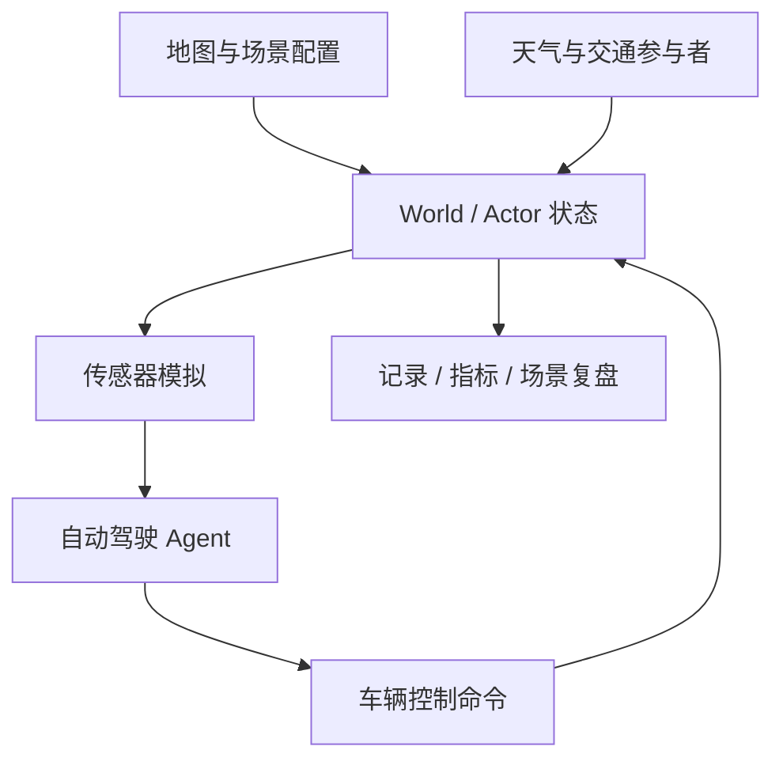
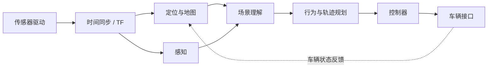
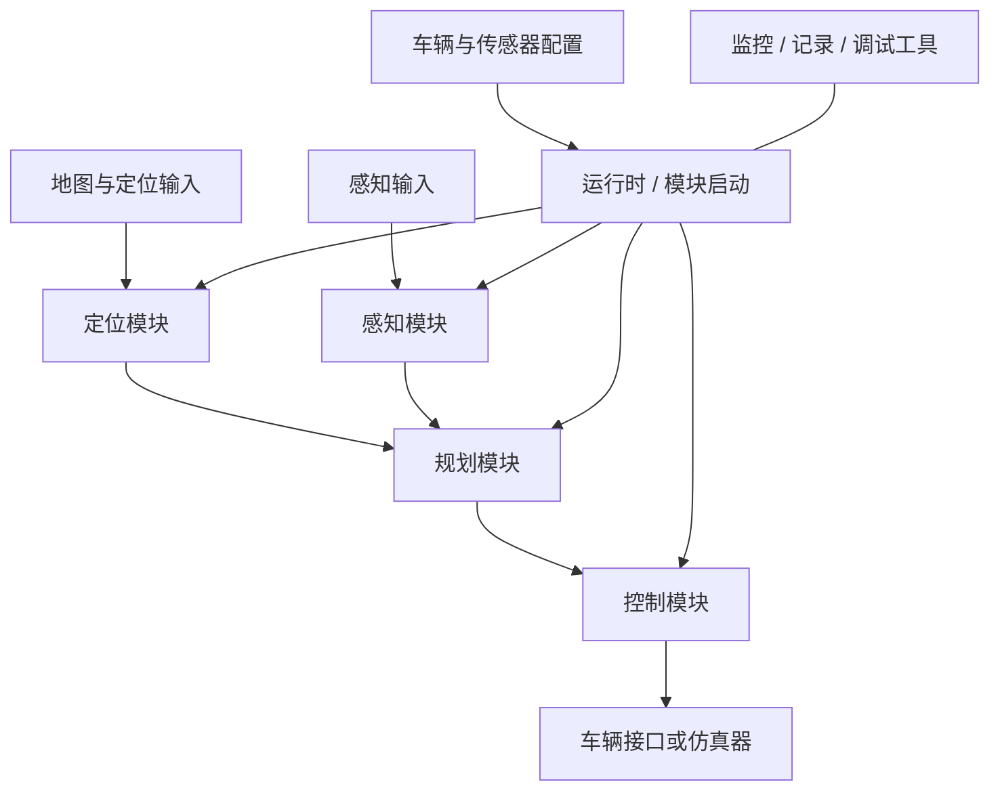
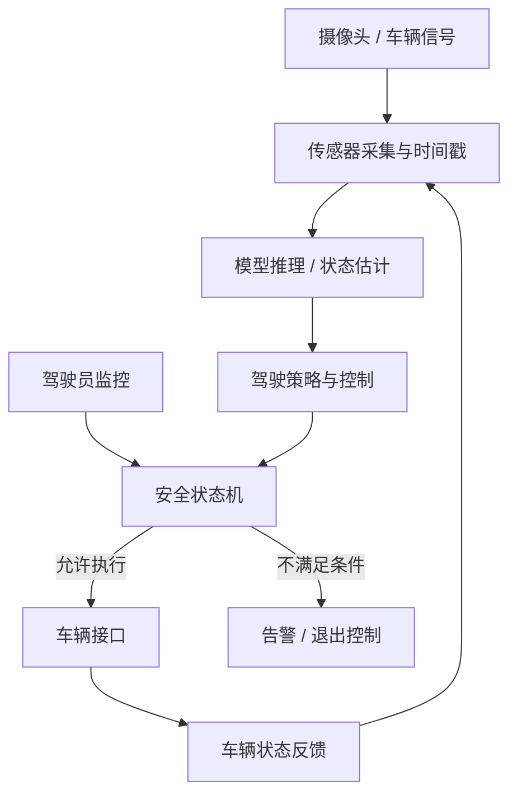
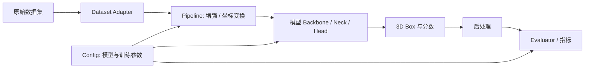
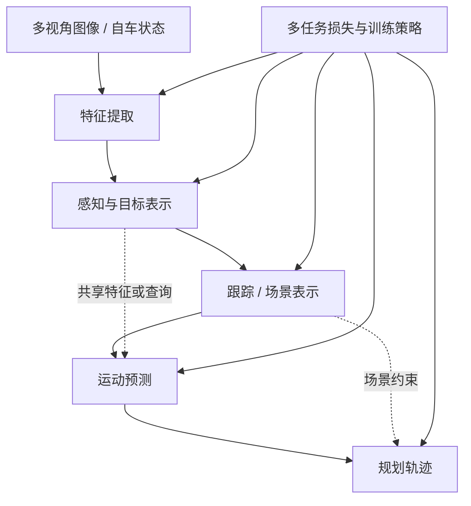
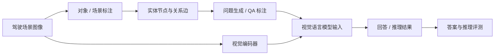
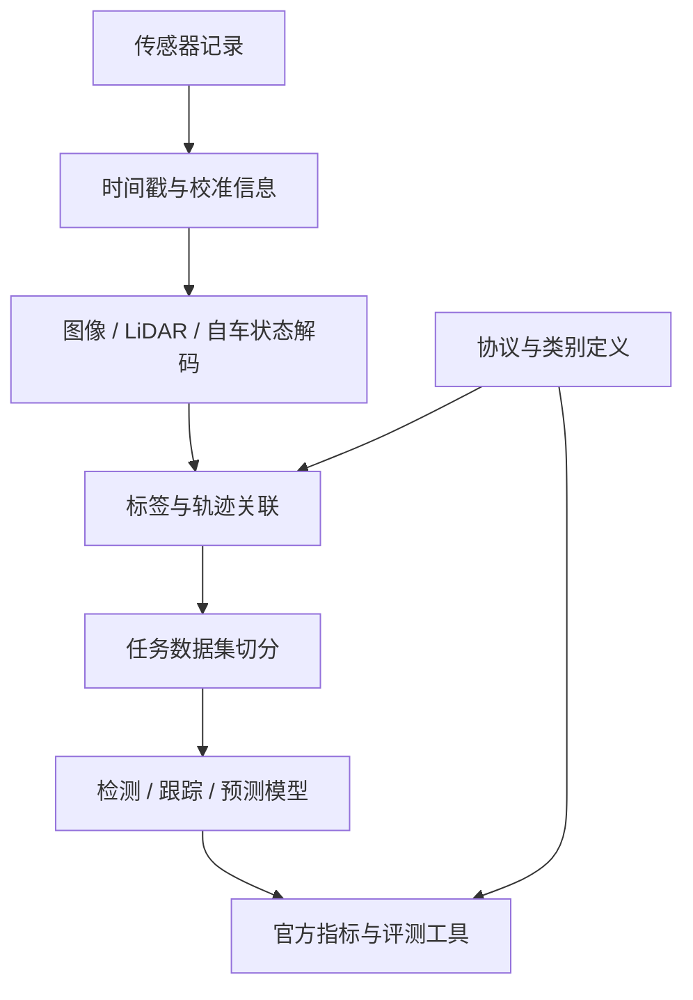
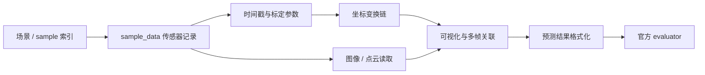
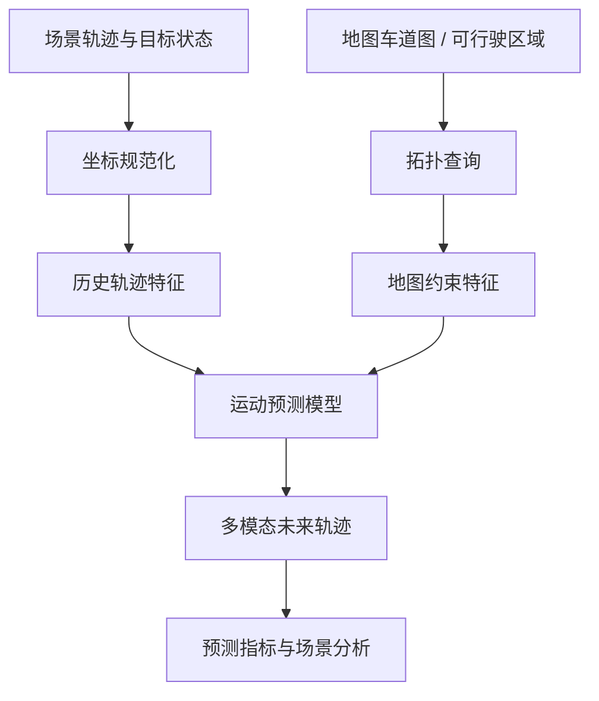

# 方向报告 03｜自动驾驶：从模块拼装到闭环证据

**周期：** 2026-10-05—2026-10-11  
**技术视角：** 自动驾驶项目的核心差别不在“是否使用 AI”，而在它们处于系统链路的哪个位置：数据与评测、感知模型、端到端规划、车辆执行，还是闭环仿真。离线指标只能证明固定样本上的性能；要讨论真实驾驶能力，还必须追踪时序、坐标、分布偏移和决策反馈。

本报告中的项目是长期技术入口，不代表每个项目都在本周官方 Trending 榜单出现。技术描述以官方仓库和论文为起点；若某个内部机制在当前可核验材料中没有充分说明，会明确标注，不把架构推测写成事实。

## 10 个项目精读

### 1. [CARLA](https://github.com/carla-simulator/carla) — 可控场景仿真与闭环测试

**技术分析（约 300 字）**

自动驾驶实车测试很难覆盖低概率、高风险事件：例如遮挡后突然出现的行人、湿滑路面、传感器退化或其他车辆的异常行为。CARLA 的价值不是“用虚拟画面代替道路”，而是把场景、交通参与者、天气、地图和传感器输出变成可配置、可重复的实验条件。研究者可固定随机种子和场景参数，比较不同感知/规划系统在同一事件下的行为差异，并通过车辆控制接口形成闭环：策略动作会改变车辆状态，车辆状态又决定后续观测。这个反馈比只对固定图像计算检测精度更接近控制问题。其主要边界是模拟器与现实的差距，包括材质和光照、传感器噪声、轮胎与车辆动力学、交通参与者行为模型等；在仿真里通过并不自动证明现实安全。阅读时应把传感器生成、世界状态更新和同步机制连起来看，确认控制命令何时生效、传感器数据对应哪个仿真时刻，以及评价指标是否只看碰撞或也覆盖舒适性和交通规则。

**项目结构图**

**如何读懂本项目：** 先看官方文档中的同步模式与传感器配置，再从 Python API 的 world、actor、sensor 生命周期入手，沿一次 tick 追踪“世界状态—传感器回调—控制命令”的时序；最后检查示例 Agent 和评测脚本的成功条件。关键核验点是仿真同步、随机性控制与传感器时延。

### 2. [Autoware](https://github.com/autowarefoundation/autoware) — ROS 2 模块化自动驾驶栈

**技术分析（约 300 字）**

Autoware 面对的是完整车辆系统的集成问题：定位、感知、对象预测、行为规划、轨迹规划、控制和车辆接口由不同模块实现，却必须在时间和坐标上保持一致。它基于 ROS 2 的节点与消息机制组织软件，模块间通过话题、服务或动作交换数据；这让团队可以替换单个算法，也意味着系统表现会受到消息频率、QoS、时间戳、坐标系和启动依赖的影响。举例说，感知输出即使单帧准确，如果使用了错误的 TF 变换或延迟过大，规划模块拿到的对象位置仍可能过时。模块化的收益是可组合、可测试和可部署，代价是集成复杂度和跨模块故障传播。评估 Autoware 不应只问“某个规划器好不好”，还要追踪从传感器话题到规划轨迹再到车辆控制的端到端时序，并确认车辆接口是否真的连接了目标硬件。阅读时以 launch 文件建立节点图，再追踪一条关键消息的数据类型、发布频率、frame_id 和消费者。

**项目结构图**

**如何读懂本项目：** 从官方安装与 launch 文档定位入口，读取 launch graph；随后挑一条感知对象消息和一条规划轨迹消息，核对消息定义、坐标 frame、时间戳和 QoS。最后运行仿真场景，检查节点生命周期、诊断话题与故障降级路径。术语可参阅[ROS 2 QoS](../../glossary/robotics.md#ros-2-qos "QoS：定义消息可靠性、队列深度和时效性等传输策略，影响模块间的数据交付")。

### 3. [Apollo](https://github.com/ApolloAuto/apollo) — 面向车辆工程的自动驾驶平台

**技术分析（约 300 字）**

Apollo 代表的是工程平台路线：算法只有与地图、传感器驱动、车辆模型、规划控制、运行时监控和开发工具集成后，才能成为可测试的系统。其架构包含多个功能模块和模块间通信，工程阅读的重点不是逐个浏览算法文件，而是先理解启动配置、消息通道和模块依赖，再选一条输入输出链追踪。例如定位模块的结果如何进入规划，规划轨迹如何被控制模块消费，模块异常如何通过监控或状态机制暴露。平台化可复用车辆接入、调试和验证基础设施，减少每个团队从零拼装的成本；但接口数量、配置组合与版本耦合也会形成复杂性。一个模块的离线精度并不能证明平台整体可用，传感器标定、地图版本、消息延迟或控制参数错误都可能改变系统结果。报告中的架构图应以项目官方文档和当前版本源码为准，避免把历史版本结构直接套用到最新版本。验证时需记录使用的分支、依赖、车辆/仿真配置和启动方式。

**项目结构图**

**如何读懂本项目：** 先读架构和运行指南，确定当前版本的模块图与消息通道；再通过启动配置定位入口，选择定位或规划模块追踪输入、输出与配置文件，最后检查对应测试、记录工具和异常处理。不要只凭目录名称推断模块的实际执行关系。

### 4. [openpilot](https://github.com/commaai/openpilot) — 驾驶辅助中的感知、控制与安全约束

**技术分析（约 300 字）**

openpilot 的研究价值在于观察学习模型如何进入持续运行的驾驶辅助循环，而不只是离线推理。系统需要将摄像头等输入转成对道路和周边车辆的理解，再与车辆接口、控制逻辑、驾驶员监控和故障处理共同工作。模型输出并非直接等于车辆动作：车辆适配、控制器、状态估计和安全条件决定了指令如何执行，以及何时需要退出或提示驾驶员接管。其工程难点包括车型差异、CAN 信号解释、时序约束、控制稳定性和驾驶员注意力监控。开源代码有助于分析系统实现，但不能把“支持某车型”理解为任何配置下都安全，也不能将驾驶辅助等同于无人驾驶。技术评价必须绑定具体版本、车型、硬件、道路条件和功能边界；只看演示视频无法判断接管逻辑和失效安全性。为避免不安全实验，代码阅读与验证应优先使用离线日志或受控仿真，不应在公共道路上进行未经授权的测试。

**项目结构图**

**如何读懂本项目：** 从安全与车型支持文档开始，再追踪主进程、模型输入输出、车辆接口与驾驶员监控的关系。重点核对状态机何时允许控制、信号丢失时如何降级，以及日志中的时间戳和事件如何关联。

### 5. [MMDetection3D](https://github.com/open-mmlab/mmdetection3d) — 3D 感知实验与模型比较

**技术分析（约 300 字）**

3D 检测不是简单把 2D 框扩展成 3D 框。点云、图像和融合模型对坐标系、点云范围、体素化、数据增强和标签定义有不同假设；预处理只要出现一个坐标或单位错误，模型仍可能训练收敛，却得到没有意义的指标。MMDetection3D 的核心贡献是将数据集适配、模型组件、训练配置、推理和评测组织为相对统一的工具箱，使不同方法能在共享实验框架中比较。统一接口降低了复现实验的工程成本，但不能自动保证公平比较：输入模态、训练轮数、数据增强、预训练权重、后处理和评测脚本都可能不同。技术分析应具体落到 pipeline 如何变换数据、模型如何生成 box、evaluator 如何匹配预测与真值，而不是只列模型名称。尤其要检查坐标约定、旋转角定义、box 尺寸顺序和数据切分。基准分数只有在数据版本、配置和评测协议一致时才有可比性。

**项目结构图**

**如何读懂本项目：** 先选一个受支持数据集和 baseline 配置，沿 dataset class 追踪样本字典，再追踪 pipeline 中的坐标与增强操作；之后读模型 head 的输出定义和 evaluator 的匹配规则。复现实验时保存完整 config、权重来源和依赖版本。

### 6. [UniAD](https://github.com/OpenDriveLab/UniAD) — 将感知、预测与规划放进统一框架

**技术分析（约 300 字）**

传统自动驾驶流水线把检测、跟踪、运动预测和规划分开训练，每个模块可以优化自己的指标，但局部最优不一定对应更安全的驾驶行为。例如，对规划有决定性影响的远处车辆若被检测遗漏，即使整体检测 mAP 变化不大，也可能显著改变轨迹选择。UniAD 的研究问题是：能否让多个任务在统一架构中共享中间表示，并通过规划相关目标让前序模块学习更有用的信息。读论文时应特别关注任务之间的数据传递、查询或特征如何复用、不同 loss 的权重和训练阶段，以及消融实验是否证明某个模块确实贡献了提升。统一训练可能改善任务协同，也可能带来优化冲突、错误传播和计算成本上升；离线轨迹指标还无法完整覆盖闭环驾驶中的反馈效应。比较时要分开看感知、预测、规划各任务指标，并检查评测数据和协议是否与基线一致，不能仅凭“统一端到端”推断它已经解决真实道路安全问题。

**项目结构图**

**如何读懂本项目：** 先读论文的整体任务图与损失定义，再从配置文件定位模型构建入口；追踪感知表示怎样传入预测和规划模块，最后对照消融表确认任务协同的贡献。若当前源码版本与论文版本不同，需分别记录。

### 7. [DriveLM](https://github.com/OpenDriveLab/DriveLM) — 用图结构组织驾驶场景问答

**技术分析（约 300 字）**

驾驶场景理解不仅是识别“有哪些对象”，还涉及对象之间的关系、交通状态以及某项行为为什么合理。DriveLM 将场景中的实体和关系组织成图，并以视觉语言问答形式表达观察、推理和驾驶决策相关问题。图结构可以把对象、关系和问题链显式化，便于构造数据集、分析模型在哪一步推理出错，也为多模态模型提供比单一类别标签更丰富的监督信号。但问答正确与驾驶安全不是同一个目标：语言模型可能生成连贯解释，却忽略速度、可见距离、动态变化或控制约束；数据集的提问方式也可能泄露答案模式。评估时要区分感知实体是否正确、关系是否正确、推理链是否有依据，以及最终驾驶判断是否符合交通规则。还需检查图节点与图边的标注协议、问题生成方式、训练/测试场景是否存在相似片段泄漏。该项目的价值主要是为场景语义推理提供可研究的数据和任务结构，而不是单独证明系统可以安全驾驶。

**项目结构图**

**如何读懂本项目：** 先看数据集的图 schema 和问答任务定义，再抽查一条样本，核对图节点、关系边、问题与答案如何对应。随后查看模型输入格式和评价脚本，判断指标是在评估语言相似度、结构正确性还是驾驶决策质量。

### 8. [Waymo Open Dataset](https://github.com/waymo-research/waymo-open-dataset) — 多传感器数据与任务基准

**技术分析（约 300 字）**

自动驾驶模型的性能很大程度上受数据分布和标注协议限制。Waymo Open Dataset 提供真实道路场景中的多传感器数据和标注，适用于研究 3D 检测、跟踪、运动预测等任务。数据的技术难点并不只在规模：激光雷达点云与摄像头图像有不同采样特性，传感器之间存在时空关系，目标类别、轨迹和可见性标注也决定了哪些错误能被指标捕捉。官方 devkit 和评测协议帮助研究者以统一方式读数据、生成预测并计算任务指标，但 benchmark 的排名只代表指定切分与规则下的结果。它无法自动覆盖训练数据以外的天气、地区、道路规则或罕见交互。精读应关注数据 schema、传感器时间戳、坐标变换、标签定义、切分策略和指标计算，而不只是引用论文中的最高分。比较模型时还应确认使用的官方版本、评测服务器/工具链以及是否遵守提交限制。

**项目结构图**

**如何读懂本项目：** 先查当前任务对应的数据 schema 与官方教程，读一条完整记录的传感器和标注字段；再核对坐标与校准信息，最后检查评测脚本对类别、距离阈值和预测时间范围的处理。避免把不同任务的指标直接横向比较。

### 9. [nuScenes devkit](https://github.com/nutonomy/nuscenes-devkit) — 数据关联、坐标变换与指标实现

**技术分析（约 300 字）**

多传感器数据集的一个隐蔽风险是：数据能被读取不代表样本在物理意义上正确。nuScenes 将场景、样本时刻、传感器数据、标定和目标标注通过关联记录组织起来；开发者必须理解 sample 与 sample_data 等对象之间的关系，才能正确拼接连续帧和多传感器观测。devkit 提供可视化、坐标变换和评测实现，使研究者能检查数据内容并复用官方指标。坐标链尤其关键：传感器坐标、车辆坐标和全局坐标之间的变换顺序或旋转约定一旦出错，结果可能整体偏移而不易被代码错误提示发现。评测工具提高了结果一致性，但指标本身仍有边界，例如平均误差可能掩盖特定类别或长尾场景失败。精读时应亲自对一条样本画出相机、LiDAR、车辆与全局坐标关系，并用已知标注核对变换结果。不要把 devkit 计算出的分数直接解释成系统安全性结论。

**项目结构图**

**如何读懂本项目：** 从数据对象关系与教程入手，跟踪一条 sample 的关联记录，手工检查一次传感器到全局坐标的变换；再看评测模块如何计算匹配、误差和综合分数。最好编写小测试验证变换的正逆一致性。

### 10. [Argoverse API](https://github.com/argoverse/argoverse-api) — 地图拓扑与运动预测数据工具

**技术分析（约 300 字）**

车辆未来运动不是简单地从过去轨迹外推直线：道路拓扑、可行驶区域、交叉口结构和其他交通参与者都会改变可能的运动模式。Argoverse API 提供驾驶场景数据与地图相关工具，为轨迹预测、目标跟踪和场景理解提供统一访问接口。地图的意义是把连续坐标中的轨迹与离散道路结构连接起来，例如判断车辆可能进入哪条车道、是否接近路口或是否存在转向分支。预测模型如果忽略地图约束，可能产生几何上平滑但道路上不可行的轨迹；反过来，地图先验也可能在地图过时、施工或未覆盖道路上造成偏差。阅读项目时要区分地图查询、轨迹坐标、数据切分和预测指标，确认模型是否真正利用了地图信息，而不只是把地图作为可视化背景。评价结果需结合预测时间范围、候选轨迹数量、距离指标和场景分布；离线轨迹误差并不等同于规划器采用该预测后会有更好的闭环行为。

**项目结构图**

**如何读懂本项目：** 先阅读地图 API 与轨迹数据结构，确认车道拓扑和坐标系的定义；再追踪基准任务如何构造历史轨迹与未来标签，最后核对预测指标和地图特征是否实际进入模型输入。关注地图缺失或轨迹越界时的处理方式。

## 跨项目技术结论

1. **数据与坐标是算法的前置条件。** MMDetection3D、Waymo、nuScenes 和 Argoverse 的主要风险之一是预处理、标注或坐标链错误；这种错误可能在训练和推理中都不报错，却让指标失去意义。
2. **模块化提高可替换性，同时引入接口风险。** Autoware 与 Apollo 的系统价值取决于时间戳、消息语义、启动依赖和故障传播，不是模块数量。
3. **离线得分、仿真闭环与真实道路证据是不同层级。** DriveLM 的语言推理、UniAD 的离线规划结果、CARLA 的仿真成功率都不能直接推导现实道路安全。
4. **下一步技术判断应围绕可复核证据。** 对任何声称的性能提升，记录项目版本、数据切分、硬件、指标定义、基线和失败样例；如果这些条件不完整，结论应保持有限。

## 术语

- [闭环仿真](../../glossary/robotics.md#闭环仿真 "闭环仿真：系统动作会改变环境后续状态，因此能暴露部分长期决策与反馈问题")
- [开环评测](../../glossary/robotics.md#开环评测 "开环评测：在固定数据上评估预测，不让预测动作反过来改变后续状态")
- [ODD（运行设计域）](../../glossary/robotics.md#odd "ODD：系统被设计为可运行的道路、环境、速度与运行条件范围")
- [多传感器融合](../../glossary/robotics.md#多传感器融合 "多传感器融合：结合多个传感器信息，依赖校准、同步和坐标一致性")

## 来源与证据边界

- 项目官方仓库：CARLA、Autoware、Apollo、openpilot、MMDetection3D、UniAD、DriveLM、Waymo Open Dataset、nuScenes devkit、Argoverse API（各项目标题链接）。
- 具体模块名称和目录可能随版本变化；实际复现应固定 commit、配置、数据版本和依赖。
- 本报告未宣称对所有项目完成源码运行或独立复现。项目方指标应视为特定协议下的证据，不能外推成未经限定的道路安全结论。
