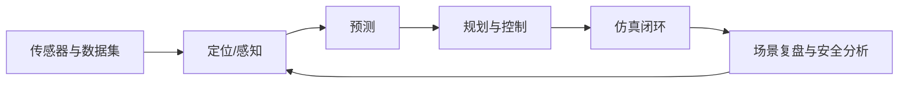

# 方向报告 03｜自动驾驶

**周期：** 2026-10-05—2026-10-11  
**核心判断：** 自动驾驶的技术价值不应只看离线感知分数，而要追踪数据、仿真、规划控制和闭环失效之间的完整链路。

## 本期判断

泛 AI 热榜不能代表自动驾驶专属热度。本报告列出值得持续跟踪的 10 个研究/工程项目，不伪造周增 Star 排名。关键难点是多传感器时序与坐标一致性、预测/规划的闭环影响、场景覆盖和安全边界。术语见[自动驾驶与机器人词典](../../glossary/robotics.md)。

## 10 个项目精读

### 1. [CARLA](https://github.com/carla-simulator/carla) — 可控自动驾驶仿真环境
**背景：** 真实道路测试昂贵且有风险，罕见危险场景难以重复。**方法：** 提供可配置道路、传感器、天气和交通参与者。**解决了什么：** 可重复运行相同场景、控制变量并注入边界情况。**影响：** 仿真是规模化验证的必要工具，但真实性和场景覆盖限制外推。**阅读路线：** scenario/地图 → 传感器与同步 → 控制接口 → benchmark 脚本 → 仿真与现实假设。

### 2. [Autoware](https://github.com/autowarefoundation/autoware) — ROS 2 模块化自动驾驶栈
**背景：** 定位、感知、规划、控制和车辆接口需要协同。**方法：** 以 ROS 2 节点和消息连接各模块。**解决了什么：** 提供可替换组件的系统集成框架。**影响：** 降低集成门槛，可靠性仍取决于时序、接口和安全验证。**阅读路线：** launch graph → 传感器消息 → 定位/规划接口 → 仿真运行 → 系统测试。

### 3. [Apollo](https://github.com/ApolloAuto/apollo) — 工程化自动驾驶平台
**背景：** 算法必须与地图、车辆、传感器、规划控制和运行时工程结合。**方法：** 提供分模块软件平台与工具链。**解决了什么：** 让多类模块在统一系统中集成、配置和验证。**影响：** 平台化利于复用，但代码规模大，需从数据流切入。**阅读路线：** 架构/启动配置 → 消息总线 → 选一个感知或规划模块 → 追踪输入输出与测试。

### 4. [openpilot](https://github.com/commaai/openpilot) — 驾驶辅助系统
**背景：** 驾驶辅助涉及车辆接口、驾驶员监控、控制循环和安全约束。**方法：** 将模型推理、车辆通信与控制结合。**解决了什么：** 在受支持车辆和规定条件下提供驾驶辅助功能。**影响：** 开放实现有助理解系统工程，但兼容性、法规和安全边界不可忽略。**阅读路线：** 安全/兼容说明 → 感知到控制主循环 → 车辆接口 → 监控与日志；不得未经授权在公共道路测试。

### 5. [MMDetection3D](https://github.com/open-mmlab/mmdetection3d) — 3D 感知实验工具箱
**背景：** 3D 检测方法的数据格式、坐标系和配置各异，难以公平比较。**方法：** 提供模型、数据适配、训练与评测配置。**解决了什么：** 降低复现实验和比较检测模型的成本。**影响：** 工具箱提升可比性，但坐标或预处理错误会让指标失真。**阅读路线：** dataset pipeline → 坐标/box 表示 → 模型配置 → evaluator → 复现 baseline。

### 6. [UniAD](https://github.com/OpenDriveLab/UniAD) — 统一感知到规划
**背景：** 传统流水线各模块单独优化，局部指标优秀不一定带来更好驾驶决策。**方法：** 将多个驾驶任务纳入统一框架，让中间表示与规划目标协同。**解决了什么：** 研究任务协同是否改善整体驾驶表现。**影响：** 统一架构有潜力，但需关注错误传播和闭环证据。**阅读路线：** 论文任务图 → 模块与 loss → 数据/配置 → ablation → 区分离线与闭环结果。

### 7. [DriveLM](https://github.com/OpenDriveLab/DriveLM) — 驾驶场景视觉语言推理
**背景：** 驾驶决策需要对象、关系和因果线索，纯检测标签表达有限。**方法：** 将驾驶场景转为视觉语言问答/图结构推理任务。**解决了什么：** 提供研究场景语义理解和可解释推理的数据入口。**影响：** 语言解释可辅助分析，但表达合理不代表动作安全。**阅读路线：** 图结构/问题构造 → 数据标注 → 模型输入输出 → 指标 → 对比语言分数和驾驶决策。

### 8. [Waymo Open Dataset](https://github.com/waymo-research/waymo-open-dataset) — 多传感器数据与基准
**背景：** 感知和预测需要真实道路数据，但传感器、标注和场景分布各异。**方法：** 提供多传感器记录、标注和任务评测工具。**解决了什么：** 为感知、跟踪和运动预测提供可重复比较基础。**影响：** 数据集决定研究能看到什么，长尾覆盖和切分同样重要。**阅读路线：** 数据 schema → 时间戳/标注 → 切分 → 官方指标 → 稀有场景覆盖。

### 9. [nuScenes devkit](https://github.com/nutonomy/nuscenes-devkit) — 多传感器时序和评测
**背景：** 多传感器数据依赖时间同步、坐标变换和标注关联。**方法：** 提供数据访问、可视化、坐标变换与评测实现。**解决了什么：** 降低数据处理错误并统一评测。**影响：** 数据工程细节决定结果可信度，devkit 指标不等于系统安全。**阅读路线：** sample/sample_data 关系 → 坐标变换链 → 可视化 → evaluator → 手工核对小样本。

### 10. [Argoverse API](https://github.com/argoverse/argoverse-api) — 地图、跟踪和运动预测资源
**背景：** 车辆未来运动受地图拓扑和参与者互动影响。**方法：** 提供驾驶数据与地图/预测工具。**解决了什么：** 支持运动预测和场景理解的统一数据访问。**影响：** 地图和预测连接感知与规划，但离线误差无法覆盖闭环风险。**阅读路线：** 数据/地图 API → 轨迹和坐标定义 → 预测指标 → 追踪规划模块如何消费预测。

## 结构图：数据到闭环验证

## 方法论沉淀

评估证据应区分离线数据集、闭环仿真、封闭场地和受控道路。每个数字需注明场景、ODD、数据集、版本和统计口径。该清单是研究地图，不代表所有项目都在本周官方热榜出现。
