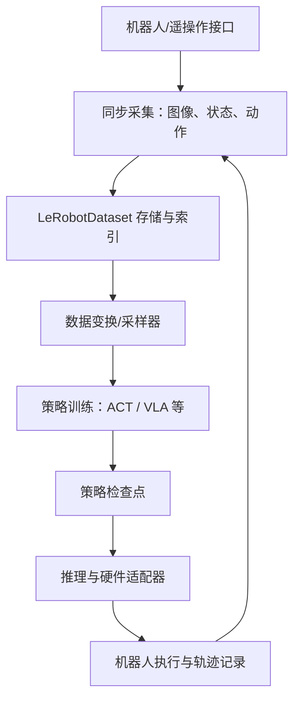
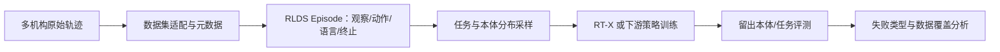
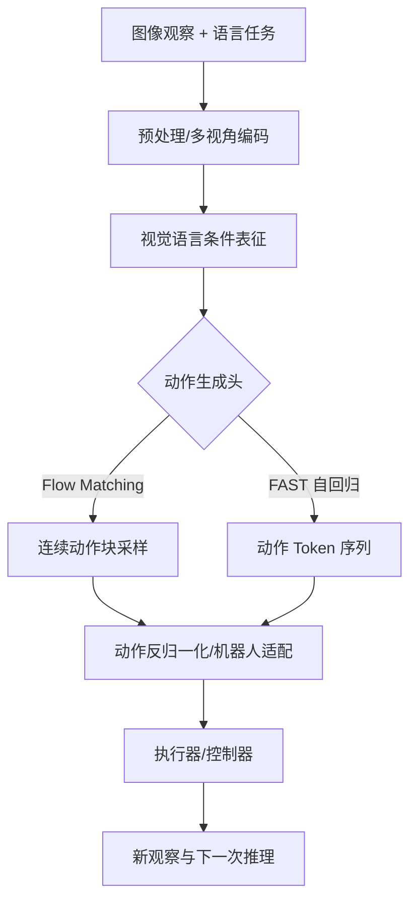
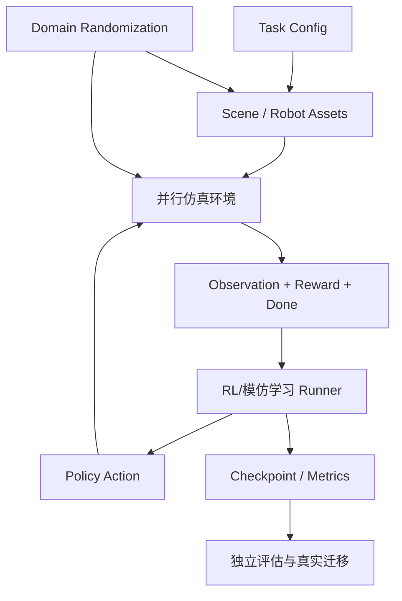
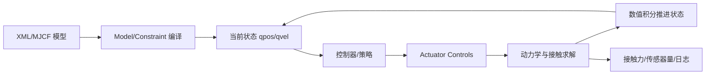
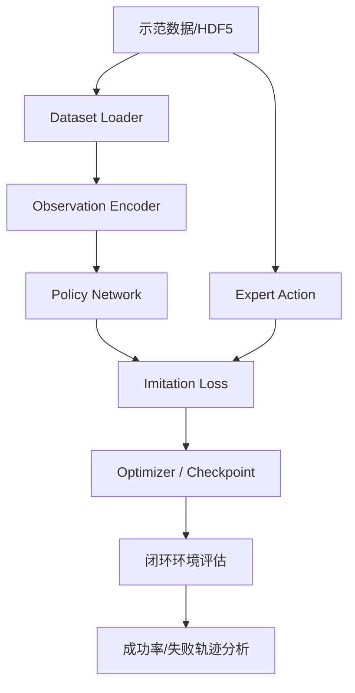
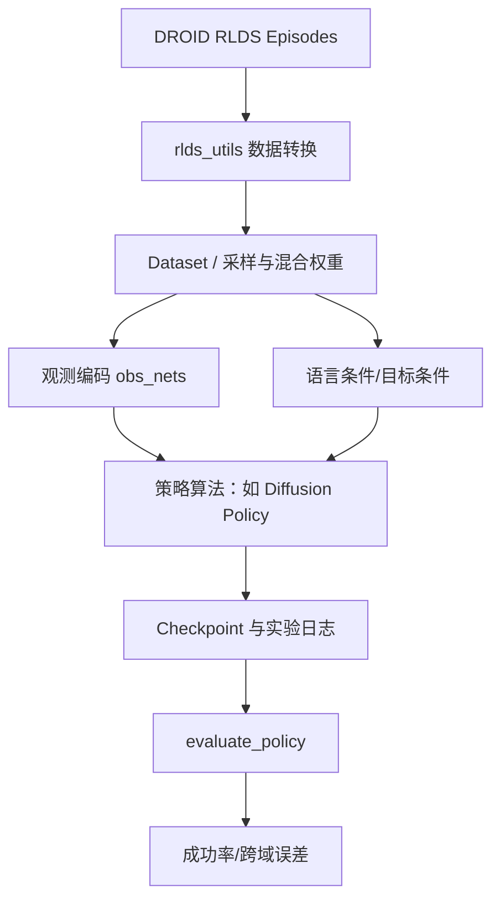
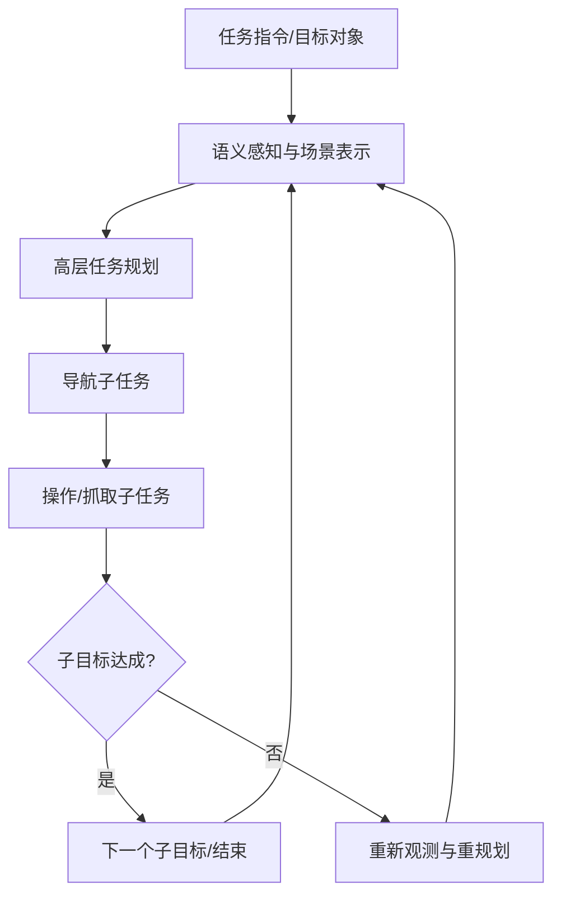
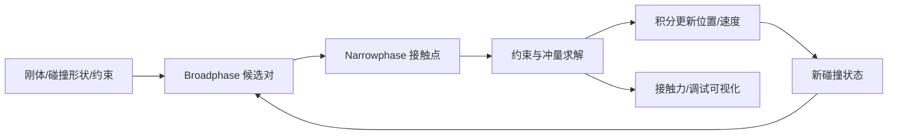
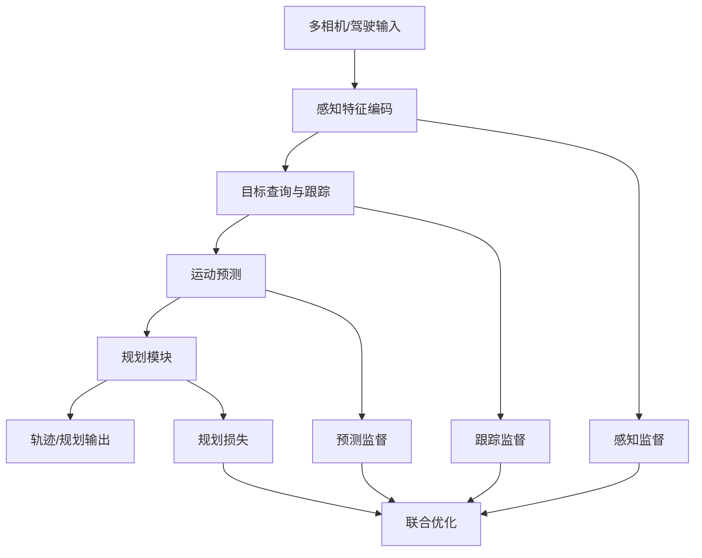

# 方向报告 04｜具身智能、机器人与世界模型：从数据分布到可迁移动作

**周期：** 2026-10-05—2026-10-11

## 技术判断

具身模型的瓶颈并非单纯“看懂图像”，而是把**视觉/语言条件、机器人状态、动作表示、控制频率与物理反馈**连接成稳定执行链。开源生态正在形成三个互补层：标准化示范数据（决定模型见过什么）、策略与训练框架（决定怎么把数据变成动作）、物理仿真和真实硬件接口（决定动作是否能执行、能否迁移）。本报告里的项目是长期技术入口，不把它们冒充成本周官方 Trending 排名。

## 10 个项目精读

### 1. [LeRobot](https://github.com/huggingface/lerobot) — 将机器人数据、策略和硬件接口标准化

**技术分析**

LeRobot 针对机器人研究中常见的“每个实验室一套数据格式和控制代码”问题：采集数据、训练策略和部署控制器经常需要重复编写适配器，造成复现门槛高、算法比较困难。它把硬件无关的 Python 接口、同步视频/状态/动作数据集、策略实现和训练/部署命令组合起来，形成 teleoperate → record → train → deploy 的工作路径。关键价值是标准化数据契约：示范不再只是视频，而是时间关联的观察、动作和状态序列；时间戳错位、动作单位不一致或机器人标定错误，都会使学习目标失真。策略层可容纳 ACT、VLA 等不同方法，但统一接口不意味着不同动作空间可以直接互换。实际验证应固定机器人本体、相机布局、控制频率和成功定义，比较新任务成功率与失败轨迹，而不只报告训练 loss。官方文档描述了硬件接口、LeRobotDataset 和训练/部署流程；具体策略性能仍需按任务和硬件单独验证。[官方文档](https://huggingface.co/docs/lerobot/index)

**项目结构图**

**如何读懂本项目：** 从 [官方文档](https://huggingface.co/docs/lerobot/index) 的 dataset 格式进入，查看机器人接口与记录命令，再追踪一个策略的 observation/action schema、训练配置和推理入口；用小数据集完成一次回放训练，核验时间戳、动作单位和相机标定是否一致。

### 2. [Open X-Embodiment](https://github.com/google-deepmind/open_x_embodiment) — 跨机器人数据集与 RT-X 训练基础

**技术分析**

单一机器人采集的数据通常覆盖有限任务、夹爪、相机视角和工作空间，策略学到的可能是某台机器人的动作习惯，而非可迁移的任务规律。Open X-Embodiment 把多个机器人平台的数据组织成相对统一的 episode 格式（仓库采用 RLDS），并提供数据集清单、元数据和 RT-X 相关材料。其关键机制不是简单地把所有轨迹拼接，而是让下游训练能够对任务文本、观察图像、机器人状态和动作序列做统一读取；跨平台共训则希望共享与“抓取、移动、放置”等任务相关的表征。最大的难题是本体异构性：不同机器人的关节数量、末端坐标、动作尺度与采样频率可能不同，统一字段并不会自动统一动作语义。技术价值要用跨本体留出测试衡量——训练中未见过的平台或任务上是否仍能完成操作；只在混合训练集随机切分上提升，可能只是记住了相近轨迹。官方仓库说明数据以 episode 组织并提供观察空间说明，效果解释需回到相应 RT-X 论文和评测设置。[官方仓库](https://github.com/google-deepmind/open_x_embodiment)

**项目结构图**

**如何读懂本项目：** 先检查 [RLDS episode 格式和数据集清单](https://github.com/google-deepmind/open_x_embodiment)，选一个数据集核对图像、状态、动作和语言指令字段；再检查 RT-1-X 示例中的 observation space，并把随机数据切分与按机器人本体留出切分分开。

### 3. [OpenPI](https://github.com/Physical-Intelligence/openpi) — π₀ 系列视觉语言动作策略

**技术分析**

视觉语言模型能够描述场景，却不自然具备高频、连续且受机器人动力学约束的控制能力。OpenPI 提供 π₀、π₀-FAST 等开放机器人策略实现，分别探索基于 flow matching 的动作生成与基于动作 token 自回归生成的路线。典型输入包含相机观察和任务指令，输出是供控制器执行的一段动作，而非普通聊天文本；这使动作分块、动作表示、推理延迟和控制频率成为架构核心。Flow-based 路线通过迭代去噪/流场积分生成连续动作块，自回归路线则把动作编码为 token 序列，便于采用语言模型式序列建模，但两者在延迟、平滑性和表达精度上存在不同取舍。仓库也明确提示 π₀ 最初面向 Physical Intelligence 自身机器人，迁移到 ALOHA、DROID 等平台并不保证成功。复现实验必须检查预训练权重、数据配方、相机视角、机器人动作 schema 和推理频率，不能把“模型可运行”当成跨本体泛化证明。[官方仓库](https://github.com/Physical-Intelligence/openpi)

**项目结构图**

**如何读懂本项目：** 从 README 里的模型与硬件支持列表开始，核对 observation/action schema；沿训练配置找到数据与归一化参数，再分别跟踪 flow head 和 FAST 的推理路径。用同一任务比较动作块长度、推理耗时、成功率和误差恢复，而不是只比较模型参数量。

### 4. [Isaac Lab](https://github.com/isaac-sim/IsaacLab) — 面向机器人学习的并行仿真任务框架

**技术分析**

强化学习和策略搜索往往需要大量环境交互，真实机器人采样既慢又有损坏风险。Isaac Lab 将机器人资产、场景、观测、动作、奖励和终止条件组织成任务环境，并利用仿真器并行运行多个环境实例，提升 rollout 速度。对于 RL，环境定义并非外围代码：观测空间、动作缩放、奖励权重、重置逻辑和终止条件共同定义了模型优化的目标；一个奖励项写错，就可能学到“刷奖励”而非完成任务的策略。并行化主要提升样本吞吐，不自动改善动力学准确性。不同环境实例的物理参数随机化有助覆盖摩擦、质量和外部扰动，但随机范围要接近真实系统，否则训练分布仍会偏离部署环境。应检查任务配置、机器人 USD 资产、观测/奖励计算与训练器之间的契约，最后用固定种子和多次独立运行统计成功率、碰撞率与策略方差；仿真进步还需要真实硬件验证支持。

**项目结构图**

**如何读懂本项目：** 从一个具体 task config 追踪 scene、observation、reward、termination 与 action 定义；对照训练 runner 的环境接口，检查 reset 和随机化到底改动哪些物理参数，再核对评测脚本是否与训练环境共享了过多设置。

### 5. [MuJoCo](https://github.com/google-deepmind/mujoco) — 刚体动力学、接触求解与控制步进

**技术分析**

机器人操作和行走的关键不只在几何碰撞，还在接触力、关节约束、质量分布、摩擦与数值积分。MuJoCo 提供刚体动力学和接触仿真引擎，将模型文件里的 body、joint、geom、actuator 等组件转为每个时间步的动力学计算。控制器通常读取状态并输出执行器控制量，模拟器根据动力学和约束求解推进系统；控制频率、仿真时间步和接触求解参数若设置不当，可能出现不稳定或不真实的动作。其工程价值是允许快速重复的物理实验，不代表模拟参数会自动与真实材料和执行器吻合。看机器人策略时，应明确哪些差异来自策略，哪些来自物理参数；至少对时间步、摩擦、质量和执行器延迟做敏感性分析。对于策略学习，单次仿真演示不足以证明稳健性，还需要多个随机种子、扰动测试和 sim-to-real 对照。官方文档和示例可用于沿模型定义到状态步进核对具体行为。

**项目结构图**

**如何读懂本项目：** 选一个官方控制示例，从 MJCF 里的关节、惯量、接触参数读起；追踪每次 step 前后状态如何更新，以及控制量如何映射为 actuator force。重点检查积分步长、接触参数和传感器采样频率，不要只看渲染画面是否“像真的”。

### 6. [robomimic](https://github.com/ARISE-Initiative/robomimic) — 在统一协议下比较模仿学习算法

**技术分析**

从专家示范学习能减少随机探索，但策略通常会在偏离示范分布后犯错：一次位置预测偏差可能导致后续观察完全不同，错误随时间累积。robomimic 的研究价值在于把数据读取、算法实现、实验配置和评估组织为可比较的框架，覆盖行为克隆及序列决策类策略。数据集格式和 observation encoder 决定模型究竟看到什么，训练 loss 则决定模型拟合动作的方式；若不同方法使用不同数据切分、图像增强或训练预算，结果就不能直接归因于算法。行为克隆优化的是示范动作拟合，并不直接惩罚长序列执行中的状态偏移，因此要额外检查闭环任务成功率和失败轨迹。与强化学习相比，模仿学习避免了在线探索成本，却受示范质量、任务覆盖和传感器分布约束。应从配置文件还原算法、数据版本和随机种子，再对照 evaluator 看成功标准是否一致。

**项目结构图**

**如何读懂本项目：** 从一个算法配置沿 dataset、observation encoder、policy 和 loss 找到实际张量形状，再看训练循环、checkpoint 与评估入口；先复现基础行为克隆基线，再测试示范之外状态下的恢复能力。

### 7. [DROID Policy Learning](https://github.com/droid-dataset/droid_policy_learning) — 把大规模真实操作示范转为训练基线

**技术分析**

大规模真实机器人数据提供丰富的自然变化，但数据量本身并不能直接转成泛化能力：摄像机标定、动作对齐、任务文本质量和数据混合权重都会影响训练信号。DROID Policy Learning 基于 robomimic 改造，提供 RLDS 数据读取、语言条件训练配置、算法类与评估脚本。其数据路径将 episode 转换为训练可消费的 observation/action 样本，并允许把目标域的少量示范与公共数据 co-train；混合数据有望扩展分布，但也可能让少数目标任务被大数据源压制。官方仓库说明 full dataset 规模约 1.7TB，另提供小型示例数据便于调试；这只是资源规模说明，不证明某个策略在任意机器人上有效。评测时要报告训练数据采样比例、语言条件方式、目标机器人配置及成功率，并使用独立场景测试；相机标定更新和标注版本也应记入复现记录。[官方仓库](https://github.com/droid-dataset/droid_policy_learning)

**项目结构图**

**如何读懂本项目：** README 中先找训练配置生成脚本，再依次打开 rlds_utils、dataset.py、obs_nets.py、algo.py、diffusion_policy.py 和 evaluate_policy.py；用 100 条示例数据跑通端到端流程后再扩数据规模。

### 8. [HomeRobot](https://github.com/facebookresearch/home-robot) — 家庭环境中的导航与操作组合

**技术分析**

家庭机器人任务通常跨越多个阶段：寻找目标物、移动到可操作位置、抓取或搬运，并在环境状态变化后继续规划。HomeRobot 将 embodied AI 的导航、感知、操作和任务执行组织到研究框架中，适合研究开放环境里的系统级接口。关键难题是模块之间的误差传播：定位偏差可能令导航停错位置，抓取失败会改变物体状态，而高层任务规划若不感知这些变化就会继续执行过期计划。因而评估不应只看单步导航或抓取指标，而要明确任务级成功条件、重规划触发和失败恢复机制。模拟场景有助重复试验，却可能无法覆盖家庭里杂乱、反光、遮挡和未知物体；不同硬件接口也限制结果可迁移性。阅读时要找任务入口与导航/操作模块交界处，弄清观察如何变成子目标，以及动作失败后状态是否回写给上层规划器。

**项目结构图**

**如何读懂本项目：** 先定位示例任务的顶层执行器，再沿目标检测、地图/导航与抓取接口查看状态类型；检查失败时哪些模块被重置、是否重新观察，以及评估器如何判断整段任务成功。

### 9. [Bullet Physics](https://github.com/bulletphysics/bullet3) — 碰撞检测、约束和多体物理模拟

**技术分析**

仿真引擎的差异往往体现在接触求解和数值稳定性，而不只在运行速度。Bullet 提供刚体、碰撞检测、约束、软体和相关接口，供机器人、交互应用和物理场景使用。典型步进过程先更新物体状态并进行 broadphase 候选碰撞筛选，再由 narrowphase 计算具体接触点，之后构建并求解约束，最后推进位置和速度。这个流程解释了为什么碰撞几何、时间步、迭代次数与摩擦模型会影响抓取和堆叠结果。它是通用物理引擎，不是机器人策略或安全证明；若要比较策略，必须固定场景和求解参数，并验证引擎参数变化是否改变结论。不同仿真器之间的轨迹一致性也不应假定，尤其是接触丰富的任务。官方代码示例适合追踪模拟循环与 collision/dynamics API 的实际边界。

**项目结构图**

**如何读懂本项目：** 从官方示例里的 stepSimulation 和碰撞对象创建流程开始；沿 broadphase、narrowphase、约束求解和积分更新向下追踪，固定时间步、solver iterations 和摩擦参数比较结果稳定性。

### 10. [UniAD](https://github.com/OpenDriveLab/UniAD) — 感知、预测与规划的任务协同参照

**技术分析**

UniAD 虽是自动驾驶项目，但它对具身研究有一个可迁移的问题：当感知、跟踪、运动预测和规划分别优化时，局部任务分数高是否真的改善最终行动？它将多个驾驶任务组合到统一框架中，研究任务间的信息流和规划目标如何影响上游表示。架构阅读应关注多任务之间的中间表示、损失函数和训练梯度，而不是把“端到端”简单理解为一个黑箱网络。联合训练可能让上游特征更符合规划需要，也会增加优化耦合、错误传播和诊断难度。它的实验结论主要绑定自动驾驶数据集、驾驶任务和评估协议，不能当作机械臂或家庭机器人的泛化证据；本体、动作空间和反馈频率都有本质差异。它在本报告中作为跨领域架构对照，价值在于帮助分析“感知到动作”链条如何被共同优化。[官方仓库](https://github.com/OpenDriveLab/UniAD)

**项目结构图**

**如何读懂本项目：** 从论文任务图定位感知、跟踪、预测和规划的连接，再核对 config、各任务 loss 与 ablation；重点区分单任务指标、联合训练收益及规划层证据，不把驾驶域结果外推到机器人操作。

## 方法论沉淀

机器人结果至少报告**机器人本体、动作空间、示范规模与来源、控制频率、任务级成功定义、失败恢复率和硬件条件**。仿真结论要有跨参数扰动和 sim-to-real 证据；视频演示、离线 loss 或统一数据格式都不能替代这些证据。术语见[机器人与世界模型词典](../../glossary/robotics.md "包含 VLA、闭环评测、sim-to-real、域随机化与 ODD 的机制和边界")。
