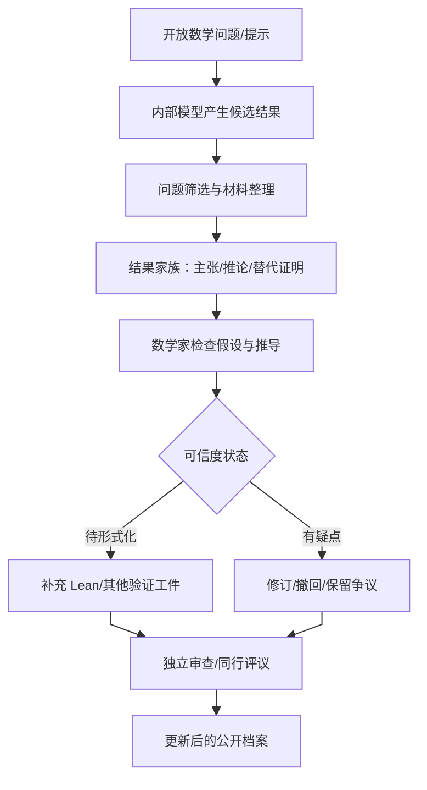
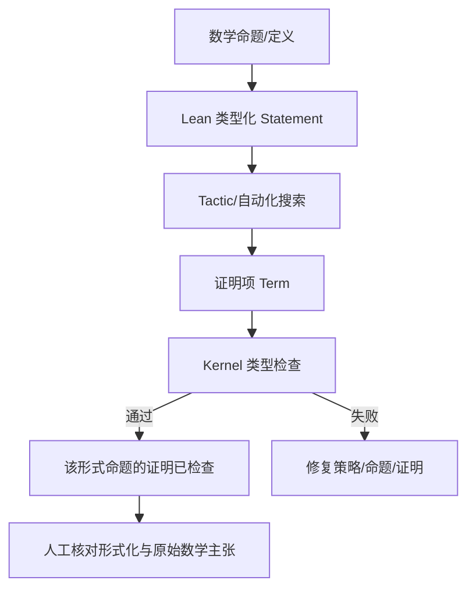
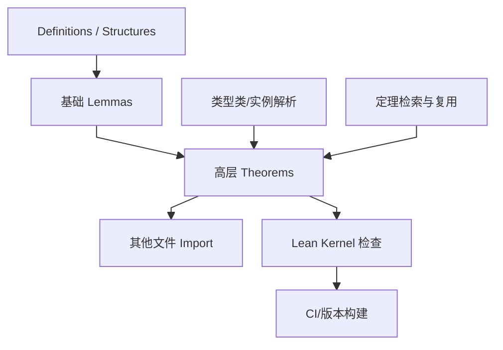
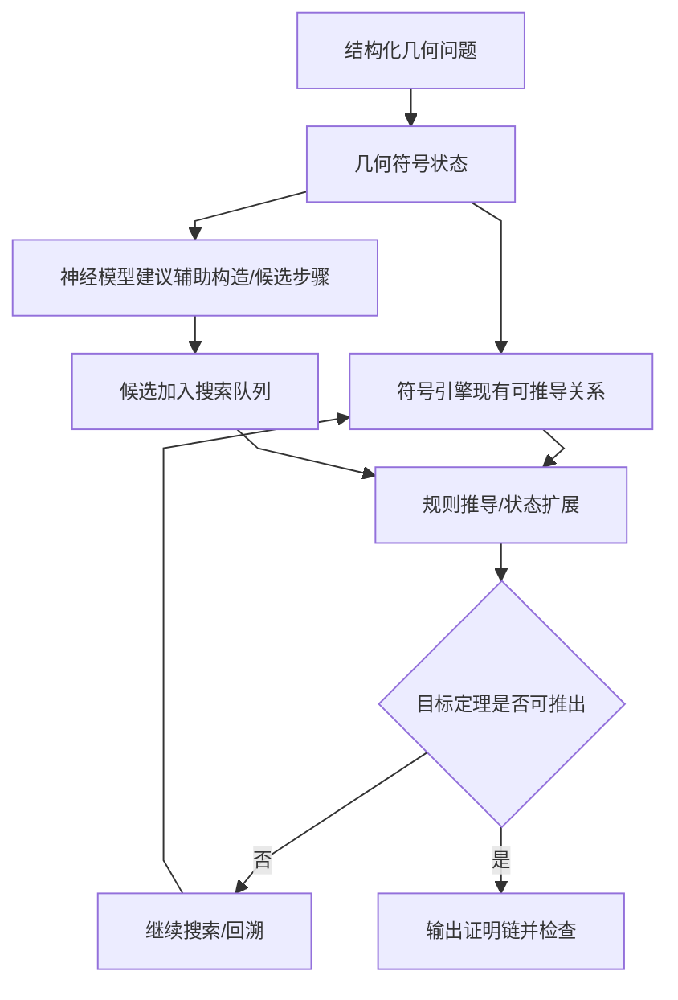
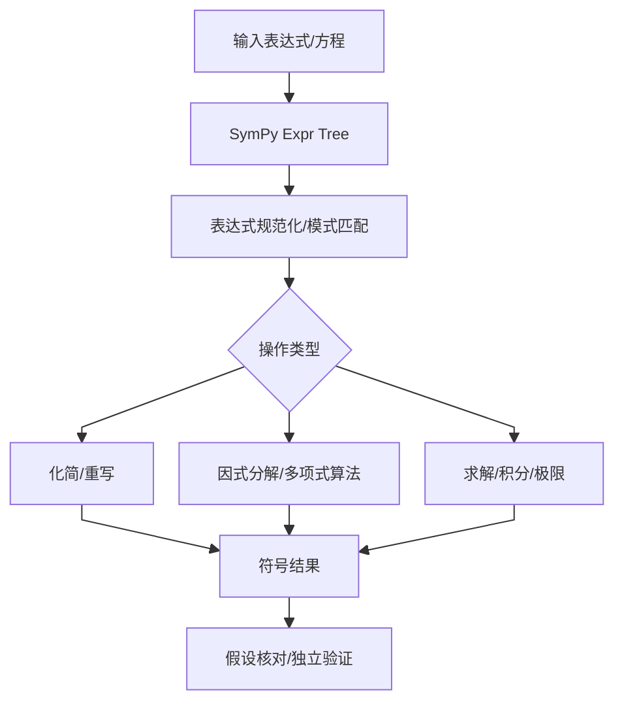
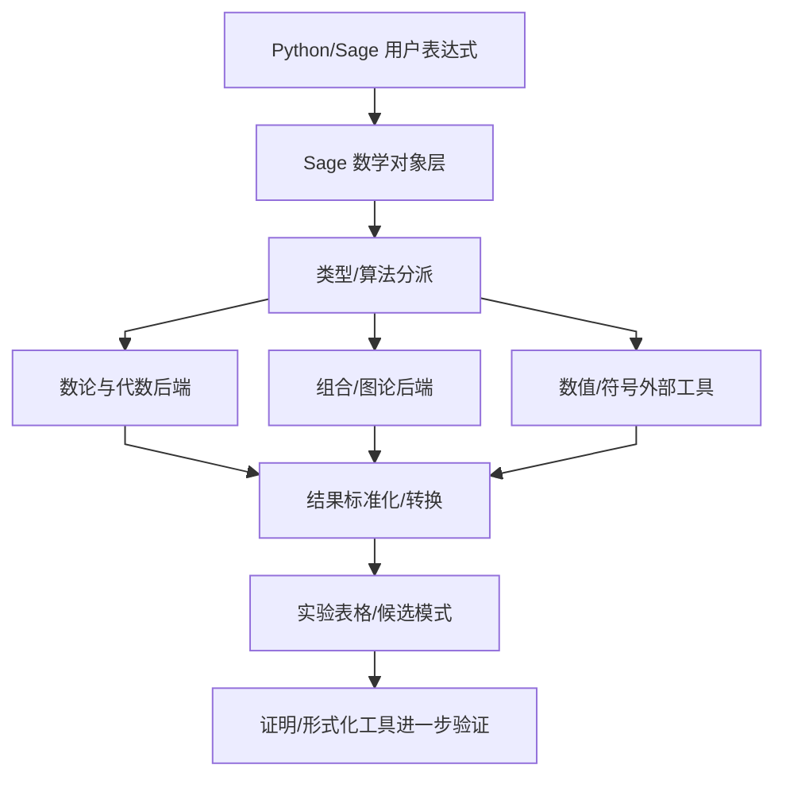
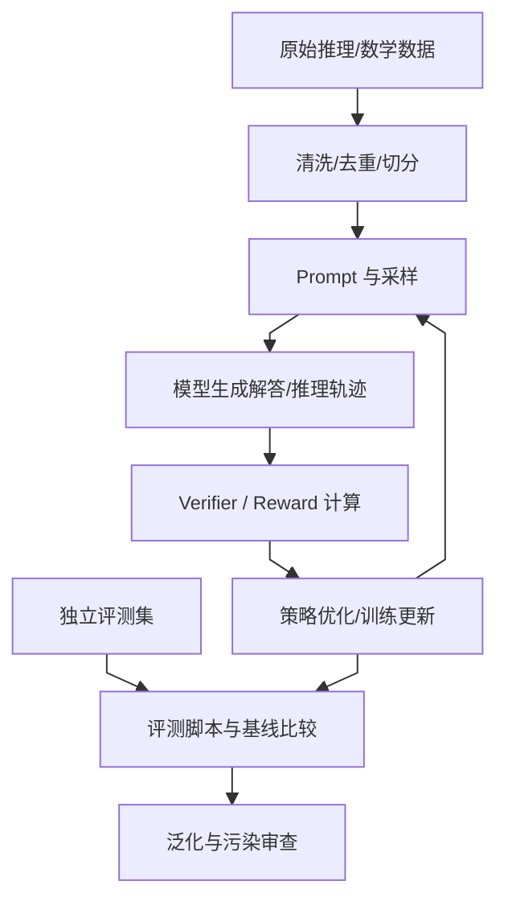
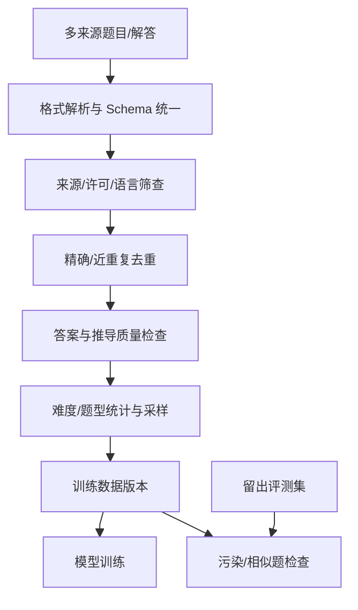
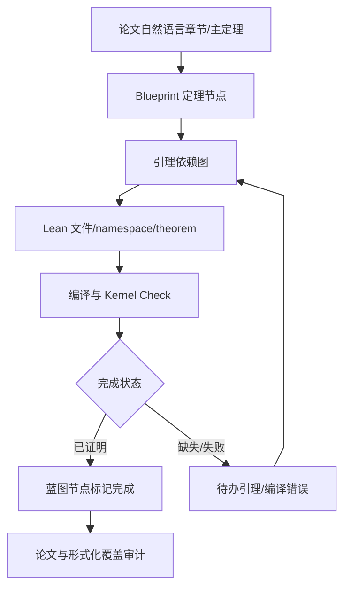
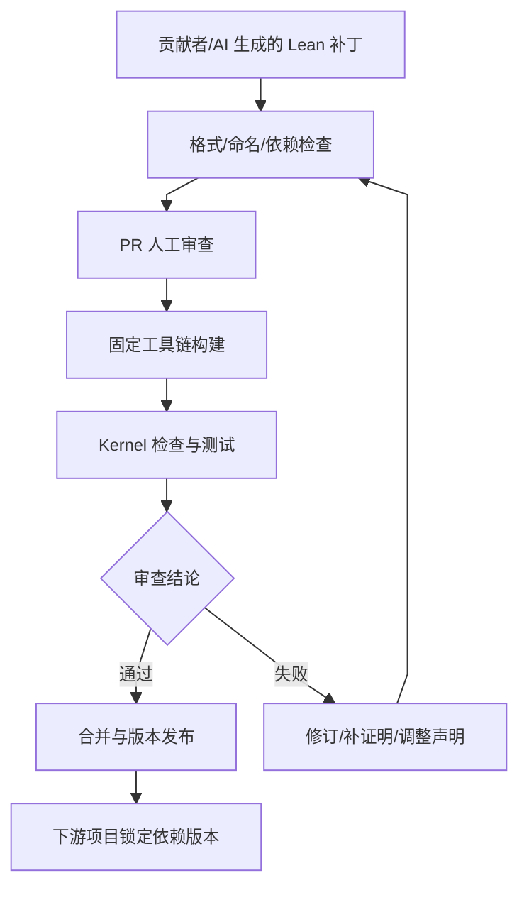

# 方向报告 05｜AI 与数学研究：候选发现、证明工件与形式化可信边界

**周期：** 2026-10-05—2026-10-11

## 本期焦点：OpenAI/math 与研究工件化

[OpenAI 在 10 月 6 日的发布说明](https://openai.com/index/sharing-ai-progress-in-mathematics/)公开了由内部前沿模型产出的数学手稿和支持性证明材料；发布时目录为 **722 篇手稿、372 个结果家族**。项目方称，工作流从约 4,000 个开放问题开始并筛选整理模型输出；其报告的平均计算量约为每项结果 3 小时 ChatGPT Pro thinking compute，这些数字均是项目方披露，不是独立算力审计。**10 月 7 日官方修订历史记载撤回 3 篇稿件、修订另外 14 篇，并更新 13 篇相关引用；同一历史页面记载主结果形式化覆盖为 300/719（约 42%）。** 当前 README 仍显示 722，故公开材料存在更新时间/统计口径不一致：本报告将 722 视为初始发布目录，将 719 视为撤回后历史页采用的分母。目录数量无论如何都不能直接等同于已被数学共同体确认的新定理。

公开目录列出的具体研究主题包括**准黎曼假设（Quasi-Riemann Hypothesis）**、**Hilbert 第十问题在有理数域上的版本**、**Unique Games 猜想与近似阈值**、**Seymour 第二邻域猜想**，以及 Kaplansky 特征二直接有限性猜想、Mahler 猜想的相关形式等。它们触及数论、可计算性、组合优化与代数等不同分支，而非单纯提升竞赛题得分。需要强调：仓库给出的是研究主张、手稿和证明材料，并不是本报告独立验证后的结论。官方记录显示，并非每项结果都已完成 [Lean 形式化](https://www.google.com/search?q=Lean%20%E5%BD%A2%E5%BC%8F%E5%8C%96%20%E6%8A%80%E6%9C%AF%E5%8E%9F%E7%90%86%20%E8%A7%A3%E9%87%8A "Lean：基于依赖类型理论的证明助手，可由内核检查形式化证明")，历史中也出现过因符号错误影响论证而撤回、修订的手稿。**正确性必须逐项核查假设、推导、文献优先权、独立复现和形式化覆盖率**。[结果概览](https://github.com/openai/math/blob/main/overview.tex) · [修订历史](https://github.com/openai/math/blob/main/history.md)

这可能改变数学研究流程：当模型能批量产生候选证明和关联线索，研究者的时间可能从从零草拟转向筛选、查错、校对假设和建立可信证明。它的潜在冲击不是“模型替代数学家”这么简单，而是**候选生成成本下降之后，验证和品控可能成为新的瓶颈**。但只有经过独立审查、可靠形式化或同行评议的结果，才能逐渐进入稳定数学知识体系。

## 10 个项目/研究入口精读

### 1. [OpenAI/math](https://github.com/openai/math) — 把 AI 产出的数学主张组织为可修订档案

**技术分析**

传统数学论文通常以整理后的证明和叙述为主，研究者难以观察一次大规模 AI 探索中产生了哪些候选结果、相关推论或替代论证。**OpenAI/math 将手稿按[结果家族](https://www.google.com/search?q=%E7%BB%93%E6%9E%9C%E5%AE%B6%E6%97%8F%20%E6%8A%80%E6%9C%AF%E5%8E%9F%E7%90%86%20%E8%A7%A3%E9%87%8A "结果家族：同一主张及关联推论、替代证明或补充材料")组织，并保留可更新的材料与历史记录，使研究者能从一个主张追踪到相关证明与修订。**其研究流程可理解为：模型对问题提出候选结果与论证草稿，筛选/整理形成结果家族，再由数学家检查定义、隐含假设、关键引理和已有文献。需要特别区分**生成和归档机制**与**数学正确性**：目录能展示研究产量，不能证明每份手稿正确、原创或达到同行审查标准。**最有效的阅读单位不是整份目录，而是一个具体结果：先把主定理写成精确命题，再核对每条假设、引用、引理依赖和证明中未展开的步骤；之后检查是否有形式化工件及历史修订。**10 月 7 日的撤回/修订记录展示了错误如何沿依赖传播：一个符号错误不仅影响单篇手稿，也可能迫使依赖它的相关论文一起撤回。**在这类规模化研究流程中，结果依赖图、版本历史和形式化补充不是发布后的装饰，而是控制错误传播的必要组成。**

**项目结构图**

**技术判断与边界：** OpenAI/math 的价值在于公开组织模型提出的候选数学主张、手稿与修订历史，使外部研究者能检查结果家族而不是只看摘要；目录规模并不等于已确认定理，证据状态必须逐项区分，且修订/撤回本身也应纳入对系统可靠性的判断。

### 2. [Lean 4](https://github.com/leanprover/lean4) — 让证明对象经过可信内核检查

**技术分析**

自然语言证明可能省略中间推导，审阅者需凭数学训练判断是否存在漏洞。**Lean 把命题编码为类型，把证明编码成满足该类型的项；tactic 可以自动化构造[证明项](https://www.google.com/search?q=%E8%AF%81%E6%98%8E%E9%A1%B9%20%E6%8A%80%E6%9C%AF%E5%8E%9F%E7%90%86%20%E8%A7%A3%E9%87%8A "证明项：在形式系统中对应命题类型的证明对象")，但最终要由内核按形式规则检查。** **搜索器或语言模型可以复杂甚至不完全可信，内核检查是缩小信任边界的关键**。不过，内核只能判断形式化后的命题是否被证明，不能保证形式化命题准确表达研究者原本想说的数学结论；错误定义、错误假设或不恰当的建模仍可能产生“形式上正确、数学上答非所问”的证明。**因此读 AI 生成的 Lean 结果时，要先审 statement 的量词、域、边界条件和隐含类型类假设，再看 theorem 的证明项是否真正闭合、是否留下未完成占位。** **内核通过是强证据，但仍需把形式化陈述与自然语言主张对应起来，并检查依赖库的公理与假设。**

**项目结构图**

**技术判断与边界：** Lean 的可信边界是内核对形式化证明项做规则检查；它能压缩证明检查所需的信任，但无法自动保证 statement 忠实表达原始数学主张、定义无误或结果原创，形式化映射仍需要数学审查。

### 3. [Mathlib](https://github.com/leanprover-community/mathlib4) — 把可复用数学知识变成形式化依赖图

**技术分析**

形式化一道复杂定理的成本不仅来自最后几行证明，还来自先前定义、局部引理、代数结构和数论/分析基础必须先编码。**Mathlib 通过社区积累的定义、定理和证明，把这些知识变成可 import、可类型检查的依赖库。**它让研究者把工作建立在已有 lemma 上，也为自动化证明提供可检索的形式化知识；另一方面，库的命名空间、[类型类](https://www.google.com/search?q=%E7%B1%BB%E5%9E%8B%E7%B1%BB%20%E6%8A%80%E6%9C%AF%E5%8E%9F%E7%90%86%20%E8%A7%A3%E9%87%8A "类型类：在 Lean 中表达需满足的结构/实例约束，影响定理适用条件")实例和依赖版本会显著影响证明脚本。**对自动证明而言，知识库不是普通全文搜索：一个定理是否可用取决于其准确类型、参数、隐含实例和当前 import 环境。**数学家应检查所引用定理是否真正满足需要，而不能只因名字相似就认为适用。大型形式化项目还需留意 build 时间、依赖变更和 API 稳定性。**Mathlib 降低重复形式化成本，但不会替代对问题建模与命题正确性的判断**；基础库越成熟，验证流程越可扩展，也越需要良好的依赖管理。

**项目结构图**

**技术判断与边界：** Mathlib 以可复用的定义、实例和定理降低形式化的重复劳动，同时把知识表示为有类型与版本的依赖图；复用定理时必须核对完整签名与假设，库的丰富程度不等于自动证明研究问题的能力。

### 4. [AlphaGeometry](https://github.com/google-deepmind/alphageometry) — 神经候选扩展与符号几何推理

**技术分析**

几何证明包含大量辅助点和中间关系，纯符号搜索可能在组合爆炸中耗费大量时间；单纯神经网络生成步骤又难保证几何约束与推理规则正确。**AlphaGeometry 采用神经语言模型提出辅助构造/候选步骤，再把候选送入[符号推理系统](https://www.google.com/search?q=%E7%AC%A6%E5%8F%B7%E6%8E%A8%E7%90%86%E7%B3%BB%E7%BB%9F%20%E6%8A%80%E6%9C%AF%E5%8E%9F%E7%90%86%20%E8%A7%A3%E9%87%8A "符号推理系统：按明确规则推导关系，可检查候选步骤")检查和扩展，利用两种方法互补：模型扩大搜索方向，符号系统负责满足形式规则。**它不是直接从像素中理解任意几何图，而是在结构化几何表示和给定规则体系中搜索证明路径，因此结论适用范围受表示语言、可用构造和数据分布限制。**阅读时应区分模型提供的启发式优先级与符号引擎确认的推理步骤，理解搜索何时分支、何时剪枝，以及停止条件如何定义。**其代表性意义是展示**神经方法可负责提出候选，确定性推理器负责约束验证**，但不等于证明了同样架构能直接推广到所有数学分支。

**项目结构图**

**技术判断与边界：** AlphaGeometry 展示神经候选生成与符号几何推理的互补：模型提供搜索方向，符号系统按形式规则推进并检查；这类系统的外推边界由几何表示、构造规则和搜索预算决定，不能据此断言通用数学研究已被解决。

### 5. [SymPy](https://github.com/sympy/sympy) — 精确符号表示与代数运算

**技术分析**

数学探索经常需要化简表达式、分解多项式、求解方程或检查特例。**使用浮点数可能引入舍入误差，也可能掩盖表达式结构；SymPy 将数学对象表示成[表达式树](https://www.google.com/search?q=%E8%A1%A8%E8%BE%BE%E5%BC%8F%E6%A0%91%20%E6%8A%80%E6%9C%AF%E5%8E%9F%E7%90%86%20%E8%A7%A3%E9%87%8A "表达式树：以节点结构表示数学表达式，便于精确重写")，在其上运行重写规则和特定符号算法。**表达式树让运算的结构可追踪，但不同形式的表达式未必都能通过通用 simplify 得到唯一“最简”结果；某些积分或方程也不存在简单闭式解。因此要区分精确符号变换、数值近似和启发式化简，明确算法的适用域及返回结果的条件。**SymPy 可用于生成猜想线索、检查低维特例和构造反例候选，却不能因为有限个样例成立就证明一般命题。**尤其是除法、根式、分支切割和参数约束，默认假设可能影响等价变换。读源码时应从表达式节点进入具体算法模块，追踪分支条件并以独立恒等式或数值检查验证输出。

**项目结构图**

**技术判断与边界：** SymPy 通过表达式树和符号算法支持精确代数操作，但 simplify 等通用接口并不保证找到唯一全局最简形式；定义域、参数假设、分支和算法前提会影响等价性，符号输出必须在相应条件下解读。

### 6. [SageMath](https://github.com/sagemath/sage) — 将多个数学计算系统组合成实验平台

**技术分析**

研究者常需在数论、代数、组合和几何等领域切换不同的成熟系统；分别安装、调用并交换数据会增加环境和接口成本。**SageMath 通过统一的 Python 环境和对象层连接多个数学库/工具，让同一实验能组合[精确代数计算](https://www.google.com/search?q=%E7%B2%BE%E7%A1%AE%E4%BB%A3%E6%95%B0%E8%AE%A1%E7%AE%97%20%E6%8A%80%E6%9C%AF%E5%8E%9F%E7%90%86%20%E8%A7%A3%E9%87%8A "精确代数计算：以符号/精确对象运算，区别于近似浮点计算")、数值计算与专门算法。**这个集成层的意义是减少脚手架成本，而不是让所有底层工具拥有相同语义或可信等级：某些操作精确计算，另一些依赖浮点近似；外部软件还可能具有不同许可、编译或版本要求。**计算实验适合发现规律、检验有限参数范围和寻找反例，但“对大量样例算出来都成立”仍不等于普遍定理。**阅读时要追踪某个 Sage 对象究竟调用哪一个后端，确认数据类型、精度和算法默认值，再决定结果能支持哪一级主张。对于 AI 辅助数学，SageMath 更适合充当探索和计算验证层，而非自动提供形式化证明的替代品。

**项目结构图**

**技术判断与边界：** SageMath 将多个数学后端连接到统一的 Python 对象层，降低组合不同数学工具的工程成本；统一入口并不意味着后端语义和可信等级统一，精确计算、浮点近似与有限范围枚举需要明确区分。

### 7. [Open-R1](https://github.com/huggingface/open-r1) — 开放推理模型的训练与评测管线

**技术分析**

**推理模型性能不仅由基础模型决定，也依赖问题分布、答案[验证器](https://www.google.com/search?q=%E9%AA%8C%E8%AF%81%E5%99%A8%20%E6%8A%80%E6%9C%AF%E5%8E%9F%E7%90%86%20%E8%A7%A3%E9%87%8A "验证器：按规则检查答案/证明/输出，能力受其支持范围限制")、奖励设计、采样温度和训练预算。** **Open-R1 的工程价值在于将数学/推理数据、训练配置、评测及可复现脚本开放出来，便于研究者检查从样本到优化目标的流程。**若采用可验证奖励，正确答案或工具检查结果可作为监督信号，但验证器覆盖不到的解法、格式变化和多答案等情况会带来奖励偏差。若评测题目泄漏进训练集，benchmark 分数也可能高估泛化。阅读时应从数据过滤和去重一路追到 reward 计算、采样策略、优化器配置与评测调用，核对生成结果如何转换为 reward，以及训练与测试是否真正隔离。**数学推理任务分数提高不等价于模型已发现新数学定理**；要评价研究能力，还需考察新问题、长证明、反例构造、证明检验和专业审查表现。

**项目结构图**

**技术判断与边界：** Open-R1 的训练/评测管线可以帮助研究者分析数据、采样、奖励和优化预算如何影响推理表现；verifier 的覆盖不足会形成奖励偏差，benchmark 提分也不等同于发现开放问题或形成可靠的新证明。

### 8. [Numina](https://github.com/project-numina/numina) — 数学问题与推理轨迹的数据资源

**技术分析**

**数学模型训练的数据质量不仅取决于题目数量，还取决于来源、解答正确性、推导完整度、难度分布、授权情况和与评测集的重合。** **Numina 提供数学推理相关数据资源和使用入口，其价值是让训练管线能以统一 schema 消费题目与解答，再进行清洗、混合、采样和训练。**但大规模数据集中常有重复题、不同表达的近重复题、错误解答、无效格式或超出许可范围的材料。若只统计总行数，无法判断数据的真实有效覆盖；随机切分还可能把相同题目的改写分配到训练与测试两边。应构建数据审计：检查题源与许可证、解析失败率、[去重](https://www.google.com/search?q=%E5%8E%BB%E9%87%8D%20%E6%8A%80%E6%9C%AF%E5%8E%9F%E7%90%86%20%E8%A7%A3%E9%87%8A "去重：识别相同和近重复样本，防止切分泄漏与虚高指标")粒度、答案一致性和难度分布，并把数据版本与模型 checkpoint 关联。数据集可扩大模型接触的题型，但其本身不证明模型掌握了数学概念，更不证明推导可被验证。

**项目结构图**

**技术判断与边界：** Numina 的价值取决于样本来源、正确性、难度分布、去重和许可质量，而不只在数据行数；近重复题泄漏可能虚高测试分数，因此数据审计和训练/测试隔离是研究结论可信度的前提。

### 9. [LeanProject](https://github.com/leanprover-community/LeanProject) — 用 Blueprint 维护论文与形式化代码的映射

**技术分析**

**大型形式化工作常涉及数百个定义、引理和主定理；如果代码中的 theorem 与自然语言论文段落没有稳定映射，团队很难知道哪些论证已完成、哪些依赖仍缺失。** **LeanProject/Blueprint 这类工具把论文结构、定理节点、[依赖关系](https://www.google.com/search?q=%E4%BE%9D%E8%B5%96%E5%85%B3%E7%B3%BB%20%E6%8A%80%E6%9C%AF%E5%8E%9F%E7%90%86%20%E8%A7%A3%E9%87%8A "依赖关系：主定理、引理和定义之间的结构化依赖链")和 Lean 代码位置联系起来，形成可导航的证明工程图。**它主要改善项目管理、可追溯性和协作，并不自动证明蓝图里的每条陈述；只有实际形式化的 statement 与证明通过内核检查，才构成相应形式证据。维护者仍需保证自然语言段落、图节点和代码中的命题一致，且依赖图在代码重构后更新。对于 AI 生成的长证明，蓝图可帮助把主结论拆成可检查子目标，追踪哪些引理由机器证明、哪些仍待人工填充。要阅读时应选一篇示例论文，从主定理沿依赖图下钻，并核实每个节点的 Lean 源码和构建状态。

**项目结构图**

**技术判断与边界：** LeanProject/Blueprint 将论文主张、定理节点、依赖图和 Lean 源码关联起来，能显示形式化覆盖缺口；蓝图只是管理映射，真正的证明证据来自相应 theorem 的实际代码与内核检查。

### 10. [Lean Community](https://github.com/leanprover-community) — 将形式化证明纳入可审查的软件协作

**技术分析**

**大规模形式化数学库不能只靠个人脚本维护：依赖升级可能让证明失效，命名风格会影响搜索，未完成证明和隐含公理也可能影响可信度。**Lean community 是多个社区形式化项目的协作入口，而不是单一算法仓库；它展示的工程机制包括贡献指南、代码审查、固定工具链、自动构建和依赖版本管理。AI 生成的证明若想变成可维护的公共知识，必须遵守同样的标准：代码可读、依赖可追踪、构建可复现、证明无未完成占位，并且命题与论文主张一致。**[CI](https://www.google.com/search?q=CI%20%E6%8A%80%E6%9C%AF%E5%8E%9F%E7%90%86%20%E8%A7%A3%E9%87%8A "CI：持续集成，自动运行构建、测试与证明检查") 通过只能说明在当前固定环境中代码通过检查，不能保证数学陈述的建模没有错误，也不能证明原创性或优先权。**社区审查和版本控制是长期可信度的补充层。阅读时不要只看组织页，要进入具体项目的贡献规范与 PR，观察修改如何经过编译、审查和依赖升级。

**项目结构图**

**技术判断与边界：** Lean Community 体现形式化数学作为长期软件工程的协作要求：固定工具链、代码审查、CI 和依赖管理有助于维持证明可构建性；代码合并或 CI 通过仍不同于数学共同体认可主张的正确性与原创性。

## 方法论沉淀

- 将**模型提出主张、自然语言证明审查、形式化 statement、内核检查、独立复现和同行评议**视为不同证据状态。
- 检查假设是否完整、引用是否正确、未证明引理是否被隐藏，以及形式化命题是否覆盖主结论。
- 记录撤回与修订。对 AI 数学系统而言，发现错误后能定位、修正和防止复发，是可靠研究流程的重要组成。
- 核心术语见[AI 数学与形式化验证词典](https://www.google.com/search?q=AI%20%E6%95%B0%E5%AD%A6%E4%B8%8E%E5%BD%A2%E5%BC%8F%E5%8C%96%E9%AA%8C%E8%AF%81%E8%AF%8D%E5%85%B8%20%E6%8A%80%E6%9C%AF%E5%8E%9F%E7%90%86%20%E8%A7%A3%E9%87%8A "解释 Lean、形式化证明、证明内核、猜想和证明工件")；跨领域证据口径见[研究证据词典](https://www.google.com/search?q=%E7%A0%94%E7%A9%B6%E8%AF%81%E6%8D%AE%E8%AF%8D%E5%85%B8%20%E6%8A%80%E6%9C%AF%E5%8E%9F%E7%90%86%20%E8%A7%A3%E9%87%8A "解释复现、消融、证据等级与基准污染")。
