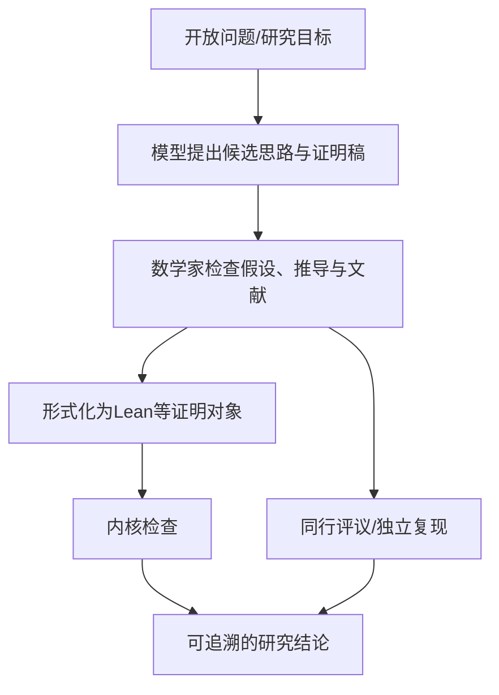

# 方向报告 05｜AI 与数学研究

**周期：** 2026-10-05—2026-10-11  
**核心判断：** AI 数学的重要变化，是模型开始批量参与开放问题探索并交付可供审查的研究材料；潜在影响很大，但必须区分论文主张、同行审查和形式化验证。

## 本期焦点：OpenAI/math

[OpenAI/math 官方仓库](https://github.com/openai/math) 说明，这是一组由 OpenAI 内部模型生成的数学手稿和支持性证明工件。README 当前列出 **722 篇手稿、372 个结果家族**；每个家族可包含主结果、相关论证、推论或替代证明。项目方称模型被用于约 4,000 个问题，绝大多数结果采用同一套内部模型流程，平均每个结果使用约 3 小时 ChatGPT Pro thinking compute。该数字来自项目方说明，不是独立算力审计。

这不是简单的“AI 解数学题”数据集，而是把 AI 研究产出作为可浏览、可修订的研究档案公开。例子包括：

- **准黎曼假设（Quasi-Riemann Hypothesis）**：仓库将其描述为关于 Dirichlet L 函数零点区域的结果，给出 Re(s)>7/8 的零点自由半平面，并列出相关替代证明材料。
- **Hilbert 第十问题在有理数域上的版本**：材料声称不存在通用算法，能够判定任意多变量整系数多项式是否有有理数解。
- **Unique Games 猜想及近似阈值**：仓库列出证明 Unique Games 猜想的材料，以及 Max-Cut 等问题的近似困难性结果。
- **Seymour 第二邻域猜想**：材料声称对每个非空有限有向图，都存在一个顶点，其距离恰为二的邻居数不少于距离为一的邻居数。
- **Kaplansky 特征二直接有限性猜想**、**Mahler 猜想的相关形式**、**三维相对论 Vlasov–Maxwell 系统**等，也列入公开的推理摘要或结果目录。

这些名称是原文索引，不是本报告替代数学审查后的结论。官方仓库明确表示，并非所有结果都已有 Lean 形式化；未形式化结果可能存在问题。历史记录也显示，部分手稿在发现符号错误影响推导后被撤回，另有手稿被修订。研究发布的意义与错误风险同时存在。[官方 README](https://github.com/openai/math) · [结果概览](https://github.com/openai/math/blob/main/overview.tex) · [修订历史](https://github.com/openai/math/blob/main/history.md)

**为什么这件事可能冲击数学研究：** 找切入点、搜索引理、连接相邻领域、验证长证明和整理成文都很耗时。如果模型能批量提出有价值的候选结果，研究者的稀缺时间可能从“从零探索”转向“筛选问题、审查论证、确认假设和建立可信证明”。潜在影响不只在速度，也在研究分工和成果归属。不过，722 篇稿件不等于 722 个已被数学共同体确认的新定理；形式化覆盖、独立复现、文献优先权和同行评议才决定最终学术地位。

## 10 个项目/研究入口精读

### 1. [openai/math](https://github.com/openai/math) — AI 生成数学研究材料的公开档案
**背景与方法：** 在既有数学评测趋于饱和后，OpenAI 将评估扩展到开放研究问题，由内部模型生成手稿与证明支持材料，再按结果家族整理公开。  
**解决的问题：** 让研究者查看模型针对开放问题提出的候选结果，而不只看到 benchmark 分数。  
**关键证据与影响：** 目录规模、问题类型和可修订材料本身说明研究工作流正在变化；正确性仍需逐项核验。  
**项目阅读路线：** README 了解流程 → 在 overview.tex 选定一个结果家族 → 读论文的假设与主定理 → 检查证明工件/Lean 目录 → 对照 history.md 查看修订和撤回。

### 2. [Lean 4](https://github.com/leanprover/lean4) — 可机器检查的证明语言与内核
**背景与方法：** 自然语言证明容易隐藏省略步骤；形式化把命题和证明编码为类型理论中的对象。  
**解决的问题：** 让证明的形式正确性可由内核检查，减少对“看起来合理”的依赖。  
**影响判断：** AI 生成候选证明与 Lean 检查结合，有机会降低验证成本；仍需确认形式化命题对应原始数学陈述。  
**项目阅读路线：** 从命题逻辑和简单定理开始 → 追踪 tactic 生成的证明项 → 查看 kernel 检查边界 → 读内核相关测试。

### 3. [Mathlib](https://github.com/leanprover-community/mathlib4) — 可复用的形式化数学库
**背景与方法：** 形式化数学若每次从基础定义开始，成本过高；Mathlib 以社区协作积累定义、定理和证明。  
**解决的问题：** 让研究者组合已有 lemma，减少重复形式化，并为自动证明提供可检索知识底座。  
**影响判断：** 数学知识库越丰富，AI 越可能把时间用于新推导而非重建基础；维护和版本兼容也随之重要。  
**项目阅读路线：** 搜索目标定理 → 看命名空间和类型类 → 追踪 import 依赖 → 阅读 CI 和贡献规范。

### 4. [AlphaGeometry](https://github.com/google-deepmind/alphageometry) — 神经候选生成与符号几何推理
**背景与方法：** 几何证明搜索空间庞大，纯符号搜索可能低效，纯神经生成又可能给出不可靠步骤。  
**解决的问题：** 结合神经模型提出候选步骤与符号推理器验证，解决一类几何证明题。  
**影响判断：** 它展示了“神经搜索 + 符号约束”的有效分工，但几何专用系统不等于通用数学研究员。  
**项目阅读路线：** 读论文流程图 → 查看几何表示 → 跟踪候选构造如何进入符号引擎 → 对照公开题目和失败案例。

### 5. [SymPy](https://github.com/sympy/sympy) — 符号计算与代数变换
**背景与方法：** 数学探索需要精确操作表达式、方程、极限和积分，浮点近似可能掩盖结构。  
**解决的问题：** 提供可编程符号表示和算法，帮助探索猜想、检查特殊情况与构造反例候选。  
**影响判断：** 符号工具能加快探索，但计算结果不是一般命题的证明。  
**项目阅读路线：** 从表达式树进入 → 选择 simplify/factor 或求解模块 → 看算法与测试 → 用独立代入或理论结果验证输出。

### 6. [SageMath](https://github.com/sagemath/sage) — 统一的数学实验环境
**背景与方法：** 数论、代数、组合与几何常依赖不同的数学库，研究脚本很难跨工具复用。  
**解决的问题：** 把多个数学计算系统组织成统一环境，支持快速实验和计算验证。  
**影响判断：** AI 可借助计算系统探索模式与反例，但“有限范围内未发现反例”不等于定理成立。  
**项目阅读路线：** 选一个数论/代数问题 → 跑最小脚本 → 查看底层算法 → 记录精确/浮点边界 → 设计理论验证。

### 7. [Open-R1](https://github.com/huggingface/open-r1) — 开放推理模型训练与评测流程
**背景与方法：** 推理模型能力与数据、奖励、采样和评测设置强相关。  
**解决的问题：** 提供开放训练/评测工作流，帮助研究者理解模型如何在数学与推理任务上优化。  
**影响判断：** 开放流程有助于复现研究，但数学 benchmark 分数不等于新定理发现能力。  
**项目阅读路线：** 先跑评测 → 追踪数据清洗与去重 → 查看 reward/verifier → 核对训练预算与基线 → 检查数据污染风险。

### 8. [Numina](https://github.com/project-numina/numina) — 数学推理数据资源
**背景与方法：** 训练数学模型需要大量题目与解答，但数据质量、许可和测试集泄漏会显著影响结果。  
**解决的问题：** 提供数学问题/推理相关数据资源与处理入口。  
**影响判断：** 数据集会影响研究结论能否泛化；题目数量不能替代难度分布、解答质量和来源审计。  
**项目阅读路线：** 查看来源和许可 → 检查 schema 与解答格式 → 做去重/难度统计 → 验证答案 → 核查训练集与测试集隔离。

### 9. [LeanProject](https://github.com/leanprover-community/LeanProject) — 将论文结构映射到形式化任务
**背景与方法：** 大型数学形式化工程不仅要写证明，还要管理定义、定理依赖、未完成部分和论文对应关系。  
**解决的问题：** 通过 blueprint 等工具组织项目结构与证明进度。  
**影响判断：** 研究团队可以把形式化从个人脚本变成协作工程，但蓝图本身不是证明。  
**项目阅读路线：** 查看 blueprint 示例 → 对照自然语言命题与 Lean statement → 追踪依赖图 → 检查 CI 如何发现未完成证明。

### 10. [Lean community](https://github.com/leanprover-community) — 社区协作与形式化生态
**背景与方法：** 单个研究者难以维护大型数学库，贡献规范、代码审查和自动构建成为基础设施。  
**解决的问题：** 提供 Mathlib 及多个形式化项目的协作生态和工程实践。  
**影响判断：** AI 生成证明若要进入长期知识体系，必须适应版本、审查、命名和可维护性规范。  
**项目阅读路线：** 从具体仓库的贡献指南 → 选一个简单 theorem → 追踪 review 与 CI → 观察依赖和版本升级。说明：这是社区组织入口，不是单一代码仓库。

## 结构图：AI 数学研究的证据链

## 方法论沉淀

1. 把“模型提出证明”“数学家审查”“Lean 形式化通过内核检查”“同行评议接受”分成不同状态。
2. 检查假设是否完整、引用是否正确、证明是否依赖未证明引理、形式化是否覆盖主结论。
3. 关注撤回和修订记录。公开更正是观察系统能否建立可信研究流程的重要证据。
4. AI 可能显著改变数学家的问题筛选、证明草拟和文献连接工作，但对学术冲击的判断要等待独立审查与长期采用证据。

词条见[AI 数学词典](../../glossary/math.md)。最新目录与版本状态以 [OpenAI/math 官方仓库](https://github.com/openai/math) 为准。
