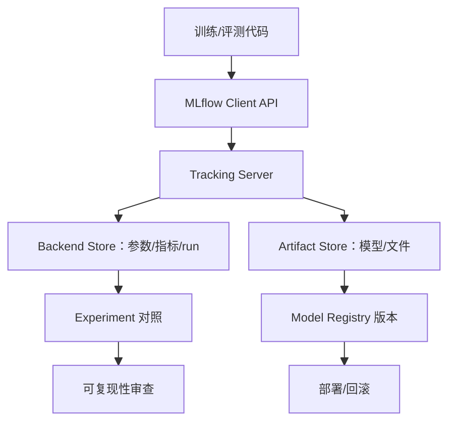
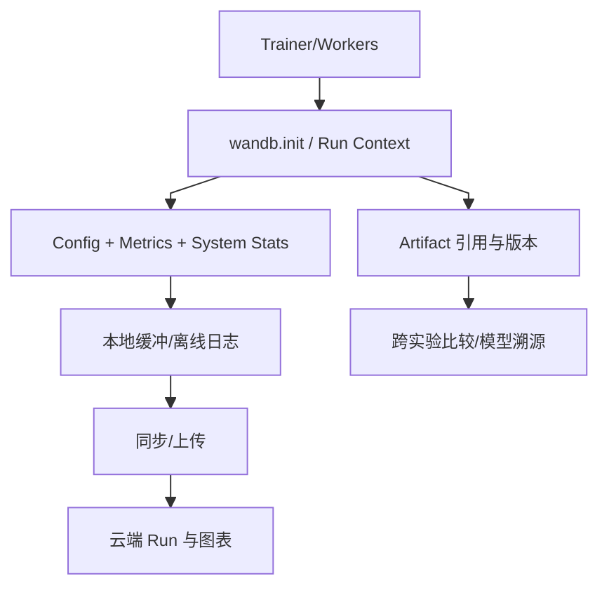
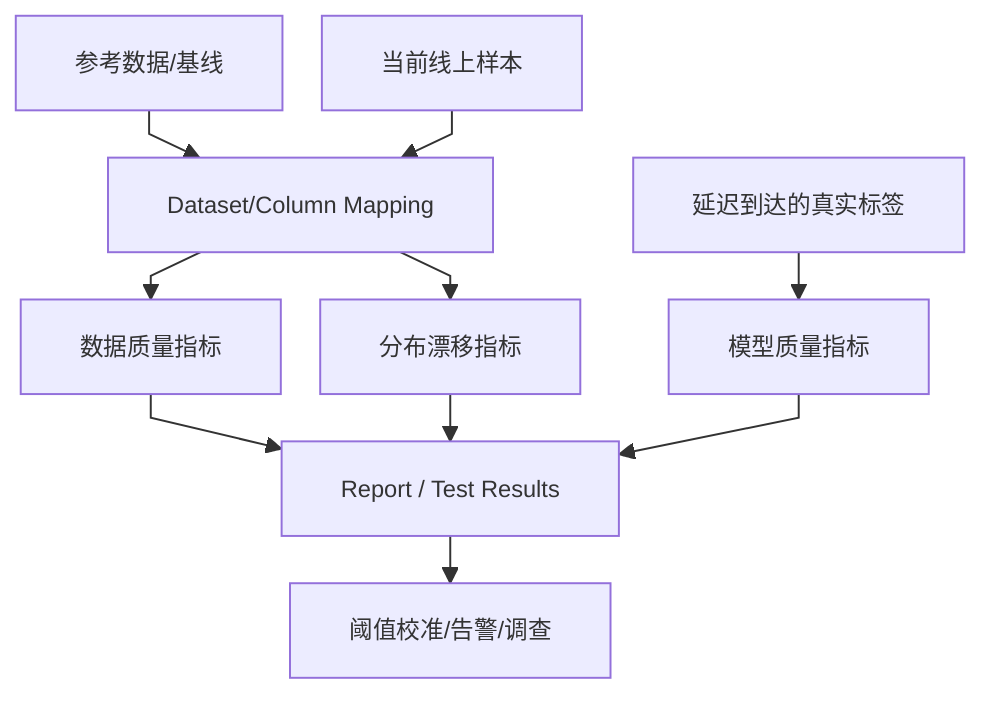
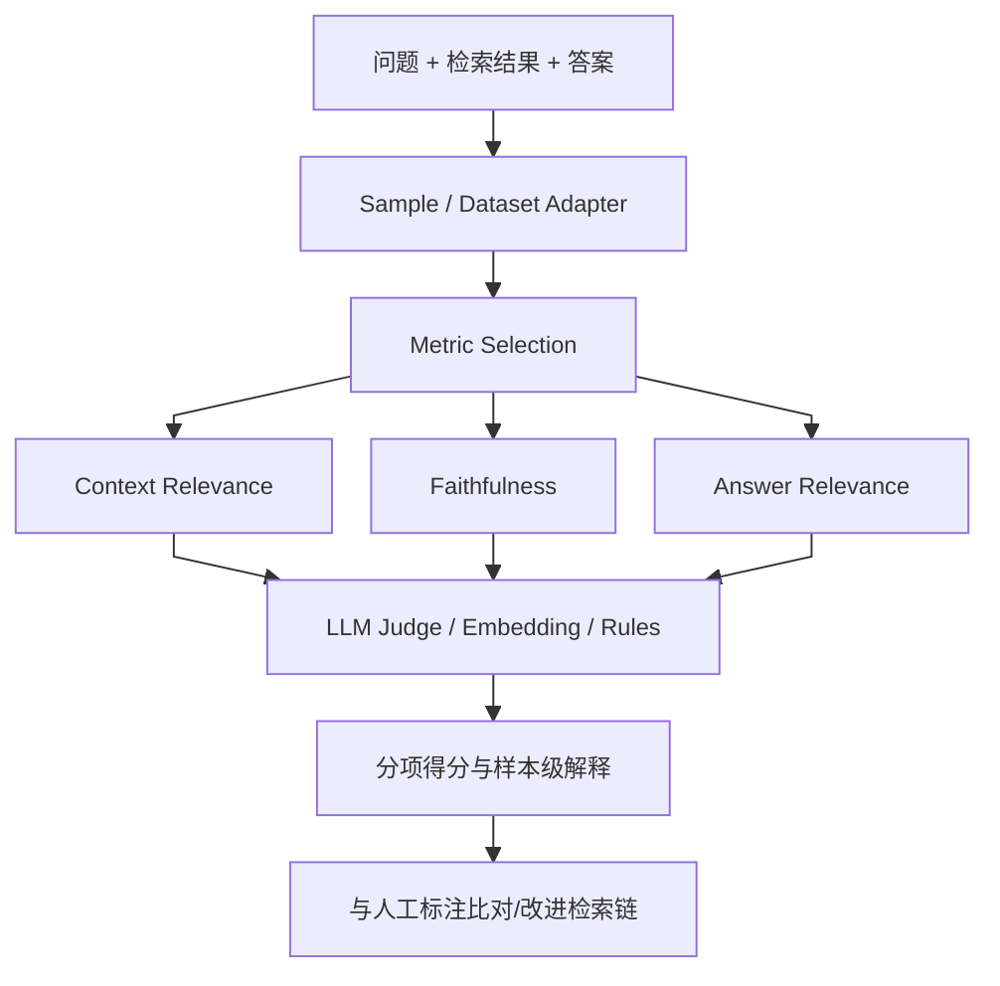
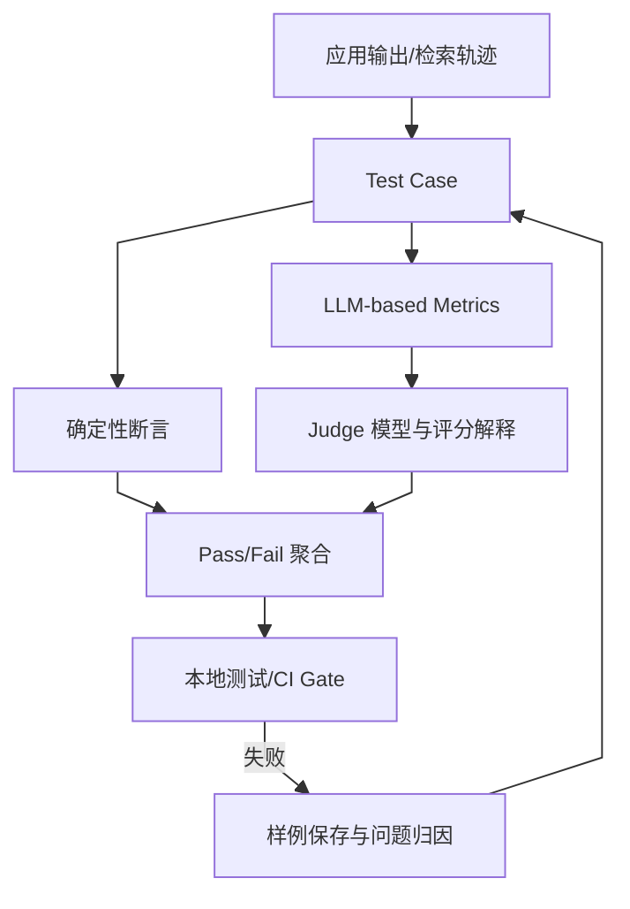
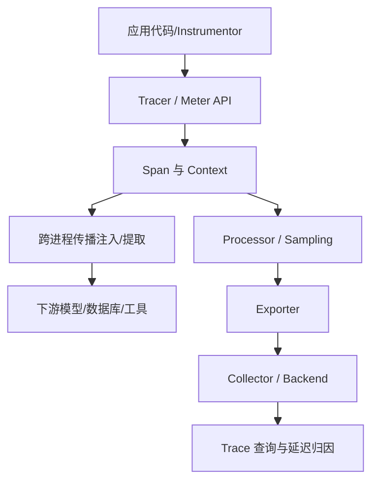
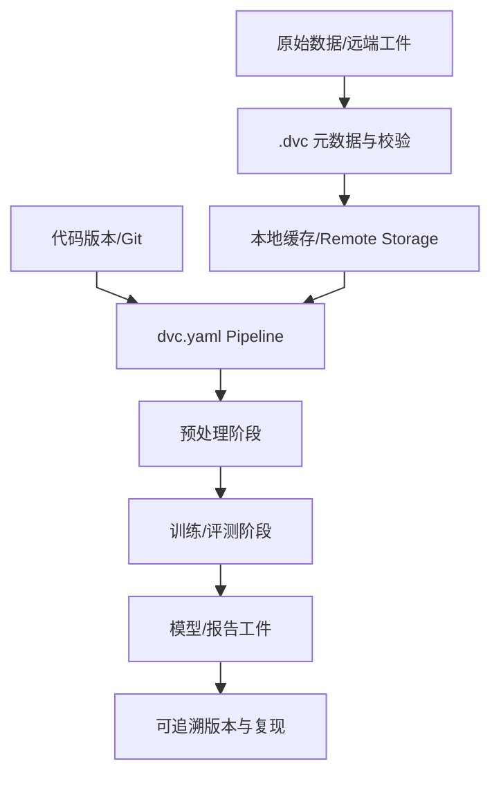
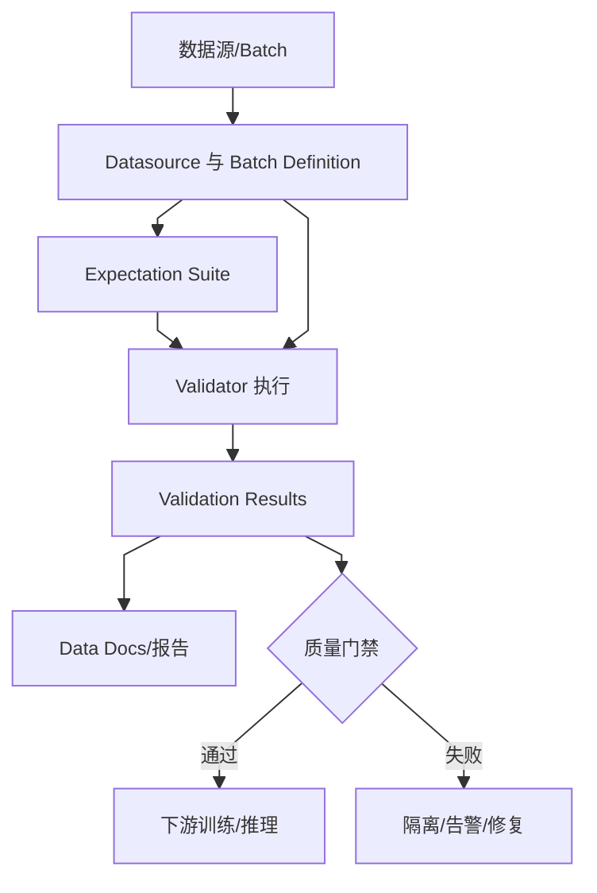
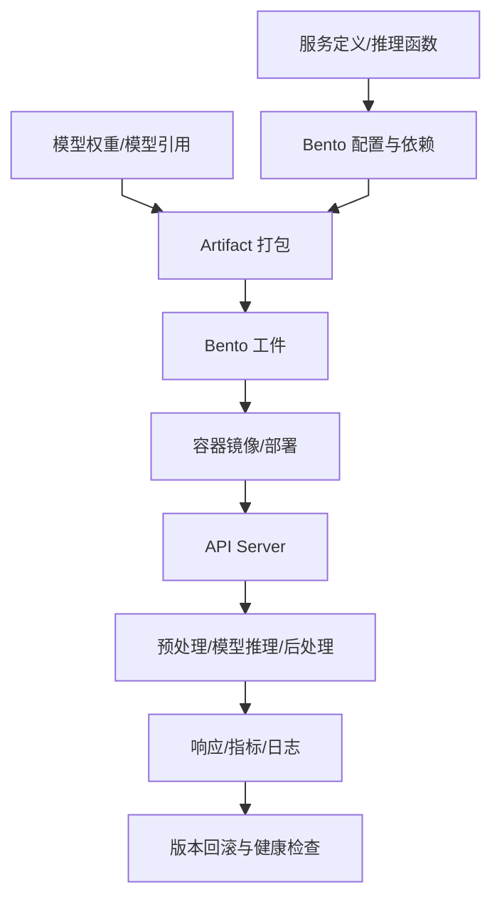
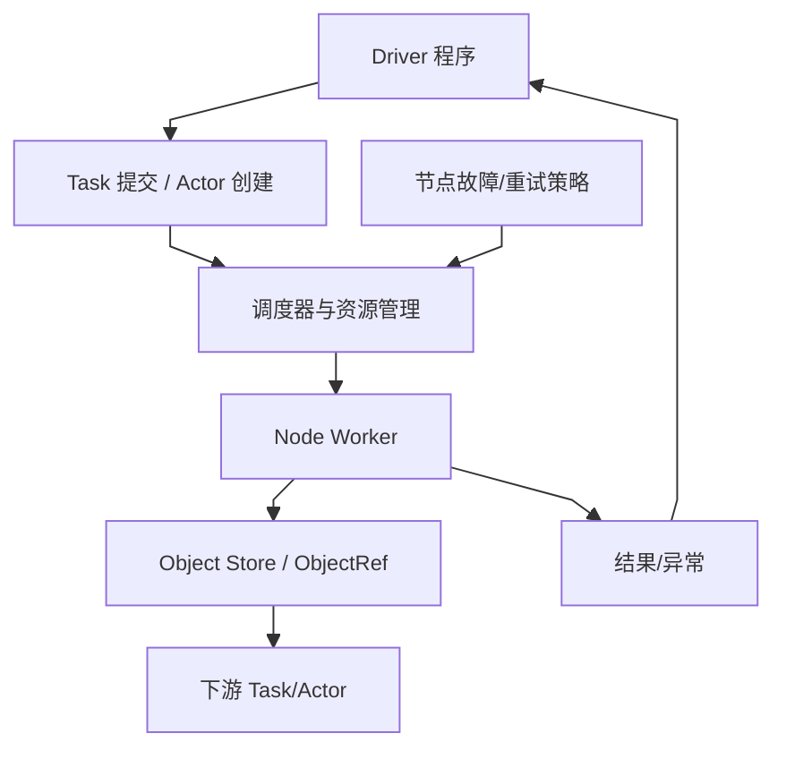

# 方向报告 06｜Other：数据谱系、评测与 AI 工程基础设施

**周期：** 2026-10-05—2026-10-11

## 一、整体结论

本周通用 AI 基础设施值得关注的是围绕 Agent 执行环境形成更清晰的安全边界：OpenShell 将隔离运行、文件/网络/凭证权限和声明式策略作为独立运行时能力。**模型可以提出动作，但能访问什么资源、动作如何被审计、失败后如何恢复，必须由可检查的执行层控制**。

## 二、本周焦点

### 本周焦点：OpenShell 把 Agent 权限边界做成独立运行时

第 41 周开源 AI 聚合报告把 NVIDIA/OpenShell 列入周内高增长项目，报告口径下周增 Star 约 5.6k；这属于第三方追踪器的阶段性数据，并非官方 Trending 的质量排名。[Week 41 开源 AI 追踪](https://olud.ai/reports/2026-w41.html)。OpenShell 官方仓库将自身定义为面向自主 Agent 的安全、私有运行时：通过 sandbox 环境和声明式 YAML policy，限制文件访问、凭证使用以及网络活动。[OpenShell 官方仓库](https://github.com/NVIDIA/OpenShell)

它解决的是 Agent 架构中的信任边界问题。模型可以根据上下文提出 shell 命令、浏览器操作或 API 请求，但模型的语言承诺不能充当权限控制；权限应由宿主运行时强制执行。把策略作为机器可读配置可以让团队审查允许访问哪些路径、哪些域名和哪些凭证，并为执行行为建立更一致的审计边界。运行时隔离也使 Agent 工具执行能和业务进程、用户数据及主机环境分离，降低提示注入或模型误判直接获得高权限的概率。

但“有沙箱”不等于天然安全：如果 policy 允许过宽的网络出口、敏感目录挂载或继承高权限凭证，隔离的边界仍可能被削弱；授权策略还需与任务需要匹配，且要测试逃逸、拒绝访问、日志完整性和失败恢复。**本周值得关注的并不是把更多动作交给 Agent，而是把哪些动作可执行、在何处执行、如何审计变成运行时可验证的配置**。周内 Star 增长只能说明开发者关注，真实安全性仍要看威胁模型、策略默认值和对抗测试。

## 三、Top 10 项目技术分析

以下十项均保留独立的项目级结构图；图中统一采用纵向布局、相同字体和节点间距。

### 1. [MLflow](https://github.com/mlflow/mlflow) — 把训练实验变成有谱系的记录

**技术分析**

训练结果通常由代码、参数、数据切分、环境和随机种子共同决定；只存一个最终分数或模型文件，无法解释结果为什么变化。**MLflow Tracking 将参数、指标、运行信息和[工件](https://www.google.com/search?q=%E5%B7%A5%E4%BB%B6%20%E6%8A%80%E6%9C%AF%E5%8E%9F%E7%90%86%20%E8%A7%A3%E9%87%8A "工件：实验产物如模型、配置、数据引用和指标记录")绑定到 run，再通过实验组织不同对照，模型注册能力则将训练产物与版本、阶段和部署生命周期连接。**技术关键不在“画曲线”，而是同一个模型工件能否反查对应的代码、数据和配置。**若数据路径指向可变文件、日志异步失败或模型别名被覆盖，实验看似被记录，实际仍不可复现。**对 LLM 系统还需记录提示模板、检索索引版本、评测器模型和推理参数，否则分数变化无法归因。实现层面需要看 Tracking API 怎样写入 backend store、artifact store 如何保存文件，以及 Model Registry 如何管理版本转换；项目本身不能保证团队记录了完整元数据。

**项目结构图**

**技术判断与边界：** MLflow 的关键价值是把实验参数、指标、运行环境引用和模型工件绑定为可追溯 run；若数据、代码或模型引用仍可变，记录的分数并不保证可复现，模型注册也需保留原始训练谱系。

### 2. [Weights & Biases](https://github.com/wandb/wandb) — 分布式训练的实验可观测层

**技术分析**

分布式训练中，单个 worker 的日志可能不完整，指标还会涉及同步、聚合和 step 对齐；将日志写在本地文件也难以跨实验对比。**W&B SDK 通过 run 生命周期组织配置、指标、系统信息和 artifacts，并将本地训练过程与可视化/协作平台连接。**关键分析点是指标在何时、由哪个进程、以怎样的 step 定义被记录；若多个 worker 写入相同指标或 step 不一致，曲线可能误导判断。**[Artifacts](https://www.google.com/search?q=Artifacts%20%E6%8A%80%E6%9C%AF%E5%8E%9F%E7%90%86%20%E8%A7%A3%E9%87%8A "Artifacts：带版本的模型/数据/文件产物引用") 能提供数据和模型版本引用，但不自动冻结外部数据源、依赖版本或随机状态。**使用时还要考虑离线模式、断网缓冲、日志上传失败和敏感输入泄露。对 LLM/Agent 实验而言，建议将模型版本、prompt、数据切分、judge 配置和运行成本一并记录，再用固定任务集比较。平台可提高可见性，却不能替代严谨的实验设计或隐私治理。

**项目结构图**

**技术判断与边界：** W&B 将训练配置、指标、系统信息和 artifacts 组织成 run 生命周期，利于跨实验对比；多进程 step 对齐、网络同步失败和敏感信息上传会影响记录质量，云端曲线不能替代清晰的对照实验设计。

### 3. [Evidently](https://github.com/evidentlyai/evidently) — 将数据漂移转化为监控证据

**技术分析**

**线上模型可能在代码未变的情况下退化，因为用户群、输入格式或环境分布发生变化。**Evidently 提供数据质量、分布差异和模型表现报告，用[参考数据](https://www.google.com/search?q=%E5%8F%82%E8%80%83%E6%95%B0%E6%8D%AE%20%E6%8A%80%E6%9C%AF%E5%8E%9F%E7%90%86%20%E8%A7%A3%E9%87%8A "参考数据：用作比较的历史或基线样本，决定漂移报告结论")与当前数据对照，形成可查看的统计信号。**这里最重要的是区分输入分布变化、标签/目标关系变化和业务指标下降：检测到特征漂移并不能证明模型已经变差；没有漂移也不意味着目标关系稳定。**漂移统计还依赖特征类型、样本量、阈值和参考窗口，类别不平衡或样本少时容易出现噪声告警。项目适合将诊断步骤标准化，但告警阈值仍需结合业务代价校准，并与真实标签到达后的模型表现交叉验证。在机制层面追踪数据 schema、metric 计算和报告生成，确认每个图表代表的统计假设，避免把可视化报告当成因果结论。

**项目结构图**

**技术判断与边界：** Evidently 能把参考样本与当前样本之间的分布差异生成统计报告，但输入漂移不等于模型性能下降，也可能存在无明显漂移却发生概念变化的情况；阈值必须用真实错误和人工判断校准。

### 4. [Ragas](https://github.com/explodinggradients/ragas) — 拆解 RAG 系统的检索与生成错误

**技术分析**

检索增强生成系统出错可能来自检索没找到证据、上下文排序不合理、模型忽略证据，或答案虽相关却包含无依据结论。Ragas 将 RAG 质量拆成若干评估维度，例如检索上下文相关性、答案与问题的相关性，以及答案对提供上下文的[忠实程度](https://www.google.com/search?q=%E5%BF%A0%E5%AE%9E%E7%A8%8B%E5%BA%A6%20%E6%8A%80%E6%9C%AF%E5%8E%9F%E7%90%86%20%E8%A7%A3%E9%87%8A "忠实程度：答案内容是否由给定检索上下文支持")。** 这些维度测量的是不同失效模式，不能合并成一个分数就判断系统可靠。****部分指标依赖 LLM 作为 judge，因而会受 judge 模型、提示、温度与参考答案质量影响；分数与人工标注也可能存在系统性偏差。**评估设计应保存问题、检索片段、最终答案、模型版本和评审提示，并抽样与人工标注对照，测量一致性及对答案微小改写的敏感性。对于企业 RAG，还需单独测引用正确率、关键事实遗漏和权限泄露，通用指标并不覆盖全部业务风险。

**项目结构图**

**技术判断与边界：** Ragas 把 RAG 结果拆成上下文相关性、答案相关性和忠实程度等维度，帮助定位检索与生成失效；这些指标往往依赖 LLM judge，其评分稳定性和与人工标注的一致程度应作为评测对象，而不是默认真值。

### 5. [DeepEval](https://github.com/confident-ai/deepeval) — 将 LLM 语义回归纳入测试流程

**技术分析**

传统单元测试能精确验证函数返回值，却不容易检查生成内容是否忠实、是否完成任务或是否泄露不该输出的信息。**DeepEval 将测试样例、指标和模型调用组织成类似测试框架的接口，使 LLM 应用可以在改 prompt、模型、检索逻辑或工具之后执行[回归评测](https://www.google.com/search?q=%E5%9B%9E%E5%BD%92%E8%AF%84%E6%B5%8B%20%E6%8A%80%E6%9C%AF%E5%8E%9F%E7%90%86%20%E8%A7%A3%E9%87%8A "回归评测：版本变化后重跑固定任务集，发现能力退化")。****其主要风险是测试结果依赖 judge：指标阈值、判分模型和评估提示发生变化时，CI 可能对同一输出得出不同结论。**可靠做法是把语义测试与确定性断言分层；格式、权限和函数副作用应由普通代码测试验证，模糊的质量维度才使用模型评审。小型测试集容易过拟合当前 prompt，也可能漏掉长尾输入，因此应从生产失败、人工反馈和对抗样例持续扩充。核心技术约束是 test case schema、metric 判分过程、阈值判断和 CI 集成，评估其误报率与漏报率，而不是只看测试绿灯。

**项目结构图**

**技术判断与边界：** DeepEval 将语义质量检查接入类似测试框架的回归流程，适合在改 prompt、模型或检索链后发现退化；判分模型和阈值变化可能产生误报/漏报，硬性格式、权限与副作用仍应通过确定性断言验证。

### 6. [OpenTelemetry Python](https://github.com/open-telemetry/opentelemetry-python) — 跨模型与工具调用的可观测标准

**技术分析**

**一个 Agent 请求可能串联 API 网关、模型服务、向量库、数据库、浏览器和业务工具。**若每个服务只写本地日志，很难重建一次请求的总延迟、重试与错误传播。OpenTelemetry 用 trace、span、[context propagation](https://www.google.com/search?q=context%20propagation%20%E6%8A%80%E6%9C%AF%E5%8E%9F%E7%90%86%20%E8%A7%A3%E9%87%8A "Context propagation：跨服务传递 trace/span 上下文以恢复调用链") 和 metrics 建立跨服务的观测模型：上游 span 的上下文被传给下游，多个 span 形成调用树，并记录时长、状态和属性。**关键点是上下文传播必须贯穿异步任务、线程和网络边界，否则链路会断开；而采样策略可能导致低频故障未被记录。**可观测并不等于安全：prompt、用户标识或工具返回内容若被直接写入 span，可能带来隐私风险。应把诊断需要与数据最小化结合，过滤敏感属性，并将 trace 与业务任务 ID 关联。在机制层面区分 API、SDK 和 exporter 的责任，确认 instrumentation 是否真正覆盖所有调用路径。

**项目结构图**

**技术判断与边界：** OpenTelemetry 的 trace/span 与上下文传播能把一次 Agent 请求的跨服务调用串起来，定位耗时和异常传播；若异步上下文丢失、采样策略不合理或敏感属性未过滤，链路会断裂或带来数据泄露风险。

### 7. [DVC](https://github.com/iterative/dvc) — 用内容寻址和流水线描述数据版本

**技术分析**

Git 适合追踪文本源代码，却不适合把大型数据集、视频和模型权重直接存进仓库。DVC 将工件内容与轻量元数据关联，配合远端存储和 pipeline 描述数据生成/模型训练步骤，使代码版本与[数据版本](https://www.google.com/search?q=%E6%95%B0%E6%8D%AE%E7%89%88%E6%9C%AC%20%E6%8A%80%E6%9C%AF%E5%8E%9F%E7%90%86%20%E8%A7%A3%E9%87%8A "数据版本：把模型结果绑定到可复现的数据输入与处理过程")可以共同回溯。**关键机制是依赖与输出关系：当输入或命令发生变化时，流水线可以判断哪些阶段需要重跑。****但这依赖元数据准确、命令环境可复现以及远端工件仍可取回；只保存数据指针而丢失对应对象，并不能复现训练。**随机数据增强、外部 API 和未锁定包版本也可能让相同 pipeline 得到不同结果。因此，数据版本控制可靠评测需同时记录原始来源、处理代码、schema、校验和、许可和敏感数据访问边界。在机制层面重点关注 .dvc 元数据、remote/cache、pipeline stage 与依赖检测，不要把“Git 提交可回滚”误当成整条数据链已被冻结。

**项目结构图**

**技术判断与边界：** DVC 通过工件哈希、缓存、远端存储和 pipeline 元数据，将大文件版本与 Git 代码版本联系起来；可复现仍依赖远端工件存在、处理环境锁定和外部依赖稳定，保存指针不是保存所有必要数据的同义词。

### 8. [Great Expectations](https://github.com/great-expectations/great_expectations) — 把数据质量要求变成可执行契约

**技术分析**

**模型训练前后的数据错误常以“模型性能变差”出现：字段类型变化、关键列空值、枚举值突然新增或业务约束被破坏，都可能污染输入。**Great Expectations 允许将数据假设表达为 expectations，并在批数据或数据管道上执行验证，生成结果和文档。**与单纯统计摘要不同，[数据契约](https://www.google.com/search?q=%E6%95%B0%E6%8D%AE%E5%A5%91%E7%BA%A6%20%E6%8A%80%E6%9C%AF%E5%8E%9F%E7%90%86%20%E8%A7%A3%E9%87%8A "数据契约：把字段类型、范围和业务约束表达为可执行检查")明确表达“什么情况被认为不合格”；但契约本身必须覆盖真实风险，若规则过宽就会漏检，若过严则会在合法分布变化时频繁阻塞任务。**规则也不能无条件要求生产分布固定——合法的季节变化可能是预期的，异常变化是否需要拦截取决于用途。要把硬性约束（类型、唯一键、非空字段）与统计告警（分布、范围）分开管理，并给每条规则配异常样例与负责人。核心技术约束是 expectation 定义、validator 执行、批次/数据资产配置和验证结果如何被 CI 或调度系统消费。

**项目结构图**

**技术判断与边界：** Great Expectations 将字段、类型、范围和业务约束编码成可执行 expectation；它能捕获已定义的违约，但规则不充分会漏检、过严会阻断合法数据变化，需区分硬性约束与统计型告警。

### 9. [BentoML](https://github.com/bentoml/BentoML) — 将模型依赖封装为可部署服务

**技术分析**

**训练脚本通常隐藏着模型权重、预处理依赖、系统库和启动参数；若只将模型文件交付给部署团队，同一模型可能在不同环境表现不一致。**** BentoML 将服务逻辑、模型引用、依赖和运行配置组织成可打包的服务单元，便于生成容器并在统一接口下处理请求。**对生成式模型而言，除了模型加载，还要考虑并发队列、流式返回、超时、显存管理和健康检查；封装并不能自动解决这些运行时问题。打包成功仅证明部署工件构建完成，不证明吞吐、延迟、弹性或安全边界满足生产要求。应核验模型权重是否按版本固定、预处理代码是否一起打包、环境变量和密钥如何注入，以及新版本失败如何回滚。在机制层面沿 service 定义、model artifact、build 和 serve 路径追踪，从本地运行到容器部署比较实际依赖是否一致。

**项目结构图**

**技术判断与边界：** BentoML 将服务代码、模型引用、依赖和运行设置封装为可部署工件，缩小训练环境与部署环境的差异；打包成功不保证线上吞吐、健康检查、显存隔离或回滚达到要求，仍需用生产负载做部署验证。

### 10. [Ray](https://github.com/ray-project/ray) — 用 task、actor 和资源调度扩展 Python 工作负载

**技术分析**

**数据处理、超参数搜索、分布式推理和训练会遇到进程管理、资源分配、任务失败和跨节点数据传输问题。**** Ray 将计算表达为 task（无状态远程函数）和 actor（持有状态的工作单元），由调度层将其映射到可用 CPU/GPU 与节点。**这个抽象降低编写分布式程序的门槛，但不消除分布式系统本身的代价：小任务可能被调度和序列化开销吞噬，actor 可能成为瓶颈，数据倾斜会造成部分节点过载，故障恢复还取决于任务是否可重试及副作用是否幂等。对象引用把生产者和消费者关联起来，若传输大型对象或不必要复制，内存和网络都可能成为瓶颈。评测应对照单机实现，记录任务粒度、对象大小、并发、吞吐和尾延迟，而非只比较节点数。在机制层面区分 Ray Core 与上层训练/数据组件，避免把所有能力都归因于底层调度器。

**项目结构图**

**技术判断与边界：** Ray 用 task、actor、资源声明和对象引用组织分布式执行，降低多进程/多机任务的编程负担；但序列化、数据传输、调度开销和任务倾斜可能吞噬收益，分布式方案要与同任务单机基线对照。

### 方法论沉淀

基础设施是否真正提高研发质量，应从**可追溯性、复现成功率、故障定位时间、线上回归检出率与数据安全边界**来衡量。仪表盘数量或“接入了监控”不是效果证据。术语见[研究证据与评测词典](https://www.google.com/search?q=%E7%A0%94%E7%A9%B6%E8%AF%81%E6%8D%AE%E4%B8%8E%E8%AF%84%E6%B5%8B%E8%AF%8D%E5%85%B8%20%E6%8A%80%E6%9C%AF%E5%8E%9F%E7%90%86%20%E8%A7%A3%E9%87%8A "解释基准、复现、消融、证据等级和趋势统计的可比条件")、[Agent 词典](https://www.google.com/search?q=Agent%20%E8%AF%8D%E5%85%B8%20%E6%8A%80%E6%9C%AF%E5%8E%9F%E7%90%86%20%E8%A7%A3%E9%87%8A "解释 tracing、工具执行、权限和幂等性")。
