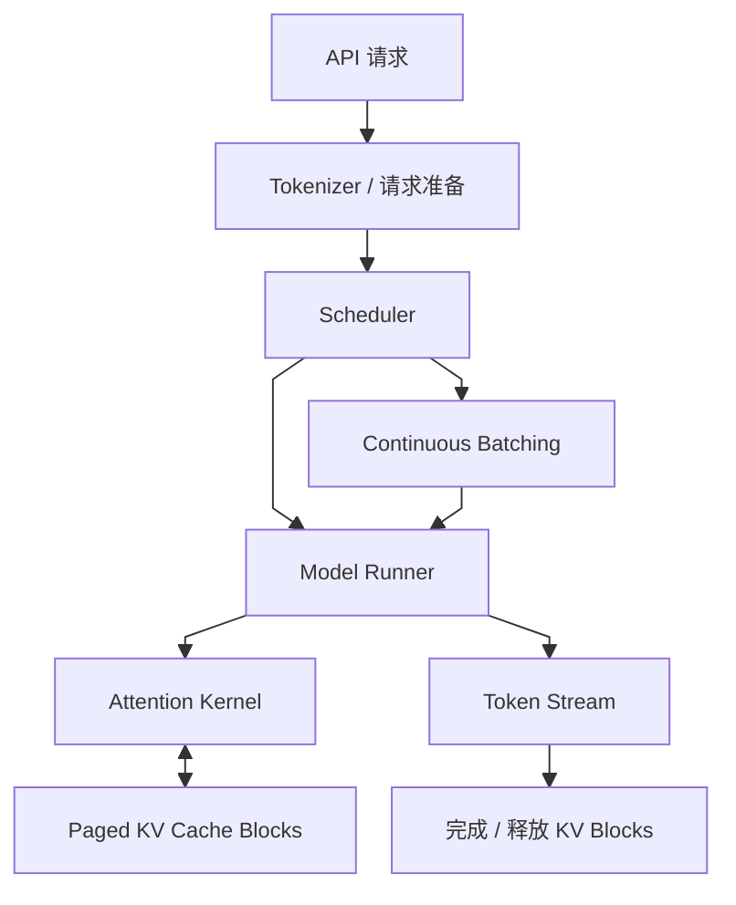
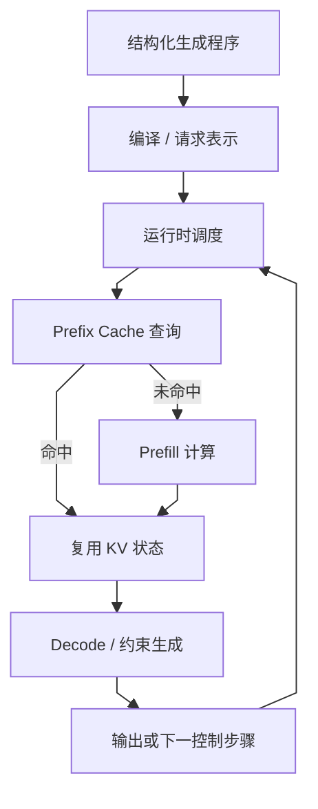
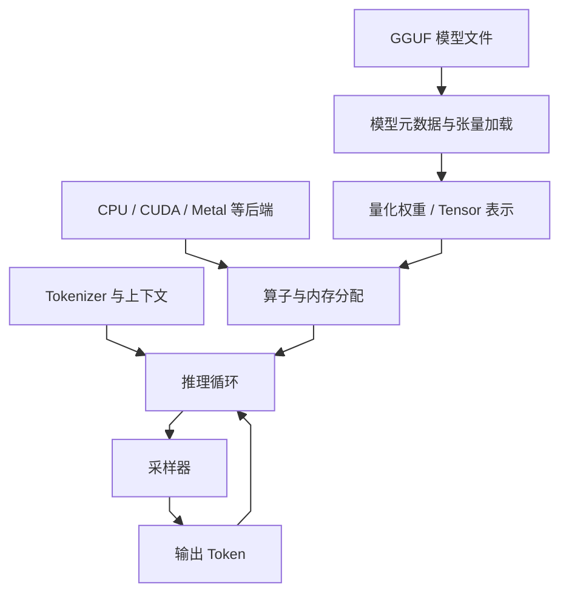
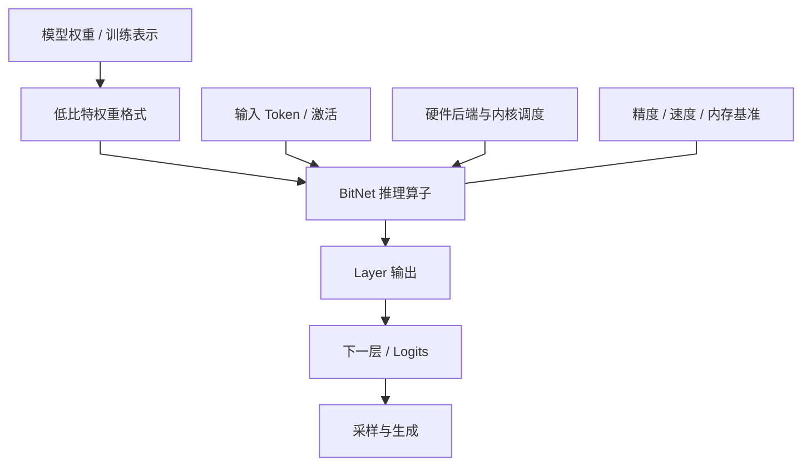
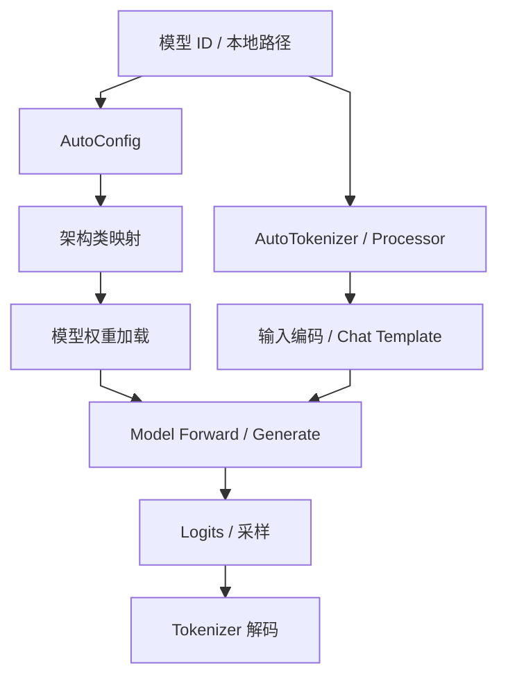
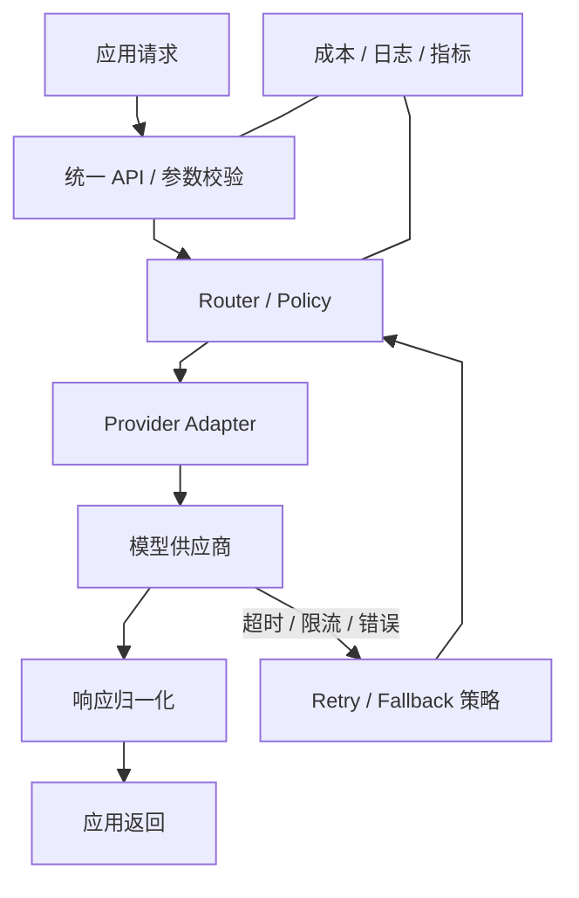
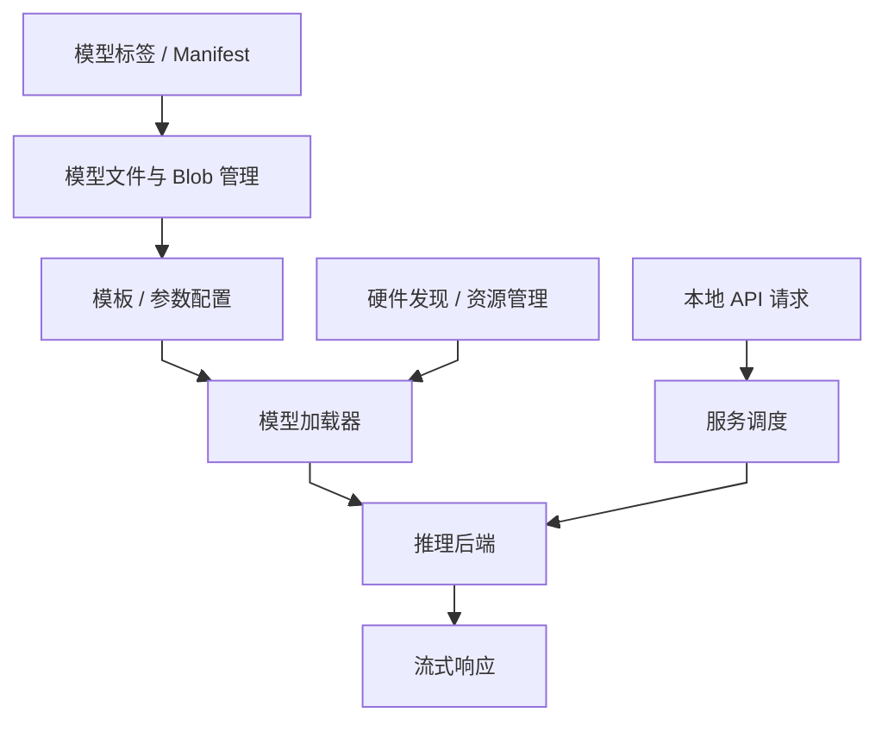
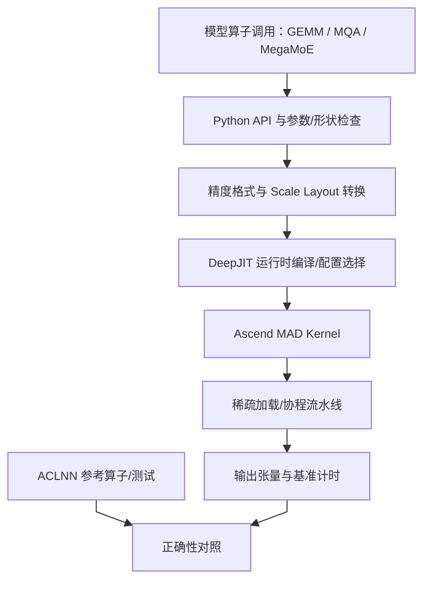
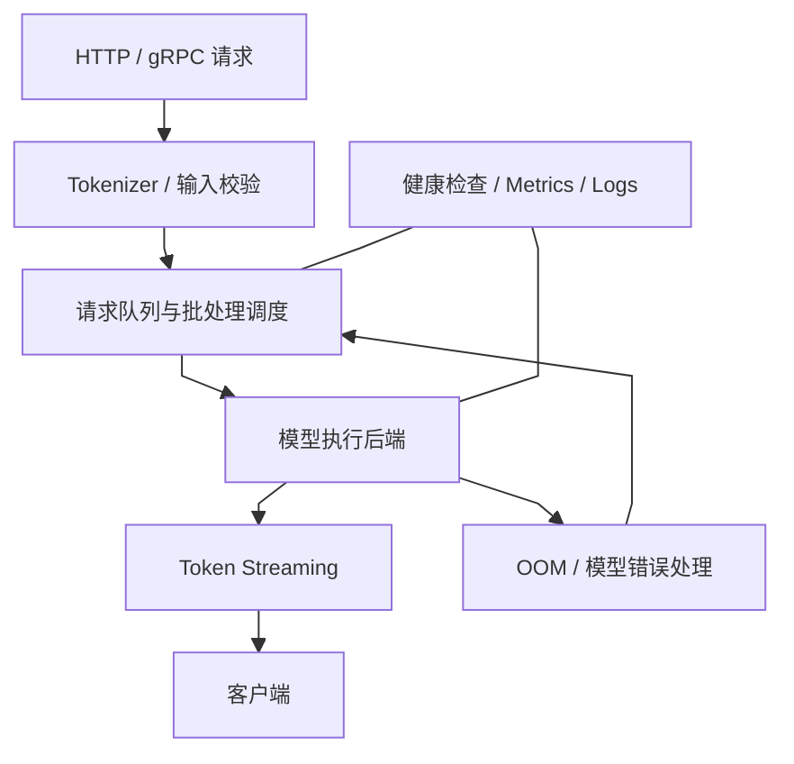
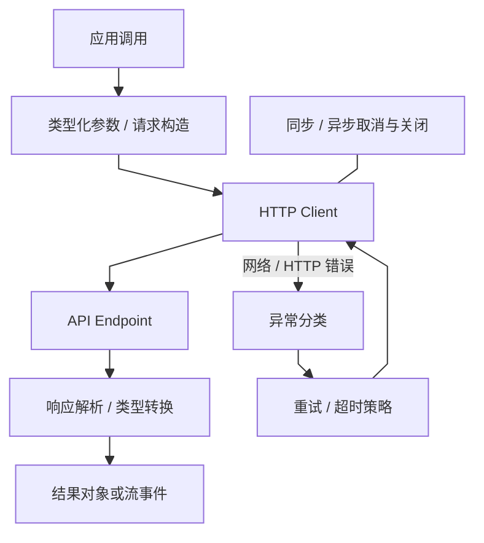

# 方向报告 01｜LLM 与大模型：本地多模态接口与可靠流式服务

**统计周期：** 2026-10-19—2026-10-25（自然周，周一至周日）　**整理日期：** 2026-10-27  
**选题口径：** 本周原创事件 + 代表项目技术精读。Top 10 为技术关注清单，不是未经快照校验的 GitHub Trending 名次；没有同口径周初周末 Star 数据，不给虚构增量。

## 一、整体结论

2026 年 10 月 19—25 日的明确更新集中在本地模型运行时的接口扩展和错误语义，而不是一个可横向比较的新吞吐纪录。Ollama 在 10 月 22 日修复流式请求部分输出后静默结束的行为，10 月 24 日继续把语音生成与结构化决策模型接入本地服务。这意味着本地推理的交付对象已经不只是文本 token，还包括连续音频、概率化决策与可识别的失败状态。

技术上必须分清模型能力、服务协议和推理内核三个层次：能在 `/v1/audio/speech` 输出流不等于端到端延迟或语音质量得到独立验证；决策模型公开可用也不证明概率校准；传输层返回明确错误是可靠性改进，却不能解决显存调度。vLLM、SGLang、llama.cpp 等作为系统架构参照，按调度、缓存、量化及异构后端比较，不能编造同期 Star 增幅。

## 二、本周焦点

**事件一｜2026-10-22，Ollama v0.40.9：流式失败不再静默伪装完成。** 官方 [release v0.40.9](https://github.com/ollama/ollama/releases/tag/v0.40.9) 写明 OpenAI Responses 与 Anthropic Messages 的 streaming 请求在生成失败时将报告错误，而非只结束于部分输出。机制上，这是给客户端一个可辨认的失败终止条件；此前仅观察到流结束，无法证明模型实际完成生成。它影响上层 Agent 的重试、幂等及用户结果标注。**边界：** release 说明可证接口行为变更，不能代替不同客户端、取消与网络断开的端到端兼容测试。

**事件二｜2026-10-24，Ollama v0.40.11：语音流和结构化决策模型。** 官方 [release v0.40.11](https://github.com/ollama/ollama/releases/tag/v0.40.11) 记录 macOS 上的在线语音播放，以及兼容 OpenAI 的 `/v1/audio/speech` 流接口；同时加入 d3 决策模型族，可对文本、结构化状态或图像进行分类、是/否判断及概率评分。数据流分别表现为「输入文本→音频生成→流分片→播放/客户端」和「输入状态→决策模型→选项/概率」。接口可用性与分类正确率、概率校准、语音质量是不同证据层级，release 无法证明后者。

## 三、Top 10 项目技术分析

每项结构图描述所列项目自身模块/工件/数据或控制流，统一为纵向 Mermaid。项目持续跟踪不等于每个项目均在本周发生重大版本更新；如无周内原始事件，技术分析以官方公开实现与可验证的架构判断为主。

### 1. [vLLM](https://github.com/vllm-project/vllm) — 以 KV Cache 管理改善并发推理

**技术分析**

**vLLM 的优势来自把 KV 缓存块生命周期与动态请求调度结合，而不是仅仅增加静态批次大小。**

自回归模型每生成一个 token，都需要保留先前 token 的 Key/Value 张量。请求长度不同、到达时间不同，会使静态批处理出现填充浪费，也让连续显存分配产生碎片。vLLM 的关键设计是 [PagedAttention](https://www.google.com/search?q=PagedAttention%20%E6%8A%80%E6%9C%AF%E5%8E%9F%E7%90%86%20%E8%A7%A3%E9%87%8A "PagedAttention：用固定大小块管理 KV Cache，降低连续显存分配约束")：把逻辑上的 KV 序列映射到非连续的固定大小块，避免要求每条序列占据一段连续显存；调度器则在请求生成和结束时动态调整批次。收益来自两个相互关联的机制：KV 块管理提高显存利用率，continuous batching 减少设备等待。但它并不消除注意力计算和 KV 容量随上下文增长的成本；长上下文、并行策略、模型结构、量化与硬件都会改变结果。性能判断必须区分理论内存利用率、吞吐和单请求延迟，不能仅引用项目 benchmark 的最大吞吐数字。可比实验必须固定请求长度分布和并发，对照相同模型、硬件与输出质量，观察 TTFT、每 token 延迟、吞吐和峰值显存。

机制依据见 [vLLM 官方仓库及项目文档](https://github.com/vllm-project/vllm)；其中关于性能、安全或泛化的评价，除非另附独立实验，否则仅属于系统分析推断。

**项目结构图**

*图注：依据 [vLLM 官方仓库](https://github.com/vllm-project/vllm) 的公开接口与实现整理；此图是项目机制示意而非逐文件证明，未公开的实现细节待源码核验。*

**技术判断与边界：** 其优势主要来自 KV 块利用率和请求动态调度，适合关注并发容量的服务负载；长上下文与尾延迟仍可能受访存、模型结构和调度策略限制，不能把单次峰值吞吐直接视为线上收益。

### 2. [SGLang](https://github.com/sgl-project/sglang) — 面向结构化生成与前缀复用的运行时

**技术分析**

**SGLang 试图用前缀复用和结构化生成接口缩短重复计算路径，但其收益依赖共享前缀的实际比例。**

简单的文本补全只需一次连续生成，但真实应用经常包含共享系统提示、结构化输出、多轮工具调用、分支采样和约束解码。 若运行时把这些工作流拆成互不相关的请求，公共前缀会重复进行 prefill，应用层也需要自行处理控制逻辑。SGLang 的路线是让[结构化生成](https://www.google.com/search?q=%E7%BB%93%E6%9E%84%E5%8C%96%E7%94%9F%E6%88%90%20%E6%8A%80%E6%9C%AF%E5%8E%9F%E7%90%86%20%E8%A7%A3%E9%87%8A "结构化生成：用语法或 schema 约束输出格式，不保证语义正确")原语与服务运行时协同，并利用前缀缓存等机制复用重复计算。它解决的不是“模型会不会推理”，而是把复杂生成程序映射为更高效的执行计划。关键取舍在于：缓存命中依赖前缀一致性和内存管理，复杂请求的调度收益依赖实际负载；增加缓存或更积极的批处理也可能提高内存压力或尾延迟。对比 SGLang 与通用服务框架时，应使用真实的共享前缀比例、请求长度分布和并发，而不是只测单一短 prompt。还需分别观察 prefill 与 decode，因为优化前者不一定改善逐 token 生成速度。

机制依据见 [SGLang 官方仓库及项目文档](https://github.com/sgl-project/sglang)；其中关于性能、安全或泛化的评价，除非另附独立实验，否则仅属于系统分析推断。

**项目结构图**

*图注：依据 [SGLang 官方仓库](https://github.com/sgl-project/sglang) 的公开接口与实现整理；此图是项目机制示意而非逐文件证明，未公开的实现细节待源码核验。*

**技术判断与边界：** 结构化生成与前缀复用能减少无效格式输出和重复 prefill，但收益依赖共享前缀比例、语法约束复杂度与请求分布；单一短 prompt benchmark 不足以判断复杂应用中的性能。

### 3. [llama.cpp](https://github.com/ggml-org/llama.cpp) — 面向 CPU 与多后端的本地推理

**技术分析**

**llama.cpp 将 GGUF 权重格式、量化算子与异构计算后端耦合，使资源约束成为可量化的部署取舍。**

本地运行大模型受到内存带宽、可用 RAM/VRAM、设备算子支持和功耗限制。llama.cpp 的工程路线不是依赖单一 GPU 服务，而是用 [GGUF](https://www.google.com/search?q=GGUF%20%E6%8A%80%E6%9C%AF%E5%8E%9F%E7%90%86%20%E8%A7%A3%E9%87%8A "GGUF：llama.cpp 生态的模型文件格式，兼容性仍取决于模型和后端") 模型文件、量化权重和多种硬件后端提供可移植推理。量化可以减少权重存储和内存搬运，但位宽降低会改变数值误差；实际收益取决于量化方案、模型层结构、算子内核和硬件是否能高效执行对应格式。若某个后端不支持高效低比特算子，节省的内存未必转化为更快生成。GGUF 也不等于模型质量保证，它主要承担模型张量与元数据的封装。在结果验证中可靠评测需同时记录模型来源、量化版本、上下文长度、线程数、后端、首 token 延迟、每 token 速度和任务质量。对隐私或离线场景，本地执行能减少网络依赖，但仍要考虑本地服务监听地址、模型文件可信度和资源争用。

机制依据见 [llama.cpp 官方仓库及项目文档](https://github.com/ggml-org/llama.cpp)；其中关于性能、安全或泛化的评价，除非另附独立实验，否则仅属于系统分析推断。

**项目结构图**

*图注：依据 [llama.cpp 官方仓库](https://github.com/ggml-org/llama.cpp) 的公开接口与实现整理；此图是项目机制示意而非逐文件证明，未公开的实现细节待源码核验。*

**技术判断与边界：** llama.cpp 的核心价值是以通用后端和量化格式扩大可运行设备范围；模型能加载不代表 token 延迟可接受，实际体验仍由 CPU/GPU 内核、内存带宽、上下文长度和线程配置共同决定。

### 4. [Microsoft BitNet](https://github.com/microsoft/BitNet) — 低比特权重与专用推理内核

**技术分析**

**BitNet 对极低比特权重的追求只有与适配内核和模型训练配合，才能转换为真实推理收益。**

大模型推理成本不只来自乘加次数，也来自权重从内存搬到计算单元的带宽消耗。BitNet 探索极低比特权重路线，试图减少权重存储与访存成本，并用适配的内核发挥低比特表示的硬件收益。关键点是算法表示和内核必须匹配：如果只是把权重压缩后再在运行时解码成高精度，或硬件缺少合适的低比特运算路径，理论上的位宽优势可能被转换开销抵消。低比特也可能带来精度退化，因此应同时检查支持的模型格式、权重训练方式、算子覆盖和任务质量。不能把一个模型或一台设备上的速度数字外推到所有 Transformer。评估需要明确基线是 FP16、BF16 还是其他[量化](https://www.google.com/search?q=%E9%87%8F%E5%8C%96%20%E6%8A%80%E6%9C%AF%E5%8E%9F%E7%90%86%20%E8%A7%A3%E9%87%8A "量化：用低精度表示权重或激活，以内存/速度收益换取潜在质量损失")方案，比较模型规模、硬件、内存峰值、tokens/s 和下游任务质量，并区分预填充与生成阶段。该方向的潜在影响在于扩大本地运行可行范围，但前提是质量与硬件效率共同成立。

机制依据见 [Microsoft BitNet 官方仓库及项目文档](https://github.com/microsoft/BitNet)；其中关于性能、安全或泛化的评价，除非另附独立实验，否则仅属于系统分析推断。

**项目结构图**

*图注：依据 [Microsoft BitNet 官方仓库](https://github.com/microsoft/BitNet) 的公开接口与实现整理；此图是项目机制示意而非逐文件证明，未公开的实现细节待源码核验。*

**技术判断与边界：** BitNet 路线的意义在于探索低比特权重表示与专用执行内核协同，而不是简单把浮点权重压缩；是否加速取决于硬件指令和算子是否匹配，必须同时审查任务质量和端到端速度。

### 5. [Transformers](https://github.com/huggingface/transformers) — 跨模型的统一接口与架构抽象

**技术分析**

**Transformers 的统一模型接口降低生态集成成本，但不会自动统一不同架构的注意力与生成语义。**

模型生态的主要工程摩擦之一，是不同模型有不同配置、[Tokenizer](https://www.google.com/search?q=Tokenizer%20%E6%8A%80%E6%9C%AF%E5%8E%9F%E7%90%86%20%E8%A7%A3%E9%87%8A "Tokenizer：将文本映射为 token 序列，决定输入表示与长度")、权重命名、输入约定和生成参数。Transformers 用统一的配置、模型类、Tokenizer 与生成接口降低接入成本，使研究者能复用数据管线和训练/推理工具。但抽象层只统一了调用形式，并不保证模型在输入格式、对话模板、位置编码、图像分辨率、特殊 token 或生成语义上等价。 若使用错误的 chat template 或默认 generation config，程序仍能运行，却可能得到显著不同的输出。架构支持通常通过配置映射和具体模型实现落地，因此调试时必须追到模型特定代码，而不能停留在 AutoModel API。它的影响是提高模型实验可组合性，也让依赖版本成为可复现性关键。报告模型结果时应记录模型 revision、Tokenizer revision、模板、dtype、attention backend 和生成参数。

机制依据见 [Transformers 官方仓库及项目文档](https://github.com/huggingface/transformers)；其中关于性能、安全或泛化的评价，除非另附独立实验，否则仅属于系统分析推断。

**项目结构图**

*图注：依据 [Transformers 官方仓库](https://github.com/huggingface/transformers) 的公开接口与实现整理；此图是项目机制示意而非逐文件证明，未公开的实现细节待源码核验。*

**技术判断与边界：** Transformers 的统一 API 降低了跨模型实验的工程摩擦，但配置、tokenizer、聊天模板和权重加载仍决定真实输入输出语义；同一个 generate 调用并不意味着模型间可直接公平比较。

### 6. [LiteLLM](https://github.com/BerriAI/litellm) — 多模型网关、路由与故障治理

**技术分析**

**LiteLLM 将跨供应商的路由和调用治理收敛为网关控制面，同时形成新的限流与故障传播边界。**

应用接入多家模型后，错误处理、限流、[重试](https://www.google.com/search?q=%E9%87%8D%E8%AF%95%20%E6%8A%80%E6%9C%AF%E5%8E%9F%E7%90%86%20%E8%A7%A3%E9%87%8A "重试：失败后的重复请求需考虑副作用、重复计费与幂等性")、成本统计、凭据管理和模型降级很容易散落在业务代码里。 LiteLLM 通过统一请求接口和 provider adapter 将差异集中到网关层，再围绕路由和治理组织模型调用。它降低的是多供应商接入与运维复杂度，而不是消除供应商之间的语义差异：相同参数名可能有不同默认值，工具调用格式、上下文上限和错误码也未必一致。重试尤其需要审慎：对纯生成请求，重试可能只增加成本；对触发外部动作的应用，重复执行甚至可能产生副作用。路由策略还需权衡价格、延迟、能力与可靠性，单纯按最低价格切换可能损害任务质量。评估应记录路由决策、fallback 次数、重复请求、费用估算偏差、限流行为和敏感日志处理。模型可替换性最终依赖统一接口、任务级评测与真实故障语义，而非 API 形状相似。

机制依据见 [LiteLLM 官方仓库及项目文档](https://github.com/BerriAI/litellm)；其中关于性能、安全或泛化的评价，除非另附独立实验，否则仅属于系统分析推断。

**项目结构图**

*图注：依据 [LiteLLM 官方仓库](https://github.com/BerriAI/litellm) 的公开接口与实现整理；此图是项目机制示意而非逐文件证明，未公开的实现细节待源码核验。*

**技术判断与边界：** LiteLLM 把多 provider 的路由与错误处理集中起来，降低业务重复造轮子的成本；但统一的调用接口无法抹平模型质量和工具协议差异，重试与回退策略还可能带来重复计费或语义变化。

### 7. [Ollama](https://github.com/ollama/ollama) — 本地模型打包、分发与服务接口

**技术分析**

**Ollama 将模型拉取、加载、推理及本地 API 组织为统一生命周期，但易用性不等于底层性能领先。**

本地模型运行常见的障碍不是模型本身，而是权重下载、格式管理、硬件后端、上下文参数和服务生命周期需要用户手工拼接。Ollama 将[模型打包](https://www.google.com/search?q=%E6%A8%A1%E5%9E%8B%E6%89%93%E5%8C%85%20%E6%8A%80%E6%9C%AF%E5%8E%9F%E7%90%86%20%E8%A7%A3%E9%87%8A "模型打包：将权重、运行参数与依赖组织成可加载工件")、运行命令与本地 API 封装成统一体验，便于快速试验和离线应用集成。对工程人员而言，重点不只是“能否启动模型”，还包括模型模板如何控制提示词、权重如何被选择和缓存、服务如何处理并发，以及失败时如何报告资源不足。便捷的默认设置也可能隐藏模型量化、上下文长度或硬件加速路径，因此不同机器上同一个标签并不必然代表相同性能。安全方面，本地 API 的监听地址和访问控制也需要核验，不能假定“本地软件”就天然隔离。结果比较必须记录模型 digest、模板、上下文设置、后端、并发和 API 行为；若用于生产，还需测量冷启动、内存压力和长时间运行稳定性。

2026 年 10 月 24 日的 [Ollama v0.40.11](https://github.com/ollama/ollama/releases/tag/v0.40.11) 把语音流接口和 d3 决策模型列为版本功能；这是项目方发布事实，尚不构成跨设备性能对照。

机制依据见 [Ollama 官方仓库及项目文档](https://github.com/ollama/ollama)；其中关于性能、安全或泛化的评价，除非另附独立实验，否则仅属于系统分析推断。

**项目结构图**

*图注：依据 [Ollama 官方仓库](https://github.com/ollama/ollama) 的公开接口与实现整理；此图是项目机制示意而非逐文件证明，未公开的实现细节待源码核验。*

**技术判断与边界：** Ollama 更适合降低本地原型和个人推理的启用成本，真正部署仍需处理服务监听、并发、模型来源和资源限制；命令启动成功只能证明运行链路基本打通，不等于具有生产安全性。

### 8. [DeepGEMM-Ascend](https://github.com/deepseek-ai/DeepGEMM-Ascend) — 面向昇腾 NPU 的低层矩阵乘法内核

**技术分析**

**DeepGEMM-Ascend 的关键在于为昇腾设备设计矩阵乘法实现与数据布局，而不是将 CUDA 性能结论直接移植。**

LLM 推理成本不只由模型结构决定，还取决于 GEMM（通用矩阵乘法）内核是否能把目标加速器的矩阵单元、内存布局和流水线用满。DeepGEMM-Ascend 将 DeepGEMM 的接口路线移植到华为 Ascend 平台，公开说明支持 BF16、FP8、FP4 GEMM、MQA logits 与 MegaMoE。它对 Ascend 的 MAD（矩阵乘加）原语提供轻量封装，隐藏分形矩阵布局、对齐和地址计算等细节，并使用稀疏数据加载、基于协程的流水线以及 JIT 编译路径减少低层调用负担。这是一条“为硬件重写算子并保持上层 API 相对稳定”的移植路线，而不是将 CUDA kernel 原样运行在另一种加速器上。 官方 README 给出的基准条件是 Ascend 950DT、CANN 9.20、冷 L2 cache、bench_msprof；在 M=4096、N=7168、K=16384 的 FP8×FP8 测试中，项目报告 1117.6 μs、861 TFLOPS，约为该表列出的 865 TFLOPS 硬件上限的 99.5%。这是特定形状、特定设备下的项目方测量，不能外推到所有矩阵大小或端到端模型生成；小 batch、内存瓶颈、量化 scale 布局和多卡通信都会改变表现。另需区分官方 README 标注的初始 release 日期（2026-09-30）与 10 月 7 日媒体集中报道该 Ascend 工具链的时间。

机制依据见 [DeepGEMM-Ascend 官方仓库及项目文档](https://github.com/deepseek-ai/DeepGEMM-Ascend)；其中关于性能、安全或泛化的评价，除非另附独立实验，否则仅属于系统分析推断。

**项目结构图**

*图注：依据 [DeepGEMM-Ascend 官方仓库](https://github.com/deepseek-ai/DeepGEMM-Ascend) 的公开接口与实现整理；此图是项目机制示意而非逐文件证明，未公开的实现细节待源码核验。*

**技术判断与边界：** 该项目的关键贡献是把高性能 GEMM 的内存布局、精度格式和流水线优化做成公开可检查的 Ascend 实现；它能证明特定 kernel shape 接近项目所报告的硬件上限，却不能单独证明模型级 tokens/s、能耗或多租户服务优势。真正有说服力的比较需要固定设备、CANN、模型、batch、上下文、量化和基准脚本，并同时报告正确性、延迟与端到端吞吐。

### 9. [Text Generation Inference](https://github.com/huggingface/text-generation-inference) — 生产级模型服务的生命周期管理

**技术分析**

**Text Generation Inference 面向可恢复的服务端推理管线，必须一起考虑模型装载、请求排队和流终止语义。**

生产推理服务不仅要运行 forward，还要处理模型下载和加载、健康检查、请求排队、流式响应、异常恢复、指标暴露和部署配置。TGI 的意义是把这些服务生命周期能力组织成可部署组件，使模型推理能接入容器和运维系统。服务性能受调度、批处理、模型支持、GPU 内存和网络流式传输共同影响；单次生成速度无法代表系统在并发和故障下的表现。尤其要看队列等待与模型执行时间如何区分，健康检查是否能识别模型已加载但无法正确服务的状态，以及客户端断开后资源是否及时释放。不同版本和模型架构的支持情况可能变化，不能仅凭项目历史 benchmark 推断当前部署结果。对照测试可比实验必须固定模型、硬件、请求分布、输出长度和客户端连接数，记录 [TTFT](https://www.google.com/search?q=TTFT%20%E6%8A%80%E6%9C%AF%E5%8E%9F%E7%90%86%20%E8%A7%A3%E9%87%8A "TTFT：从请求发出到首个输出 token 到达的时间")、吞吐、尾延迟、错误率、冷启动与恢复时间。生产可用性还需要安全更新、访问控制和资源隔离，不由 benchmark 自动保证。

机制依据见 [Text Generation Inference 官方仓库及项目文档](https://github.com/huggingface/text-generation-inference)；其中关于性能、安全或泛化的评价，除非另附独立实验，否则仅属于系统分析推断。

**项目结构图**

*图注：依据 [Text Generation Inference 官方仓库](https://github.com/huggingface/text-generation-inference) 的公开接口与实现整理；此图是项目机制示意而非逐文件证明，未公开的实现细节待源码核验。*

**技术判断与边界：** TGI 的价值不只是模型推理，还包括服务生命周期、监控与并发处理；生产适用性要看当前版本的维护状态、硬件支持、部署需求和负载测试，不能仅凭服务可以启动推断运维成熟度。

### 10. [OpenAI Python SDK](https://github.com/openai/openai-python) — 把网络与协议失败纳入应用设计

**技术分析**

**OpenAI Python SDK 把重试与流式接口封装为稳定调用表面，但任何自动重试仍受幂等与计费语义约束。**

模型 API 客户端看似只是 HTTP 封装，但重试、超时、流式解析、异步取消和异常类型会直接决定应用的可靠性与成本。 OpenAI Python SDK 提供类型化请求接口、同步/异步客户端、流式响应和常见 API 错误处理，减少业务代码直接操作网络协议的负担。工程上最需要读懂的是请求失败的语义：连接失败与服务端已处理但响应丢失并不相同；若客户端无条件重试，可能产生重复费用，或在外部工具调用链中重复触发副作用。流式响应还要求正确处理事件结束、连接中断和部分输出，不能把“收到了一段文本”当成请求成功。SDK 的重试和超时默认值可能随版本变化，调用方应显式配置并监控。测试应覆盖 429、5xx、超时、断流、取消与无效参数，确认异常是否可分类、重试次数是否符合预期、日志是否泄露敏感内容。

机制依据见 [OpenAI Python SDK 官方仓库及项目文档](https://github.com/openai/openai-python)；其中关于性能、安全或泛化的评价，除非另附独立实验，否则仅属于系统分析推断。

**项目结构图**

*图注：依据 [OpenAI Python SDK 官方仓库](https://github.com/openai/openai-python) 的公开接口与实现整理；此图是项目机制示意而非逐文件证明，未公开的实现细节待源码核验。*

**技术判断与边界：** SDK 对异常、流式事件和重试的封装会直接影响业务可靠性；自动重试适合可安全重复的请求，但有外部副作用的操作需要幂等标识或由调用方控制，避免超时后重复执行。
