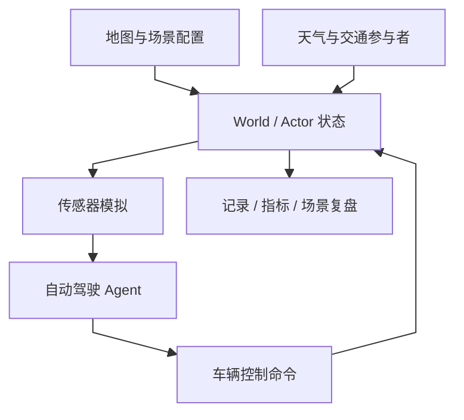
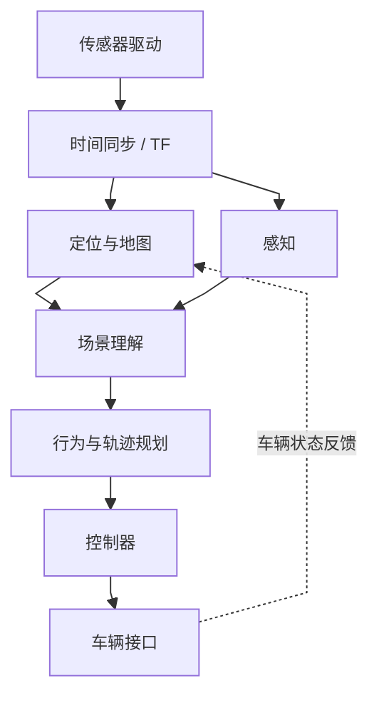
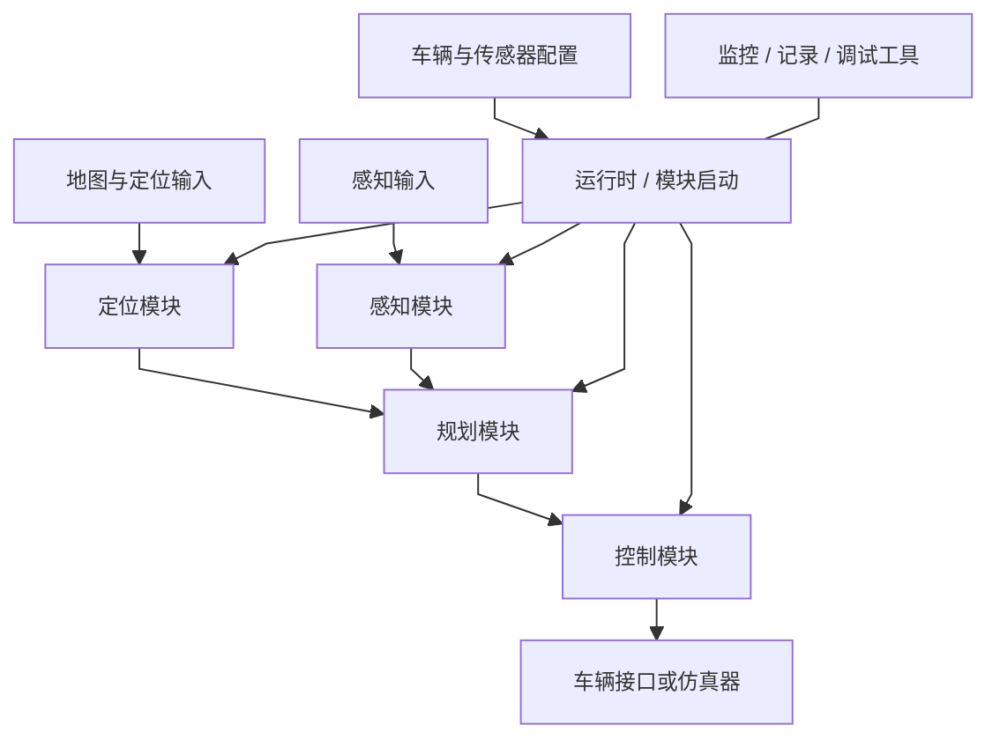
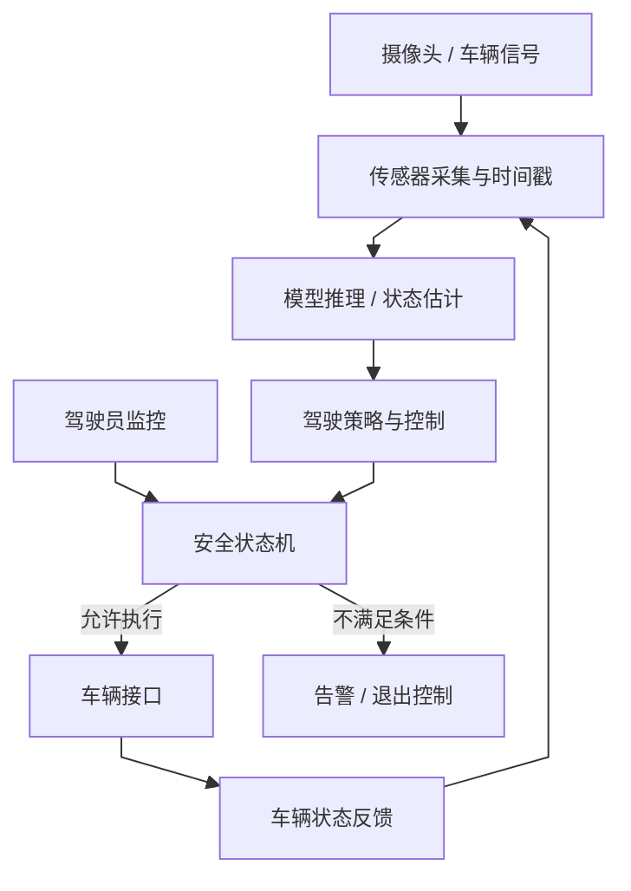
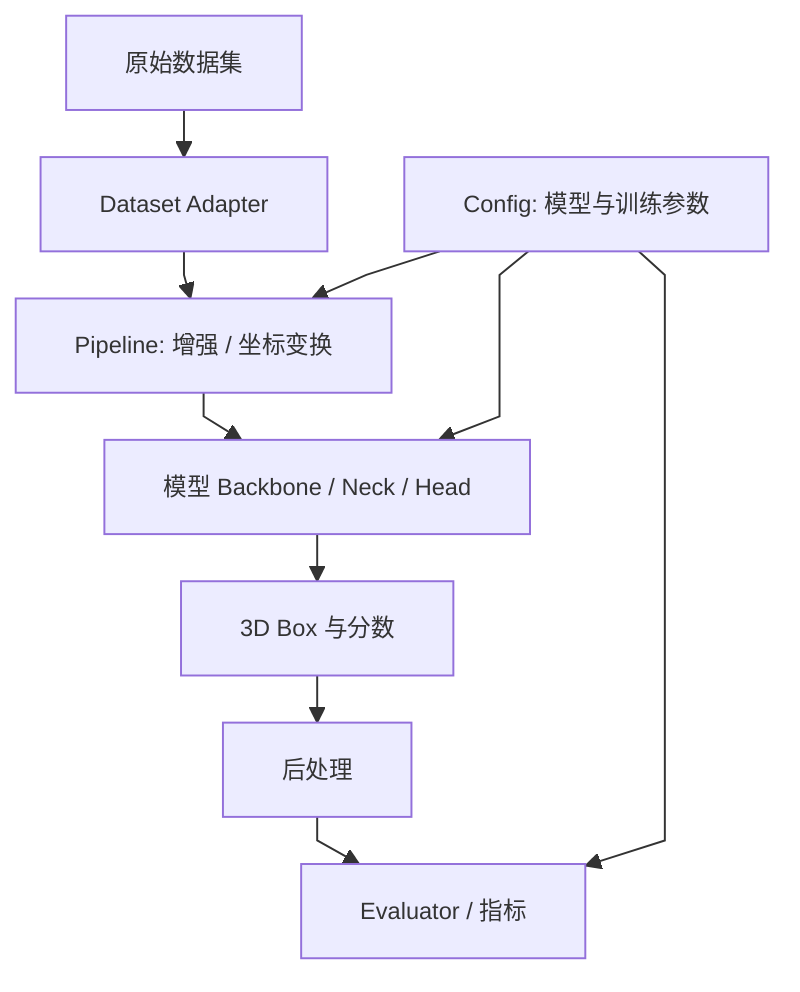
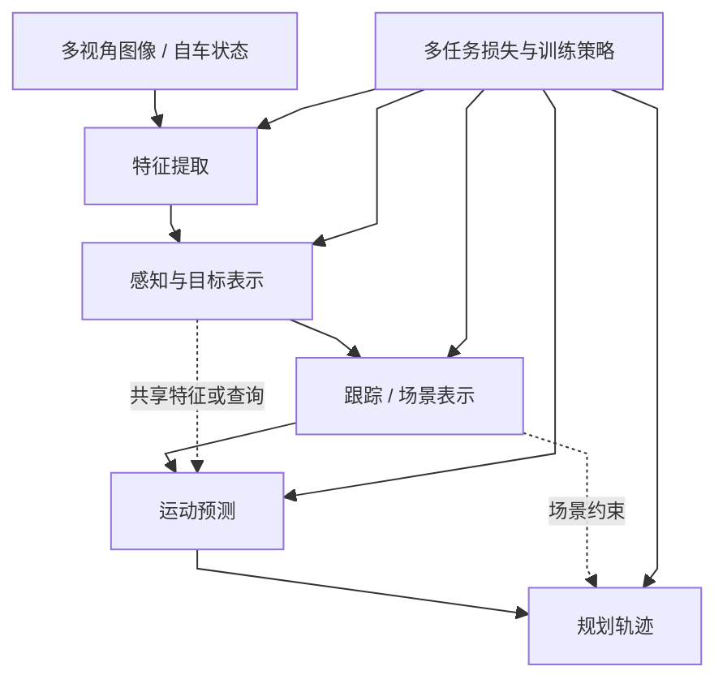
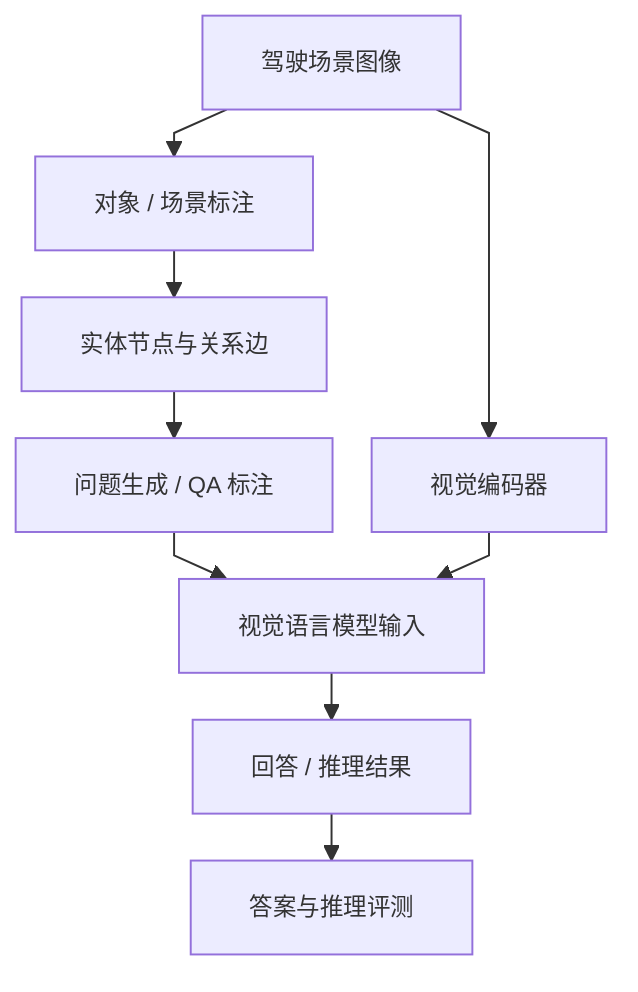
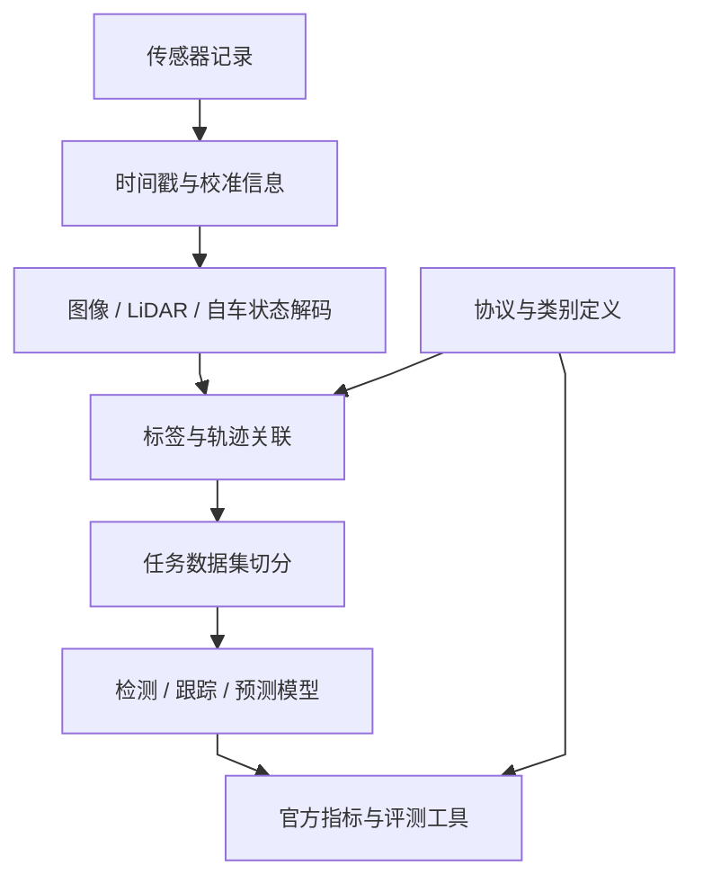
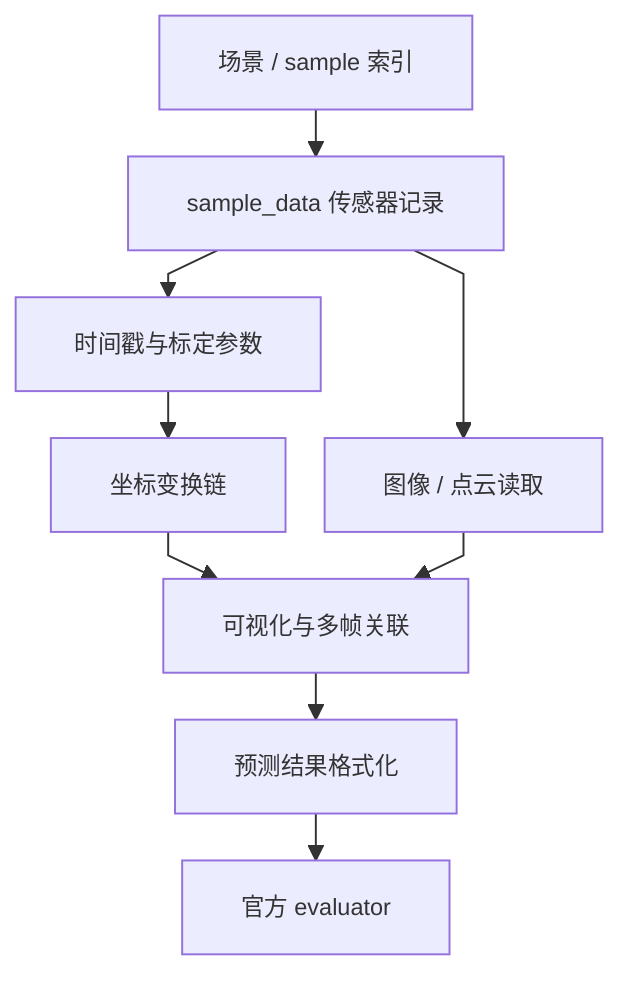
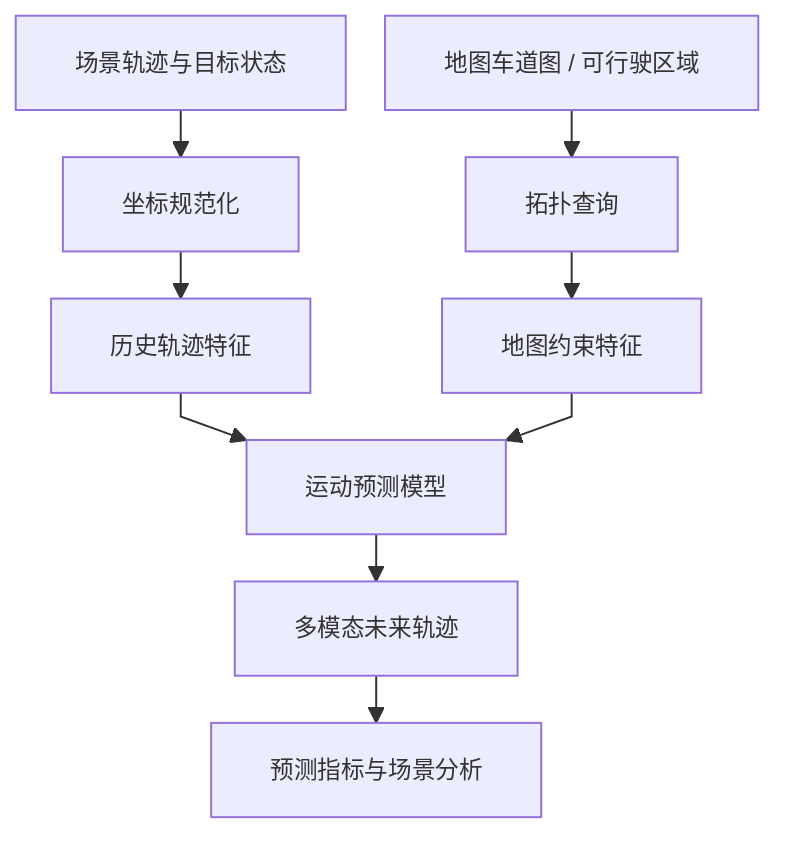

# 方向报告 03｜自动驾驶：仿真工具链迁移和验证证据

**统计周期：** 2026-10-19—2026-10-25（自然周，周一至周日）　**整理日期：** 2026-10-27  
**选题口径：** 本周原创事件 + 代表项目技术精读。Top 10 为技术关注清单，不是未经快照校验的 GitHub Trending 名次；没有同口径周初周末 Star 数据，不给虚构增量。

## 一、整体结论

自动驾驶方向在 2026 年 10 月 19—25 日的可核实事件，主要是 CARLA 将 CI/CD 与资源分支迁移至 Unreal Engine 5.8 路线，并完成全量文档核查。与上一周的传感器和交通管理维护不同，本周未找到足以宣称新闭环规划算法取得突破的官方发布。因此真正的结论是仿真平台正在固化新引擎分支上的构建、操作与复现契约。

分支迁移会改变编译产物、内容资产版本和测试触发的组合，不是只替换文档链接。仿真中的离线检测精度、场景闭环无碰撞率与真实车辆部署证据必须继续分层；不能将 CI 绿灯或 UE 5.8 文档完整视为道路安全结果。

## 二、本周焦点

**事件一｜2026-10-19，CARLA PR #9981：CI/CD 转向 ue58-dev。** 官方 [PR #9981](https://github.com/carla-simulator/carla/pull/9981) 显示测试工作流的 push/PR 目标分支从 `ue5-dev` 改成 `ue58-dev`，同时内容资源克隆分支转为 `ue58-dev-carla`，已在 10 月 19 日合并。其机制是把代码、资产和自动构建路径指向一致引擎版本，减少测试一个分支却加载另一版资产的配置歧义。**边界：** 合并 PR 不意味着已在所有 GPU、交通场景和传感器组合上通过独立复现。

**事件二｜2026-10-22，CARLA PR #9983：UE5.8 文档与流程核查。** 官方 [PR #9983](https://github.com/carla-simulator/carla/pull/9983) 于 10 月 22 日合并，说明覆盖文档页面审阅与菜单可访问性；其自述测试环境为 Ubuntu 22.04、Python 3.10、UE5.8。改动还涉及仓库流程指引，改进研究人员找到构建、地图资产、ROS 2 与场景复现入口的确定性。**性质判定：** 工程文档/CI 维护，不是新感知模型、规划策略或实车部署里程碑。

## 三、Top 10 项目技术分析

每项结构图描述所列项目自身模块/工件/数据或控制流，统一为纵向 Mermaid。项目持续跟踪不等于每个项目均在本周发生重大版本更新；如无周内原始事件，技术分析以官方公开实现与可验证的架构判断为主。

### 1. [CARLA](https://github.com/carla-simulator/carla) — 可控场景仿真与闭环测试

**技术分析**

**CARLA 的研究价值来自环境状态、传感器仿真和控制回路的可配置耦合，而不是单独追求渲染逼真。**

自动驾驶实车测试很难覆盖低概率、高风险事件：例如遮挡后突然出现的行人、湿滑路面、传感器退化或其他车辆的异常行为。 CARLA 的价值不是“用虚拟画面代替道路”，而是把场景、交通参与者、天气、地图和传感器输出变成可配置、可重复的实验条件。研究者可固定随机种子和场景参数，比较不同感知/规划系统在同一事件下的行为差异，并通过车辆控制接口形成闭环：策略动作会改变车辆状态，车辆状态又决定后续观测。这个反馈比只对固定图像计算检测精度更接近控制问题。其主要边界是模拟器与现实的差距，包括材质和光照、传感器噪声、轮胎与车辆动力学、交通参与者行为模型等；在仿真里通过并不自动证明现实安全。实现层面需要把传感器生成、世界状态更新和同步机制连起来看，确认控制命令何时生效、传感器数据对应哪个仿真时刻，以及评价指标是否只看碰撞或也覆盖舒适性和交通规则。

本周 [CARLA PR #9981](https://github.com/carla-simulator/carla/pull/9981) 的分支与内容资产迁移说明复现还取决于引擎、地图和测试脚本的一致固定；这项维护没有提供真实道路收益证据。

机制依据见 [CARLA 官方仓库及项目文档](https://github.com/carla-simulator/carla)；其中关于性能、安全或泛化的评价，除非另附独立实验，否则仅属于系统分析推断。

**项目结构图**

*图注：依据 [CARLA 官方仓库](https://github.com/carla-simulator/carla) 的公开接口与实现整理；此图是项目机制示意而非逐文件证明，未公开的实现细节待源码核验。*

**技术判断与边界：** CARLA 的核心价值在于固定场景下重现闭环行为并控制危险条件；它提供的是可重复的仿真证据，真实有效性仍取决于传感器模型、交通参与者行为、动力学参数与现实场景覆盖。

### 2. [Autoware](https://github.com/autowarefoundation/autoware) — ROS 2 模块化自动驾驶栈

**技术分析**

**Autoware 的 ROS 2 分层将感知、定位、预测与规划连接为消息流，时延和接口一致性是系统性的失败源。**

Autoware 面对的是完整车辆系统的集成问题：定位、感知、对象预测、行为规划、轨迹规划、控制和车辆接口由不同模块实现，却必须在时间和坐标上保持一致。它基于 [ROS 2](https://www.google.com/search?q=ROS%202%20%E6%8A%80%E6%9C%AF%E5%8E%9F%E7%90%86%20%E8%A7%A3%E9%87%8A "ROS 2：机器人中间件，以节点、topic、service/action 和消息连接模块") 的节点与消息机制组织软件，模块间通过话题、服务或动作交换数据；这让团队可以替换单个算法，也意味着系统表现会受到消息频率、QoS、时间戳、坐标系和启动依赖的影响。举例说，感知输出即使单帧准确，如果使用了错误的 TF 变换或延迟过大，规划模块拿到的对象位置仍可能过时。模块化的收益是可组合、可测试和可部署，代价是集成复杂度和跨模块故障传播。评估 Autoware 不应只问“某个规划器好不好”，还要追踪从传感器话题到规划轨迹再到车辆控制的端到端时序，并确认车辆接口是否真的连接了目标硬件。在机制层面以 launch 文件建立节点图，再追踪一条关键消息的数据类型、发布频率、frame_id 和消费者。

机制依据见 [Autoware 官方仓库及项目文档](https://github.com/autowarefoundation/autoware)；其中关于性能、安全或泛化的评价，除非另附独立实验，否则仅属于系统分析推断。

**项目结构图**

*图注：依据 [Autoware 官方仓库](https://github.com/autowarefoundation/autoware) 的公开接口与实现整理；此图是项目机制示意而非逐文件证明，未公开的实现细节待源码核验。*

**技术判断与边界：** Autoware 通过 ROS 2 接口把定位、感知、规划、控制和车辆适配组合成模块化栈，降低替换和集成成本；但模块能通信不代表时序和安全契约正确，QoS、坐标系、生命周期与降级策略仍是系统级风险点。

### 3. [Apollo](https://github.com/ApolloAuto/apollo) — 面向车辆工程的自动驾驶平台

**技术分析**

**Apollo 将车辆侧感知、规划、控制与工程适配纳入较完整的系统栈，部署质量依赖车辆标定。**

Apollo 代表的是工程平台路线：算法只有与地图、传感器驱动、车辆模型、规划控制、运行时监控和开发工具集成后，才能成为可测试的系统。其架构包含多个功能模块和模块间通信，工程阅读的重点不是逐个浏览算法文件，而是先理解启动配置、消息通道和模块依赖，再选一条输入输出链追踪。 例如定位模块的结果如何进入规划，规划轨迹如何被控制模块消费，模块异常如何通过监控或状态机制暴露。平台化可复用车辆接入、调试和验证基础设施，减少每个团队从零拼装的成本；但接口数量、配置组合与版本耦合也会形成复杂性。一个模块的离线精度并不能证明平台整体可用，传感器标定、地图版本、消息延迟或控制参数错误都可能改变系统结果。报告中的架构图应以项目官方文档和当前版本源码为准，避免把历史版本结构直接套用到最新版本。验证时需记录使用的分支、依赖、车辆/仿真配置和启动方式。

机制依据见 [Apollo 官方仓库及项目文档](https://github.com/ApolloAuto/apollo)；其中关于性能、安全或泛化的评价，除非另附独立实验，否则仅属于系统分析推断。

**项目结构图**

*图注：依据 [Apollo 官方仓库](https://github.com/ApolloAuto/apollo) 的公开接口与实现整理；此图是项目机制示意而非逐文件证明，未公开的实现细节待源码核验。*

**技术判断与边界：** Apollo 的平台化设计便于在统一工程框架中组织感知、规划、地图和运行服务；代价是模块数量与配置依赖较多，系统行为不能仅由架构示意图推断，必须绑定版本、启动配置和实际数据通路判断。

### 4. [openpilot](https://github.com/commaai/openpilot) — 驾驶辅助中的感知、控制与安全约束

**技术分析**

**openpilot 的驾驶辅助能力必须与驾驶员监督、安全约束和限定运行场景共同理解。**

openpilot 的研究价值在于观察学习模型如何进入持续运行的驾驶辅助循环，而不只是离线推理。 系统需要将摄像头等输入转成对道路和周边车辆的理解，再与车辆接口、控制逻辑、驾驶员监控和故障处理共同工作。模型输出并非直接等于车辆动作：车辆适配、控制器、状态估计和安全条件决定了指令如何执行，以及何时需要退出或提示驾驶员接管。其工程难点包括车型差异、CAN 信号解释、时序约束、控制稳定性和驾驶员注意力监控。开源代码有助于分析系统实现，但不能把“支持某车型”理解为任何配置下都安全，也不能将驾驶辅助等同于无人驾驶。技术评价必须绑定具体版本、车型、硬件、道路条件和功能边界；只看演示视频无法判断接管逻辑和失效安全性。为避免不安全实验，代码阅读与验证应优先使用离线日志或受控仿真，不应在公共道路上进行未经授权的测试。

机制依据见 [openpilot 官方仓库及项目文档](https://github.com/commaai/openpilot)；其中关于性能、安全或泛化的评价，除非另附独立实验，否则仅属于系统分析推断。

**项目结构图**

*图注：依据 [openpilot 官方仓库](https://github.com/commaai/openpilot) 的公开接口与实现整理；此图是项目机制示意而非逐文件证明，未公开的实现细节待源码核验。*

**技术判断与边界：** openpilot 展示了模型推理、车辆通信、控制与驾驶员监控协同的驾驶辅助系统；其可用范围受支持车型、硬件、法规和运行条件限制，开放代码不能代替车辆安全论证，未经授权不应在公共道路做实验。

### 5. [MMDetection3D](https://github.com/open-mmlab/mmdetection3d) — 3D 感知实验与模型比较

**技术分析**

**MMDetection3D 统一三维检测训练、数据集适配和评测工具，跨数据集分数并不天然可比。**

[3D 检测](https://www.google.com/search?q=3D%20%E6%A3%80%E6%B5%8B%20%E6%8A%80%E6%9C%AF%E5%8E%9F%E7%90%86%20%E8%A7%A3%E9%87%8A "3D 检测：预测目标三维位置、尺寸与朝向，依赖坐标与标注约定")不是简单把 2D 框扩展成 3D 框。点云、图像和融合模型对坐标系、点云范围、体素化、数据增强和标签定义有不同假设；预处理只要出现一个坐标或单位错误，模型仍可能训练收敛，却得到没有意义的指标。MMDetection3D 的核心贡献是将数据集适配、模型组件、训练配置、推理和评测组织为相对统一的工具箱，使不同方法能在共享实验框架中比较。统一接口降低了复现实验的工程成本，但不能自动保证公平比较：输入模态、训练轮数、数据增强、预训练权重、后处理和评测脚本都可能不同。技术分析应具体落到 pipeline 如何变换数据、模型如何生成 box、evaluator 如何匹配预测与真值，而不是只列模型名称。尤其要检查坐标约定、旋转角定义、box 尺寸顺序和数据切分。基准分数只有在数据版本、配置和评测协议一致时才有可比性。

机制依据见 [MMDetection3D 官方仓库及项目文档](https://github.com/open-mmlab/mmdetection3d)；其中关于性能、安全或泛化的评价，除非另附独立实验，否则仅属于系统分析推断。

**项目结构图**

*图注：依据 [MMDetection3D 官方仓库](https://github.com/open-mmlab/mmdetection3d) 的公开接口与实现整理；此图是项目机制示意而非逐文件证明，未公开的实现细节待源码核验。*

**技术判断与边界：** MMDetection3D 让不同 3D 检测模型可通过统一数据流水线和评测接口比较；但坐标系、box 定义、数据增强和 evaluator 匹配规则会显著改变分数，工具箱的统一接口不保证实验设置天然公平。

### 6. [UniAD](https://github.com/OpenDriveLab/UniAD) — 将感知、预测与规划放进统一框架

**技术分析**

**UniAD 的研究焦点在于把感知与规划的目标耦合训练，联合优化并不自动保证闭环安全。**

传统自动驾驶流水线把检测、跟踪、运动预测和规划分开训练，每个模块可以优化自己的指标，但局部最优不一定对应更安全的驾驶行为。例如，对规划有决定性影响的远处车辆若被检测遗漏，即使整体检测 mAP 变化不大，也可能显著改变轨迹选择。UniAD 的研究问题是：能否让多个任务在统一架构中共享中间表示，并通过规划相关目标让前序模块学习更有用的信息。读论文时应特别关注任务之间的数据传递、查询或特征如何复用、不同 loss 的权重和训练阶段，以及消融实验是否证明某个模块确实贡献了提升。统一训练可能改善任务协同，也可能带来优化冲突、错误传播和计算成本上升；离线轨迹指标还无法完整覆盖闭环驾驶中的反馈效应。比较时要分开看感知、预测、规划各任务指标，并检查评测数据和协议是否与基线一致，不能仅凭“统一[端到端](https://www.google.com/search?q=%E7%AB%AF%E5%88%B0%E7%AB%AF%20%E6%8A%80%E6%9C%AF%E5%8E%9F%E7%90%86%20%E8%A7%A3%E9%87%8A "端到端学习：上游表示受最终任务目标影响，不保证可解释或安全")”推断它已经解决真实道路安全问题。

机制依据见 [UniAD 官方仓库及项目文档](https://github.com/OpenDriveLab/UniAD)；其中关于性能、安全或泛化的评价，除非另附独立实验，否则仅属于系统分析推断。

**项目结构图**

*图注：依据 [UniAD 官方仓库](https://github.com/OpenDriveLab/UniAD) 的公开接口与实现整理；此图是项目机制示意而非逐文件证明，未公开的实现细节待源码核验。*

**技术判断与边界：** UniAD 的研究重点是让感知、跟踪、运动预测与规划围绕驾驶目标协同，而不是把所有模块简单串联；联合优化可能提高任务一致性，也可能造成上游错误传播和诊断困难，需结合 ablation 与闭环证据解释收益。

### 7. [DriveLM](https://github.com/OpenDriveLab/DriveLM) — 用图结构组织驾驶场景问答

**技术分析**

**DriveLM 把驾驶场景的对象关系组织为可问答的图结构，正确回答不等于可执行控制。**

驾驶场景理解不仅是识别“有哪些对象”，还涉及对象之间的关系、交通状态以及某项行为为什么合理。DriveLM 将场景中的实体和关系组织成图，并以[视觉语言](https://www.google.com/search?q=%E8%A7%86%E8%A7%89%E8%AF%AD%E8%A8%80%20%E6%8A%80%E6%9C%AF%E5%8E%9F%E7%90%86%20%E8%A7%A3%E9%87%8A "视觉语言模型：联合处理图像和语言，不自动具备安全动作能力")问答形式表达观察、推理和驾驶决策相关问题。图结构可以把对象、关系和问题链显式化，便于构造数据集、分析模型在哪一步推理出错，也为多模态模型提供比单一类别标签更丰富的监督信号。但问答正确与驾驶安全不是同一个目标：语言模型可能生成连贯解释，却忽略速度、可见距离、动态变化或控制约束；数据集的提问方式也可能泄露答案模式。结果比较必须区分感知实体是否正确、关系是否正确、推理链是否有依据，以及最终驾驶判断是否符合交通规则。还需检查图节点与图边的标注协议、问题生成方式、训练/测试场景是否存在相似片段泄漏。该项目的价值主要是为场景语义推理提供可研究的数据和任务结构，而不是单独证明系统可以安全驾驶。

机制依据见 [DriveLM 官方仓库及项目文档](https://github.com/OpenDriveLab/DriveLM)；其中关于性能、安全或泛化的评价，除非另附独立实验，否则仅属于系统分析推断。

**项目结构图**

*图注：依据 [DriveLM 官方仓库](https://github.com/OpenDriveLab/DriveLM) 的公开接口与实现整理；此图是项目机制示意而非逐文件证明，未公开的实现细节待源码核验。*

**技术判断与边界：** DriveLM 将驾驶场景中的对象、关系和驾驶问题组织成视觉语言推理任务，便于研究模型如何解释场景；自然语言回答合理并不意味着规划动作正确，评价应分清图结构理解、语言评分和实际驾驶安全。

### 8. [Waymo Open Dataset](https://github.com/waymo-research/waymo-open-dataset) — 多传感器数据与任务基准

**技术分析**

**Waymo Open Dataset 以标注与任务协议提供外部可复算的数据基线，离线分数不验证车辆策略。**

自动驾驶模型的性能很大程度上受数据分布和标注协议限制。Waymo Open Dataset 提供真实道路场景中的多传感器数据和标注，适用于研究 3D 检测、跟踪、[运动预测](https://www.google.com/search?q=%E8%BF%90%E5%8A%A8%E9%A2%84%E6%B5%8B%20%E6%8A%80%E6%9C%AF%E5%8E%9F%E7%90%86%20%E8%A7%A3%E9%87%8A "运动预测：估计其他交通参与者未来轨迹，误差会影响规划")等任务。数据的技术难点并不只在规模：激光雷达点云与摄像头图像有不同采样特性，传感器之间存在时空关系，目标类别、轨迹和可见性标注也决定了哪些错误能被指标捕捉。官方 devkit 和评测协议帮助研究者以统一方式读数据、生成预测并计算任务指标，但 benchmark 的排名只代表指定切分与规则下的结果。它无法自动覆盖训练数据以外的天气、地区、道路规则或罕见交互。精读应关注数据 schema、传感器时间戳、坐标变换、标签定义、切分策略和指标计算，而不只是引用论文中的最高分。比较模型时还应确认使用的官方版本、评测服务器/工具链以及是否遵守提交限制。

机制依据见 [Waymo Open Dataset 官方仓库及项目文档](https://github.com/waymo-research/waymo-open-dataset)；其中关于性能、安全或泛化的评价，除非另附独立实验，否则仅属于系统分析推断。

**项目结构图**

*图注：依据 [Waymo Open Dataset 官方仓库](https://github.com/waymo-research/waymo-open-dataset) 的公开接口与实现整理；此图是项目机制示意而非逐文件证明，未公开的实现细节待源码核验。*

**技术判断与边界：** Waymo Open Dataset 为感知、跟踪和运动预测提供结构化多传感器记录和基准；数据集能够支持同口径比较，但采样场景、标注规则和长尾分布决定研究可见范围，基准得分不等于部署安全性。

### 9. [nuScenes devkit](https://github.com/nutonomy/nuscenes-devkit) — 数据关联、坐标变换与指标实现

**技术分析**

**nuScenes devkit 将传感器坐标、采样与评测接口统一，标定误差会沿指标计算路径传递。**

多传感器数据集的一个隐蔽风险是：数据能被读取不代表样本在物理意义上正确。 nuScenes 将场景、样本时刻、传感器数据、标定和目标标注通过关联记录组织起来；开发者必须理解 sample 与 sample_data 等对象之间的关系，才能正确拼接连续帧和多传感器观测。devkit 提供可视化、[坐标变换](https://www.google.com/search?q=%E5%9D%90%E6%A0%87%E5%8F%98%E6%8D%A2%20%E6%8A%80%E6%9C%AF%E5%8E%9F%E7%90%86%20%E8%A7%A3%E9%87%8A "坐标变换：把点/姿态从一个参考系映射到另一个参考系")和评测实现，使研究者能检查数据内容并复用官方指标。坐标链尤其关键：传感器坐标、车辆坐标和全局坐标之间的变换顺序或旋转约定一旦出错，结果可能整体偏移而不易被代码错误提示发现。评测工具提高了结果一致性，但指标本身仍有边界，例如平均误差可能掩盖特定类别或长尾场景失败。精读时应亲自对一条样本画出相机、LiDAR、车辆与全局坐标关系，并用已知标注核对变换结果。不要把 devkit 计算出的分数直接解释成系统安全性结论。

机制依据见 [nuScenes devkit 官方仓库及项目文档](https://github.com/nutonomy/nuscenes-devkit)；其中关于性能、安全或泛化的评价，除非另附独立实验，否则仅属于系统分析推断。

**项目结构图**

*图注：依据 [nuScenes devkit 官方仓库](https://github.com/nutonomy/nuscenes-devkit) 的公开接口与实现整理；此图是项目机制示意而非逐文件证明，未公开的实现细节待源码核验。*

**技术判断与边界：** nuScenes devkit 的关键作用是统一多传感器数据的关联、坐标变换、可视化和评测实现；时间戳与校准数据处理若有错误会污染全部下游结果，官方指标还需与真实运行的闭环表现区分。

### 10. [Argoverse API](https://github.com/argoverse/argoverse-api) — 地图拓扑与运动预测数据工具

**技术分析**

**Argoverse API 的地图拓扑与轨迹关联支持运动预测研究，但未知道路环境会冲击分布假设。**

车辆未来运动不是简单地从过去轨迹外推直线：道路拓扑、可行驶区域、交叉口结构和其他交通参与者都会改变可能的运动模式。Argoverse API 提供驾驶场景数据与地图相关工具，为[轨迹预测](https://www.google.com/search?q=%E8%BD%A8%E8%BF%B9%E9%A2%84%E6%B5%8B%20%E6%8A%80%E6%9C%AF%E5%8E%9F%E7%90%86%20%E8%A7%A3%E9%87%8A "轨迹预测：预测参与者未来位置序列，需注意多模态和不确定性")、目标跟踪和场景理解提供统一访问接口。地图的意义是把连续坐标中的轨迹与离散道路结构连接起来，例如判断车辆可能进入哪条车道、是否接近路口或是否存在转向分支。预测模型如果忽略地图约束，可能产生几何上平滑但道路上不可行的轨迹；反过来，地图先验也可能在地图过时、施工或未覆盖道路上造成偏差。阅读项目时要区分地图查询、轨迹坐标、数据切分和预测指标，确认模型是否真正利用了地图信息，而不只是把地图作为可视化背景。评价结果需结合预测时间范围、候选轨迹数量、距离指标和场景分布；离线轨迹误差并不等同于规划器采用该预测后会有更好的闭环行为。

机制依据见 [Argoverse API 官方仓库及项目文档](https://github.com/argoverse/argoverse-api)；其中关于性能、安全或泛化的评价，除非另附独立实验，否则仅属于系统分析推断。

**项目结构图**

*图注：依据 [Argoverse API 官方仓库](https://github.com/argoverse/argoverse-api) 的公开接口与实现整理；此图是项目机制示意而非逐文件证明，未公开的实现细节待源码核验。*

**技术判断与边界：** Argoverse 将地图拓扑、历史轨迹与运动预测任务连接起来，体现了道路结构对未来运动判断的约束；地图缺失或分布变化会改变预测难度，离线轨迹误差也无法完整反映规划器对预测的敏感性。
