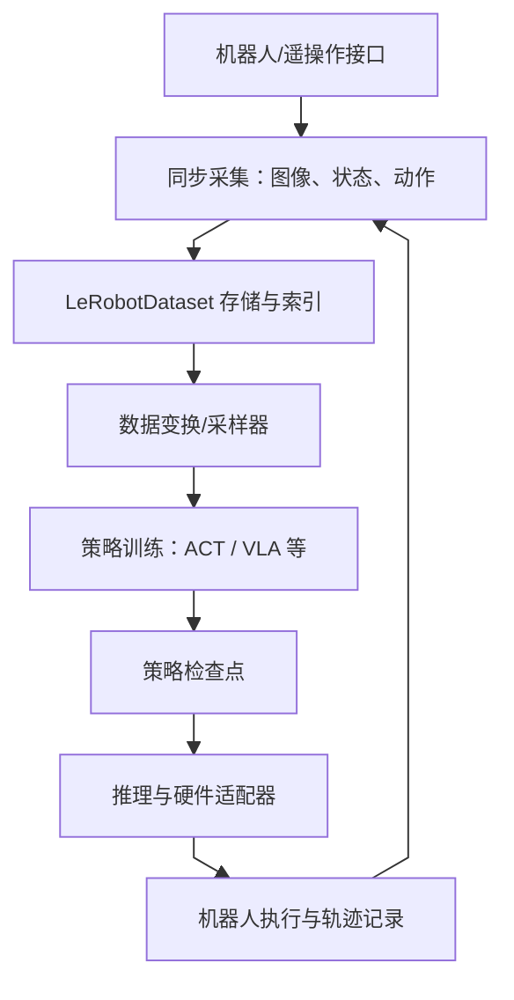
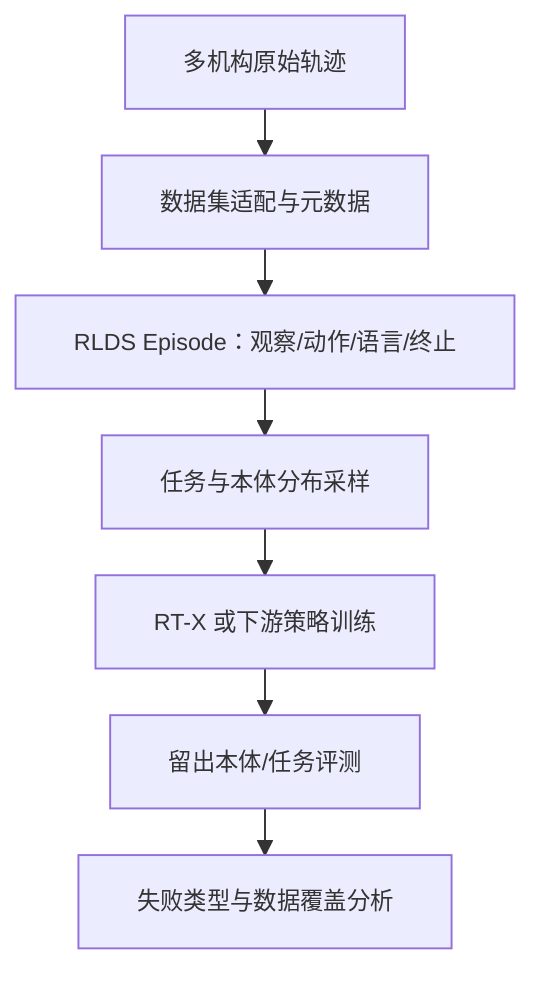
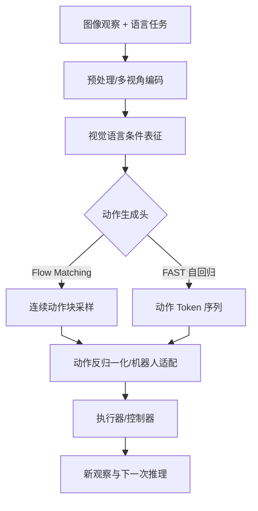
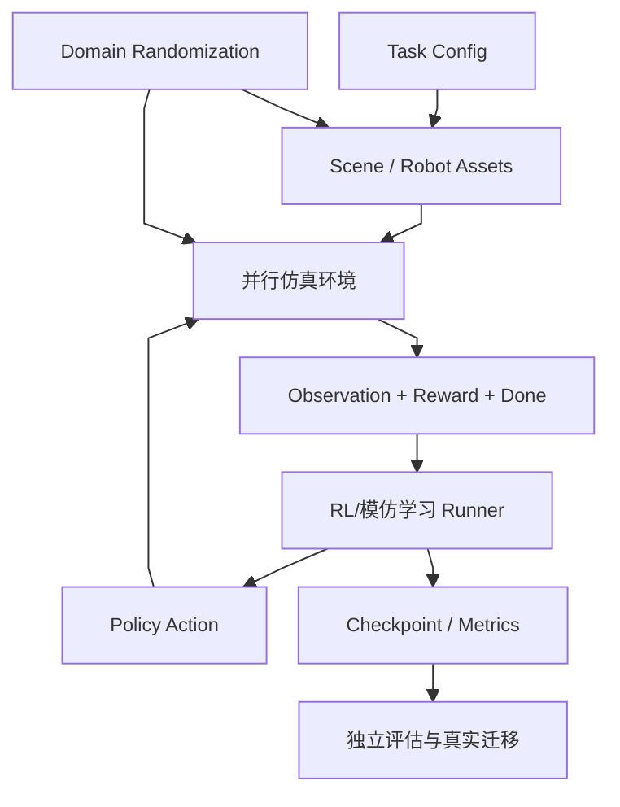
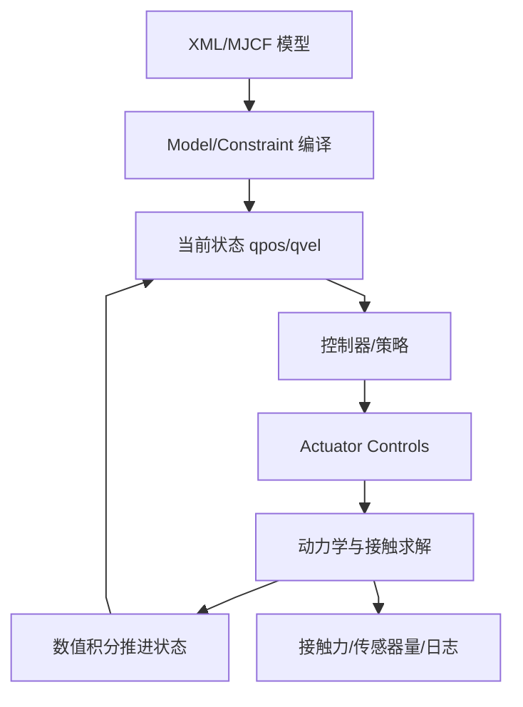
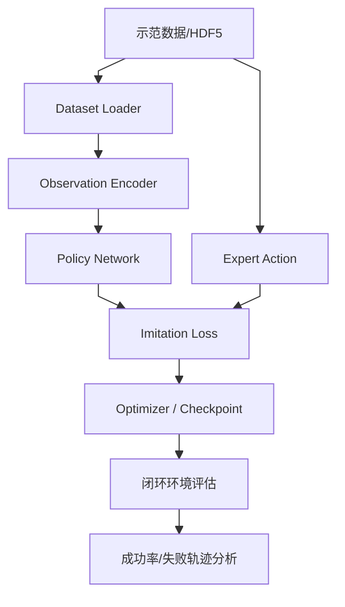
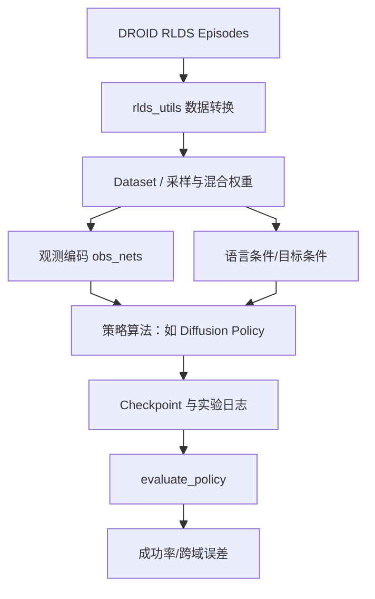
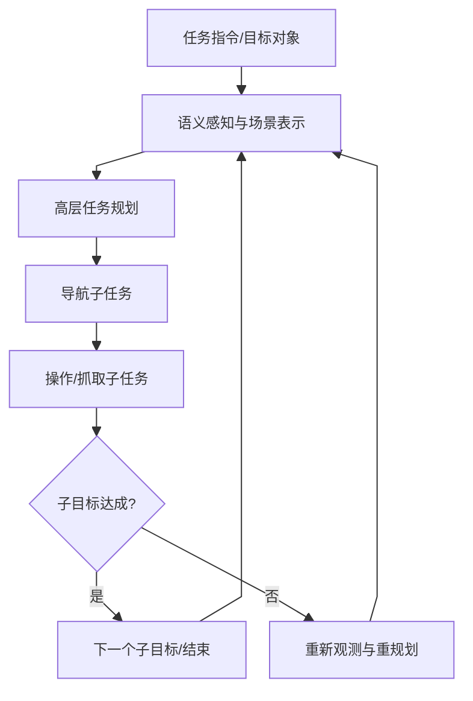
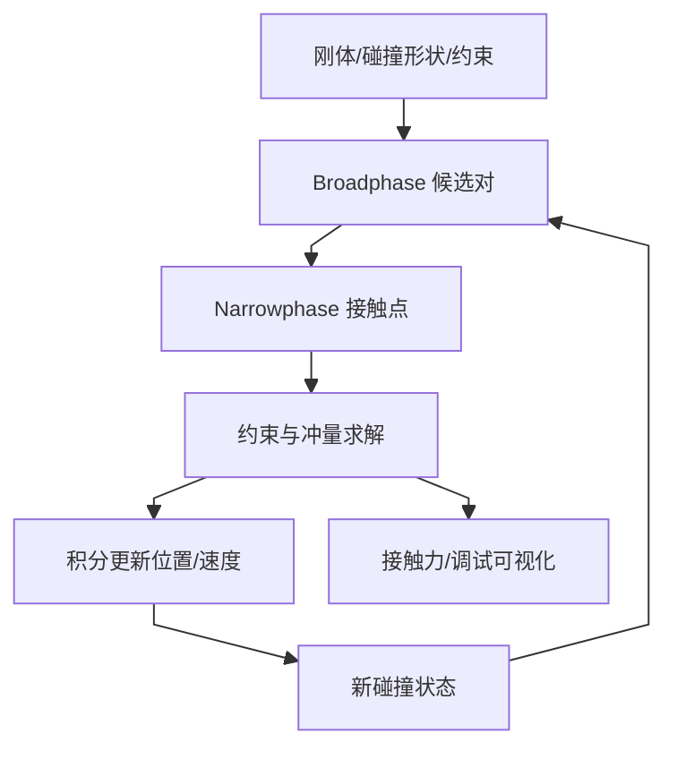
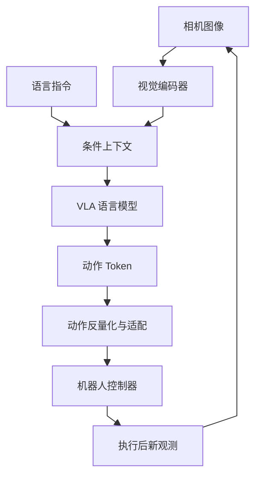

# 方向报告 04｜具身智能：数据标签一致性与动作块推理优化

**统计周期：** 2026-10-19—2026-10-25（自然周，周一至周日）　**整理日期：** 2026-10-27  
**选题口径：** 本周原创事件 + 代表项目技术精读。Top 10 为技术关注清单，不是未经快照校验的 GitHub Trending 名次；没有同口径周初周末 Star 数据，不给虚构增量。

## 一、整体结论

2026 年 10 月 23 日，LeRobot 同时出现两类直指机器人学习可用性的 PR：一项检查 v2.1→v3.0 数据集转换中 episode 标签与实际文件序列是否冲突，另一项尝试将 SmolVLA 的固定视觉语言前缀 cross-attention K/V 投影从每个去噪步移到每个动作块执行一次。这分别针对「训练样本拿错」与「重复计算」两个不同瓶颈。

前者暴露了元数据与行级字段不一致导致视觉帧和动作窗口错配的静默错误；后者的两轮 H20 性能样本只支持特定设备/配置下的候选优化，两项截至归档截稿均为开放 PR，不能写作已并入正式版。机器人方向的优先证据仍是观测—动作对齐、实际控制延迟和真实硬件任务成功率，而非仓库活跃度。

## 二、本周焦点

**事件一｜2026-10-23，LeRobot PR #5066：拒绝错误标注的 episode。** 官方 [PR #5066](https://github.com/huggingface/lerobot/pull/5066) 描述：v3.0 元信息依文件顺序与累计行数重建，但读取器仍从旧行字段获取 episode/index；两者不一致时可能读取其他 episode 的视频帧和动作窗口。作者对实际数据举出 episode 42 被标为 episode 0 的例子，提出只读取 `episode_index` 和 `index` 进行转换前校验，不确定哪边正确时直接拒绝，而非猜测重标。作者报告 18 项测试通过；**截至截稿 PR 未合并，证据属于提交者复现和测试声明**。

**事件二｜2026-10-23，LeRobot PR #5067：SmolVLA cross-attention 专家 K/V 预计算。** [原始 PR](https://github.com/huggingface/lerobot/pull/5067) 将固定 VLM 前缀对应的 cross-attention K/V 在每个 action chunk 预计算一次，让多步去噪重复使用，避免每步重投影。作者提供两次 H20、batch=1、16 层、50 action/chunk、10 步设置下约 5.1% full-chunk eager 延迟下降，并给出等价/投影次数测试。**证据边界：** 仍为开放 PR，性能为项目贡献者的小样本实验；不是跨 GPU 的独立 benchmark，更不是实机成功率提高。

## 三、Top 10 项目技术分析

每项结构图描述所列项目自身模块/工件/数据或控制流，统一为纵向 Mermaid。项目持续跟踪不等于每个项目均在本周发生重大版本更新；如无周内原始事件，技术分析以官方公开实现与可验证的架构判断为主。

### 1. [LeRobot](https://github.com/huggingface/lerobot) — 将机器人数据、策略和硬件接口标准化

**技术分析**

**LeRobot 的工程核心是让机器人观测、示范动作和硬件控制共享明确的数据字段与时间语义。**

LeRobot 针对机器人研究中常见的“每个实验室一套数据格式和控制代码”问题：采集数据、训练策略和部署控制器经常需要重复编写适配器，造成复现门槛高、算法比较困难。它把硬件无关的 Python 接口、同步视频/状态/动作[数据集](https://www.google.com/search?q=%E6%95%B0%E6%8D%AE%E9%9B%86%20%E6%8A%80%E6%9C%AF%E5%8E%9F%E7%90%86%20%E8%A7%A3%E9%87%8A "数据集：记录样本、字段、来源和切分规则，决定实验可比性")、策略实现和训练/部署命令组合起来，形成 teleoperate → record → train → deploy 的工作路径。关键价值是标准化数据契约：示范不再只是视频，而是时间关联的观察、动作和状态序列；时间戳错位、动作单位不一致或机器人标定错误，都会使学习目标失真。策略层可容纳 ACT、VLA 等不同方法，但统一接口不意味着不同动作空间可以直接互换。实际验证可比实验必须固定机器人本体、相机布局、控制频率和成功定义，比较新任务成功率与失败轨迹，而不只报告训练 loss。官方文档描述了硬件接口、LeRobotDataset 和训练/部署流程；具体策略性能仍需按任务和硬件单独验证。[官方文档](https://huggingface.co/docs/lerobot/index)

本周 [数据转换 PR #5066](https://github.com/huggingface/lerobot/pull/5066) 的行级标签错配是具体反例；[动作块缓存 PR #5067](https://github.com/huggingface/lerobot/pull/5067) 则是计算复用提案，二者截至截稿都不能当作正式发布功能。

机制依据见 [LeRobot 官方仓库及项目文档](https://github.com/huggingface/lerobot)；其中关于性能、安全或泛化的评价，除非另附独立实验，否则仅属于系统分析推断。

**项目结构图**

*图注：依据 [LeRobot 官方仓库](https://github.com/huggingface/lerobot) 的公开接口与实现整理；此图是项目机制示意而非逐文件证明，未公开的实现细节待源码核验。*

**技术判断与边界：** LeRobot 的标准化价值在于把时间对齐的观察、动作、数据集和策略接口连接起来，降低复现实验的适配成本；统一 schema 仍不能自动修复采集延迟、动作单位或相机标定错误，任务成功率需绑定机器人和控制频率。

### 2. [Open X-Embodiment](https://github.com/google-deepmind/open_x_embodiment) — 跨机器人数据集与 RT-X 训练基础

**技术分析**

**Open X-Embodiment 将跨机器人示范映射到共同数据描述，但动作空间异质性不会因统一容器而消失。**

单一机器人采集的数据通常覆盖有限任务、夹爪、相机视角和工作空间，策略学到的可能是某台机器人的动作习惯，而非可迁移的任务规律。Open X-Embodiment 把多个机器人平台的数据组织成相对统一的 episode 格式（仓库采用 RLDS），并提供数据集清单、元数据和 RT-X 相关材料。其关键机制不是简单地把所有轨迹拼接，而是让下游训练能够对任务文本、观察图像、机器人状态和动作序列做统一读取；跨平台共训则希望共享与“抓取、移动、放置”等任务相关的表征。最大的难题是本体异构性：不同机器人的关节数量、末端坐标、动作尺度与采样频率可能不同，统一字段并不会自动统一[动作语义](https://www.google.com/search?q=%E5%8A%A8%E4%BD%9C%E8%AF%AD%E4%B9%89%20%E6%8A%80%E6%9C%AF%E5%8E%9F%E7%90%86%20%E8%A7%A3%E9%87%8A "动作语义：统一动作字段不等于不同机器人上的动作含义相同")。技术价值要用跨本体留出测试衡量——训练中未见过的平台或任务上是否仍能完成操作；只在混合训练集随机切分上提升，可能只是记住了相近轨迹。官方仓库说明数据以 episode 组织并提供观察空间说明，效果解释需回到相应 RT-X 论文和评测设置。[官方仓库](https://github.com/google-deepmind/open_x_embodiment)

机制依据见 [Open X-Embodiment 官方仓库及项目文档](https://github.com/google-deepmind/open_x_embodiment)；其中关于性能、安全或泛化的评价，除非另附独立实验，否则仅属于系统分析推断。

**项目结构图**

*图注：依据 [Open X-Embodiment 官方仓库](https://github.com/google-deepmind/open_x_embodiment) 的公开接口与实现整理；此图是项目机制示意而非逐文件证明，未公开的实现细节待源码核验。*

**技术判断与边界：** Open X-Embodiment 通过统一 episode 数据形式扩大跨机构、跨本体示范的可用性；核心风险仍是不同机器人动作含义和状态空间并不天然一致，真正的泛化证据应来自留出本体或任务，而不是只在混合数据随机切分上评估。

### 3. [OpenPI](https://github.com/Physical-Intelligence/openpi) — π₀ 系列视觉语言动作策略

**技术分析**

**OpenPI 的视觉语言动作策略通过条件动作序列生成连接语义任务与低层执行，闭环稳定性依赖动作频率。**

视觉语言模型能够描述场景，却不自然具备高频、连续且受机器人动力学约束的控制能力。OpenPI 提供 π₀、π₀-FAST 等开放机器人策略实现，分别探索基于 flow matching 的[动作生成](https://www.google.com/search?q=%E5%8A%A8%E4%BD%9C%E7%94%9F%E6%88%90%20%E6%8A%80%E6%9C%AF%E5%8E%9F%E7%90%86%20%E8%A7%A3%E9%87%8A "动作生成：把视觉/语言条件映射为可执行动作序列")与基于动作 token 自回归生成的路线。典型输入包含相机观察和任务指令，输出是供控制器执行的一段动作，而非普通聊天文本；这使动作分块、动作表示、推理延迟和控制频率成为架构核心。Flow-based 路线通过迭代去噪/流场积分生成连续动作块，自回归路线则把动作编码为 token 序列，便于采用语言模型式序列建模，但两者在延迟、平滑性和表达精度上存在不同取舍。 仓库也明确提示 π₀ 最初面向 Physical Intelligence 自身机器人，迁移到 ALOHA、DROID 等平台并不保证成功。复现实验必须检查预训练权重、数据配方、相机视角、机器人动作 schema 和推理频率，不能把“模型可运行”当成跨本体泛化证明。[官方仓库](https://github.com/Physical-Intelligence/openpi)

机制依据见 [OpenPI 官方仓库及项目文档](https://github.com/Physical-Intelligence/openpi)；其中关于性能、安全或泛化的评价，除非另附独立实验，否则仅属于系统分析推断。

**项目结构图**

*图注：依据 [OpenPI 官方仓库](https://github.com/Physical-Intelligence/openpi) 的公开接口与实现整理；此图是项目机制示意而非逐文件证明，未公开的实现细节待源码核验。*

**技术判断与边界：** OpenPI 把视觉与语言条件转为机器人动作块，探索 flow-based 连续动作生成与 FAST 自回归动作 token 等路线；其优势和代价需在推理时延、动作平滑性、控制频率和跨本体复现中比较，开放实现本身不保证所有硬件均能直接运行。

### 4. [Isaac Lab](https://github.com/isaac-sim/IsaacLab) — 面向机器人学习的并行仿真任务框架

**技术分析**

**Isaac Lab 的并行物理环境与训练任务接口提高数据采样效率，但接触模型偏差会放大现实迁移风险。**

[强化学习](https://www.google.com/search?q=%E5%BC%BA%E5%8C%96%E5%AD%A6%E4%B9%A0%20%E6%8A%80%E6%9C%AF%E5%8E%9F%E7%90%86%20%E8%A7%A3%E9%87%8A "强化学习：通过环境交互和奖励优化策略，依赖环境与奖励定义")和策略搜索往往需要大量环境交互，真实机器人采样既慢又有损坏风险。 Isaac Lab 将机器人资产、场景、观测、动作、奖励和终止条件组织成任务环境，并利用仿真器并行运行多个环境实例，提升 rollout 速度。对于 RL，环境定义并非外围代码：观测空间、动作缩放、奖励权重、重置逻辑和终止条件共同定义了模型优化的目标；一个奖励项写错，就可能学到“刷奖励”而非完成任务的策略。并行化主要提升样本吞吐，不自动改善动力学准确性。不同环境实例的物理参数随机化有助覆盖摩擦、质量和外部扰动，但随机范围要接近真实系统，否则训练分布仍会偏离部署环境。应检查任务配置、机器人 USD 资产、观测/奖励计算与训练器之间的契约，最后用固定种子和多次独立运行统计成功率、碰撞率与策略方差；仿真进步还需要真实硬件验证支持。

机制依据见 [Isaac Lab 官方仓库及项目文档](https://github.com/isaac-sim/IsaacLab)；其中关于性能、安全或泛化的评价，除非另附独立实验，否则仅属于系统分析推断。

**项目结构图**

*图注：依据 [Isaac Lab 官方仓库](https://github.com/isaac-sim/IsaacLab) 的公开接口与实现整理；此图是项目机制示意而非逐文件证明，未公开的实现细节待源码核验。*

**技术判断与边界：** Isaac Lab 将场景、观测、奖励、动作和重置逻辑组织成并行仿真任务，提升强化学习采样效率；策略学到什么高度依赖奖励和终止条件，仿真吞吐提升也不自动意味着真实迁移改善。

### 5. [MuJoCo](https://github.com/google-deepmind/mujoco) — 刚体动力学、接触求解与控制步进

**技术分析**

**MuJoCo 以动力学和接触约束求解为核心，可控仿真不能自动覆盖柔软物体和未知摩擦分布。**

机器人操作和行走的关键不只在几何碰撞，还在接触力、关节约束、质量分布、摩擦与数值积分。MuJoCo 提供刚体[动力学](https://www.google.com/search?q=%E5%8A%A8%E5%8A%9B%E5%AD%A6%20%E6%8A%80%E6%9C%AF%E5%8E%9F%E7%90%86%20%E8%A7%A3%E9%87%8A "动力学：描述力、质量、约束如何决定系统状态随时间演化")和接触仿真引擎，将模型文件里的 body、joint、geom、actuator 等组件转为每个时间步的动力学计算。控制器通常读取状态并输出执行器控制量，模拟器根据动力学和约束求解推进系统；控制频率、仿真时间步和接触求解参数若设置不当，可能出现不稳定或不真实的动作。其工程价值是允许快速重复的物理实验，不代表模拟参数会自动与真实材料和执行器吻合。看机器人策略时，应明确哪些差异来自策略，哪些来自物理参数；至少对时间步、摩擦、质量和执行器延迟做敏感性分析。对于策略学习，单次仿真演示不足以证明稳健性，还需要多个随机种子、扰动测试和 sim-to-real 对照。官方文档和示例可用于沿模型定义到状态步进核对具体行为。

机制依据见 [MuJoCo 官方仓库及项目文档](https://github.com/google-deepmind/mujoco)；其中关于性能、安全或泛化的评价，除非另附独立实验，否则仅属于系统分析推断。

**项目结构图**

*图注：依据 [MuJoCo 官方仓库](https://github.com/google-deepmind/mujoco) 的公开接口与实现整理；此图是项目机制示意而非逐文件证明，未公开的实现细节待源码核验。*

**技术判断与边界：** MuJoCo 的物理表现由模型参数、接触约束、数值积分和控制频率共同决定；它能让实验可重复，但并不保证默认摩擦、执行器或接触模型与实物吻合，结论要经参数扰动与硬件实验检验。

### 6. [robomimic](https://github.com/ARISE-Initiative/robomimic) — 在统一协议下比较模仿学习算法

**技术分析**

**robomimic 统一模仿学习算法的实验输入与评测设置，示范覆盖不足仍决定失败模式。**

从专家示范学习能减少随机探索，但策略通常会在偏离示范分布后犯错：一次位置预测偏差可能导致后续观察完全不同，错误随时间累积。robomimic 的研究价值在于把数据读取、算法实现、实验配置和评估组织为可比较的框架，覆盖[行为克隆](https://www.google.com/search?q=%E8%A1%8C%E4%B8%BA%E5%85%8B%E9%9A%86%20%E6%8A%80%E6%9C%AF%E5%8E%9F%E7%90%86%20%E8%A7%A3%E9%87%8A "行为克隆：直接拟合示范中的观察到动作映射")及序列决策类策略。数据集格式和 observation encoder 决定模型究竟看到什么，训练 loss 则决定模型拟合动作的方式；若不同方法使用不同数据切分、图像增强或训练预算，结果就不能直接归因于算法。行为克隆优化的是示范动作拟合，并不直接惩罚长序列执行中的状态偏移，因此要额外检查闭环任务成功率和失败轨迹。与强化学习相比，模仿学习避免了在线探索成本，却受示范质量、任务覆盖和传感器分布约束。配置文件定义了算法、数据版本和随机种子，再对照 evaluator 看成功标准是否一致。

机制依据见 [robomimic 官方仓库及项目文档](https://github.com/ARISE-Initiative/robomimic)；其中关于性能、安全或泛化的评价，除非另附独立实验，否则仅属于系统分析推断。

**项目结构图**

*图注：依据 [robomimic 官方仓库](https://github.com/ARISE-Initiative/robomimic) 的公开接口与实现整理；此图是项目机制示意而非逐文件证明，未公开的实现细节待源码核验。*

**技术判断与边界：** robomimic 的优势是让模仿学习算法在统一数据接口和评估设置下可比较；行为克隆拟合示范动作却不直接优化长时序状态恢复，分布外状态可能累积误差，因此平均动作 loss 不是任务成功的充分指标。

### 7. [DROID Policy Learning](https://github.com/droid-dataset/droid_policy_learning) — 把大规模真实操作示范转为训练基线

**技术分析**

**DROID Policy Learning 把真实示范数据接入行为学习管线，真实来源不等于代表所有操纵条件。**

大规模真实机器人数据提供丰富的自然变化，但数据量本身并不能直接转成泛化能力：摄像机标定、动作对齐、任务文本质量和数据混合权重都会影响训练信号。 DROID Policy Learning 基于 robomimic 改造，提供 [RLDS](https://www.google.com/search?q=RLDS%20%E6%8A%80%E6%9C%AF%E5%8E%9F%E7%90%86%20%E8%A7%A3%E9%87%8A "RLDS：以 episode 表示机器人轨迹的标准化数据格式") 数据读取、语言条件训练配置、算法类与评估脚本。其数据路径将 episode 转换为训练可消费的 observation/action 样本，并允许把目标域的少量示范与公共数据 co-train；混合数据有望扩展分布，但也可能让少数目标任务被大数据源压制。官方仓库说明 full dataset 规模约 1.7TB，另提供小型示例数据便于调试；这只是资源规模说明，不证明某个策略在任意机器人上有效。评测时要报告训练数据采样比例、语言条件方式、目标机器人配置及成功率，并使用独立场景测试；相机标定更新和标注版本也应记入复现记录。[官方仓库](https://github.com/droid-dataset/droid_policy_learning)

机制依据见 [DROID Policy Learning 官方仓库及项目文档](https://github.com/droid-dataset/droid_policy_learning)；其中关于性能、安全或泛化的评价，除非另附独立实验，否则仅属于系统分析推断。

**项目结构图**

*图注：依据 [DROID Policy Learning 官方仓库](https://github.com/droid-dataset/droid_policy_learning) 的公开接口与实现整理；此图是项目机制示意而非逐文件证明，未公开的实现细节待源码核验。*

**技术判断与边界：** DROID Policy Learning 把大规模真实操作轨迹连接到训练与评估流程，为数据混合与语言条件策略提供研究入口；数据规模不等于有效覆盖，采样权重、相机/动作对齐和目标任务分布都可能决定策略是否真正迁移。

### 8. [HomeRobot](https://github.com/facebookresearch/home-robot) — 家庭环境中的导航与操作组合

**技术分析**

**HomeRobot 把移动导航与物体操作拆为依赖环境状态的技能链，感知不确定性会在多步骤中累积。**

家庭机器人任务通常跨越多个阶段：寻找目标物、移动到可操作位置、抓取或搬运，并在环境状态变化后继续规划。HomeRobot 将 embodied AI 的导航、感知、操作和任务执行组织到研究框架中，适合研究开放环境里的系统级接口。关键难题是模块之间的误差传播：定位偏差可能令导航停错位置，抓取失败会改变物体状态，而高层任务规划若不感知这些变化就会继续执行过期计划。因而评估不应只看单步导航或抓取指标，而要明确任务级成功条件、[重规划](https://www.google.com/search?q=%E9%87%8D%E8%A7%84%E5%88%92%20%E6%8A%80%E6%9C%AF%E5%8E%9F%E7%90%86%20%E8%A7%A3%E9%87%8A "重规划：根据新观察或失败反馈重新生成子目标/动作计划")触发和失败恢复机制。模拟场景有助重复试验，却可能无法覆盖家庭里杂乱、反光、遮挡和未知物体；不同硬件接口也限制结果可迁移性。关键判断在于找任务入口与导航/操作模块交界处，弄清观察如何变成子目标，以及动作失败后状态是否回写给上层规划器。

机制依据见 [HomeRobot 官方仓库及项目文档](https://github.com/facebookresearch/home-robot)；其中关于性能、安全或泛化的评价，除非另附独立实验，否则仅属于系统分析推断。

**项目结构图**

*图注：依据 [HomeRobot 官方仓库](https://github.com/facebookresearch/home-robot) 的公开接口与实现整理；此图是项目机制示意而非逐文件证明，未公开的实现细节待源码核验。*

**技术判断与边界：** HomeRobot 将导航、场景理解、任务规划和操作放在较完整的具身任务链中，暴露单模块基准难覆盖的阶段间失败；其研究价值在于系统级任务与恢复，但仿真表现和单平台演示不应外推为开放家庭通用能力。

### 9. [Bullet Physics](https://github.com/bulletphysics/bullet3) — 碰撞检测、约束和多体物理模拟

**技术分析**

**Bullet Physics 通过碰撞检测与约束求解维护模拟状态，但求解步长与接触参数影响控制结论。**

仿真引擎的差异往往体现在接触求解和数值稳定性，而不只在运行速度。Bullet 提供刚体、[碰撞检测](https://www.google.com/search?q=%E7%A2%B0%E6%92%9E%E6%A3%80%E6%B5%8B%20%E6%8A%80%E6%9C%AF%E5%8E%9F%E7%90%86%20%E8%A7%A3%E9%87%8A "碰撞检测：先筛选潜在碰撞对，再确定接触几何关系")、约束、软体和相关接口，供机器人、交互应用和物理场景使用。典型步进过程先更新物体状态并进行 broadphase 候选碰撞筛选，再由 narrowphase 计算具体接触点，之后构建并求解约束，最后推进位置和速度。这个流程解释了为什么碰撞几何、时间步、迭代次数与摩擦模型会影响抓取和堆叠结果。它是通用物理引擎，不是机器人策略或安全证明；若要比较策略，必须固定场景和求解参数，并验证引擎参数变化是否改变结论。不同仿真器之间的轨迹一致性也不应假定，尤其是接触丰富的任务。官方代码示例适合追踪模拟循环与 collision/dynamics API 的实际边界。

机制依据见 [Bullet Physics 官方仓库及项目文档](https://github.com/bulletphysics/bullet3)；其中关于性能、安全或泛化的评价，除非另附独立实验，否则仅属于系统分析推断。

**项目结构图**

*图注：依据 [Bullet Physics 官方仓库](https://github.com/bulletphysics/bullet3) 的公开接口与实现整理；此图是项目机制示意而非逐文件证明，未公开的实现细节待源码核验。*

**技术判断与边界：** Bullet Physics 提供碰撞检测、约束求解和多体动力学计算，影响接触操作和运动仿真的数值行为；不同求解器、时间步和摩擦参数可能改变轨迹，比较机器人策略时应固定求解配置并做稳定性检查。

### 10. [OpenVLA](https://github.com/openvla/openvla) — 视觉语言动作模型与机器人执行接口

**技术分析**

**OpenVLA 的关键技术思路，是把相机图像与自然语言指令共同编码，再生成可转换为连续机器人控制量的动作 token。** 在 [官方项目](https://github.com/openvla/openvla) 中，视觉观测经视觉编码路径进入语言模型条件上下文，动作则通过离散化表示以序列预测形式输出，然后反量化并按目标本体的动作规范执行。这与纯视频描述不同：模型输出必须符合末端执行器位姿或关节控制的数值范围、频率和坐标系，才能在物理系统闭环。离散动作便于借助自回归模型的训练与数据管线，但量化粒度可能牺牲精细控制，长期生成又容易积累误差。跨机器人迁移还取决于训练数据覆盖的相机布局、末端执行器标定、任务文本和动作语义是否相容。模型在已有任务视频上输出合理动作，并不等价于陌生物体、阻抗变化和遮挡条件下稳定完成任务。项目方开源权重与训练代码是机制证据；真实成功率仍需绑定机器人体、测试任务、控制频率及失败恢复策略。尤其当推理时间超过控制步长时，动作块会在过时观察上执行，造成明显的分布偏移。

**项目结构图**

*图示依据：[OpenVLA 官方实现](https://github.com/openvla/openvla)，为接口层机制示意；不同机器人适配器细节需固定版本核验。*

**技术判断与边界：** OpenVLA 让大规模视觉语言预训练模型接入机器人动作生成，但真实控制的时间预算、动作表征误差与跨本体适配是独立瓶颈；离线动作预测与实际硬件成功率不能混同。
